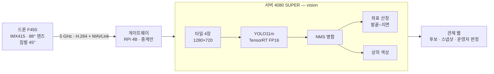
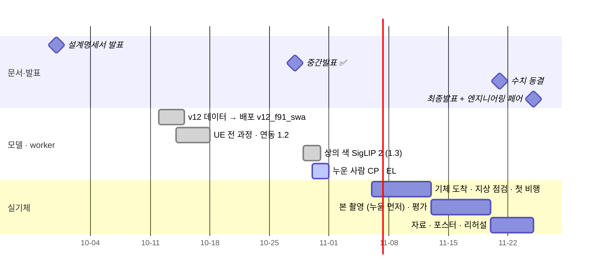

> [!summary] 자율 정찰 드론 관제 시스템 · 비전 파트 (정서인)
> 드론이 농촌 · 산지를 자율 정찰하며 **사람 (쓰러진 사람 포함) 을 찾아** 관제 지도에 신고한다
> 비전 = **사람 탐지 · 요구조자 상태 (누움 · 멈춤 → 위급 등급) · 추적 · 좌표 · 상의 색** — 후보를 거르지 않고 순위만 · 최종 판단은 운영자
> 지난 홈 (10-13) → [[00 홈 (10-13 판)]]

> [!important] 다음 마일스톤 — **11-25 (화) 최종발표 + 엔지니어링 페어 (포스터)** · 기체 ~11-06 도착 · **수치 동결 11-21** → [[20 최종발표 · 실기체 비전 계획 (10-30)]]
> 페어 비전 정리본 → `발표자료/엔지니어링페어_비전/` (git 밖) · 중간발표 (10-28) 자료 → `발표자료/비전_중간발표/`

> [!tip] 최근 정리 — [[21 누운 사람 강건성 - 진단 · 문헌 · 파이프라인 점검 (10-30)]] · [[결정 - 상의 색 SigLIP 2 제로샷 (worker 1.3)]] · [[10.30 최종 준비 · 누운 사람 강건성]] · [[10.29 상의 색 개선 · worker 1.3]] · [[18 UE 비전 전 과정 검증 (10-14)]]

# 지금 상태 (10-30)

| 영역 | 상태 | 핵심 수치 | 문서 |
|---|---|---|---|
| 기준 조건 | ✅ | 주 렌즈 88° (수평 80.2° · f 1,141 px · 왜곡 실측은 기체 도착 뒤 `camera_calib.py`) · 마운트 45° · 16~20 m | [[결정 - 기본 마운트각 45°]] · [[결정 - 최종 예산안 (2026-09-23 계획서)]] |
| **배포 탐지 모델** | ✅ 10-14 | **v12_f91_swa** · 임계값 0.20 · TensorRT 20.6 ms · 타일 4장 + 경계 합치기 | [[결정 - 배포 탐지 모델 v12_f91_swa · 임계값 0.20]] |
| 탐지 정확도 V03 | ⚠ | 숲 0.659 · 비스듬 0.616 · 한국 1.000 (목표 0.80 · 학습에 없던 장소로) · 같은 오탐 기준에서 재현율 숲 +10.9 · 작은 사람 +29.0 %p (이전 모델 대비) | [[NFR-V03 탐지 정확도]] · [[17 v12 데이터 재구성 - 파이프라인 점검 (10-12)]] |
| **누운 사람** | 🔄 **지금 주력** | UE 16~20 m 박스 뜸 0.96 · **Okutama 현장 누움 30~35 % 박스 안 뜸** (도로 · 그늘 · 벤치 위) · 회전 증강 박스 부풀림 발견 · **CP · EL 학습 중** | [[21 누운 사람 강건성 - 진단 · 문헌 · 파이프라인 점검 (10-30)]] |
| 추론 시간 V01 · V02 | ✅ | 탐지 20.6 ms · 탐지 + 추적 + 좌표 + 상태 + 색 38~51 ms (≈ 20 FPS) · 관제 경유 실연 지연 중앙 575 ms | [[NFR-V01 추론 시간]] · [[NFR-V02 분석 처리율]] |
| 좌표 V04 | ✅ UE · ⏳ 실기체 | UE 정답 · DEM 중앙 0.34~0.61 m · P95 ≤ 2.3 m · 실연은 연결기 pose 시각 문제로 보류 (팀) | [[NFR-V04 좌표 정확도]] · [[18 UE 비전 전 과정 검증 (10-14)]] |
| 오탐 V06 | ✅ | 사람 없는 장 0.17~0.55 건/장 · 도로 0.55 · 화면 가장자리 줄기 막기 T1 (SIM) | [[NFR-V06 프레임 오탐]] |
| 요구조자 상태 | ⚠ | 박스 모양 자세 + 드론 움직임 뺀 멈춘 시간 → 등급 · Okutama 누움 AUROC **0.922** (v12) · 누움 잡힌 비율 0.405 (탐지 몫) · 프레임 간격 0.1~0.2 s 필요 | [[06 요구조자 상태 인지 계획]] · [[_학습 큐]] 「10-30 S」 |
| 추적 · 후보 | ⚠ | UE IDF1 0.36~0.46 · 사람당 후보 4~5 · 잇기 G · R · R2 ❌ (R −28.5 % 아슬) | [[_학습 큐]] 「10-15 R」 · 「10-30 R2」 |
| **상의 색** | ✅ 10-29 · 배포 대기 | **SigLIP 2 제로샷 + 잔디 문장 + 남색 문턱** · 색 균형 1순위 0.27~0.42 → **0.51~0.89** (6셋) · 3 ms/명 | [[결정 - 상의 색 SigLIP 2 제로샷 (worker 1.3)]] |
| 실시간 서비스 | ✅ 1.2 · ⏳ 1.3 | worker 1.2 배포 (REAL 10-14 · SIM 10-26 + DEM) · **1.3 (상의 색 · 실비행 녹화)** 통합 담당 반영 대기 | `deploy/vision_worker/integration_v1_3/README.md` · [[다음 할 일]] |
| 실기체 | 📝 | 녹화 (`record.py`) · 비행 뒤 평가 (`real_flight_eval.py`) · 화각 (`camera_calib.py`) 준비 ✅ · 본 촬영 11-13~19 (누움 장면 먼저) | [[20 최종발표 · 실기체 비전 계획 (10-30)]] |
| 학습 (GPU) | 🔄 | `chain_lying3.sh` — CP (누운 사람 복사-붙여넣기) → EL (타원 회전 박스) · 10-31 오후 끝 | [[_학습 큐]] 「10-30 CP · EL」 |

> [!warning] 가장 큰 미결 다섯 가지 (10-30)
> 1. **누운 사람 현장 다양성** — Okutama 누움 30~35 % 미탐 · CP · EL → 안 되면 C2A · UE 합성 · **자체 촬영 누움** (장소로 나눠 학습 · 판정)
> 2. **장소 일반화 V03** — 숲 0.66 · 비스듬 0.62 (목표 0.80) · 우리 조건 수치는 실기체로 처음 잼 (11-21 전)
> 3. **사람당 후보 쪼개짐** (4~5) — 운영자가 같은 사람을 여러 번 봄 · 실기체 영상으로 다시
> 4. **연동** — 1.3 배포 · SIM 프레임 간격 0.1~0.2 s · 연결기 pose 시각 · 실기체 실시간 수신 확인
> 5. **최종발표 · 페어 자료** — 공개 → UE → 실기체 수치 한 장 · 실비행 시연 영상 · 포스터

# 흐름 한 장

# 일정

# 어떻게 찾아볼까

| 찾는 방식 | 들어가는 곳 |
|---|---|
| **학습 계획 전체** | [[00 학습 계획 한눈에]] |
| **시간순** — 언제 무엇을 했나 | [[타임라인]] · 일자별 → `09 기록/일자별/` |
| **할 일** | [[다음 할 일]] |
| **실험 결과** | [[_실험 색인]] |
| **왜 그렇게 정했나** | [[_결정 색인]] |
| **데이터** | [[_데이터셋 한눈에]] |
| **합격 기준** | [[성능 요구사항 한눈에]] |
| **용어·개념** | [[_개념 색인]] · [[용어 및 약어]] |
| **실수·함정** | [[함정 모음]] · [[막다른 길]] |
| **파일이 어디 있나** | [[문서와 코드 위치]] |
| **한 장 지도** | [[프로젝트 지도.canvas\|프로젝트 지도]] · [[가중치 계보.canvas\|가중치 계보]] |

# 주제별 지도

## 1. 무엇을 만드는가
[[프로젝트 개요]] · [[운용 조건]] · [[요구명세서]] · [[설계명세서]] · [[팀과 역할]] · [[발표 피드백]] · [[관제 뷰어 프로토타입]]
하드웨어 → [[결정 - 최종 예산안 (2026-09-23 계획서)]] · 지난 안 → `01 프로젝트/지난 하드웨어안/`

## 2. 합격 기준
[[성능 요구사항 한눈에]] · [[측정 조건]] · [[수치 표기 규칙]] · [[관측 시간과 영상 수신 기준]]
비전: [[NFR-V01 추론 시간]] · [[NFR-V02 분석 처리율]] · [[NFR-V03 탐지 정확도]] · [[NFR-V04 좌표 정확도]] · [[NFR-V05 신뢰도 기준]] · [[NFR-V06 프레임 오탐]]
시스템: [[NFR-P01 연결 판정]] · [[NFR-P02 영상 수신 성능]] · [[NFR-P03 장애 감지]] · [[NFR-P04 동시 처리]] · [[NFR-I01 관측 완료도]]

## 3. 데이터
[[_데이터셋 한눈에]] — [[AI-Hub 182 조난자 수색]] · [[WiSARD]] · [[NOMAD]] · [[Unicamp-UAV]] · [[VisDrone]] · [[Okutama-Action]] · [[SARD]] · [[NII-CU]]
받는 법 → [[데이터 다운로드]] · 후보 → [[후보 - 비스듬 시점 데이터셋]] · 제외 → [[검토 후 제외한 데이터셋]]

## 4. 모델과 학습
[[00 학습 계획 한눈에]] → [[01 기준 요건 확정안]] · [[02 학습 계획 v6 (60° 기준)]] · [[_학습 큐]] · **[[결정 - 배포 탐지 모델 v12_f91_swa · 임계값 0.20]]**
[[가중치 계보]] · [[stage1_all]] · [[VisDrone 기성 모델]]
서버 → [[학과 서버]] · [[서버 인계]]

## 5. 실험
최근: [[21 누운 사람 강건성 - 진단 · 문헌 · 파이프라인 점검 (10-30)]] · [[결정 - 상의 색 SigLIP 2 제로샷 (worker 1.3)]] · [[18 UE 비전 전 과정 검증 (10-14)]] · [[좌표 산정 GeoResolver - 평지 교차 검증]] · [[NWD·P2 효과 없음 - 원인 분석]] · [[서버 v6_obl - 60° 데이터]] · [[서버 v3_place - 장소 분리 학습]] · [[타일 추론]] · 일자별 [[9.27 v8 판정과 반복 수프]] · [[9.28 최종 모델 확정]] · [[9.29 60 에폭 기각과 v9]]
전체 → [[_실험 색인]] · 종료된 자세 판별 트랙 → `04 실험/자세 판별 (종료)/`

## 6. 막힌 곳
[[장소 일반화 - NFR-V03 0.22]] · [[성능 개선 후보 - AP50 벽]] · [[학습 데이터 촬영 각도 불일치]] · [[GPU 장애 Xid 79]] · [[NOMAD 검증 배우 불일치]] · [[겨울 0.922의 한계]]

# 규칙

- 데이터 원본과 파생물(크롭 · 추론 결과 이미지)은 **git 에 올리지 않는다**
- API 키 · 토큰은 문서 · 커밋에 남기지 않는다
- 이 저장소는 공개다 — 팀 내부 주소 · 개인 연락처 · 학번을 넣지 않는다
- 기준 문서 우선순위: **캡스톤 디자인 계획서(예산) · 요구명세서 v1.7** → 이 볼트
- 지난 판 문서는 지우지 않고 `지난 …` 폴더로 옮긴다 — 맨 위에 대체 문서 링크가 있다
