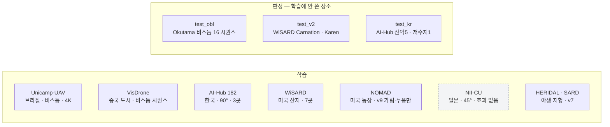
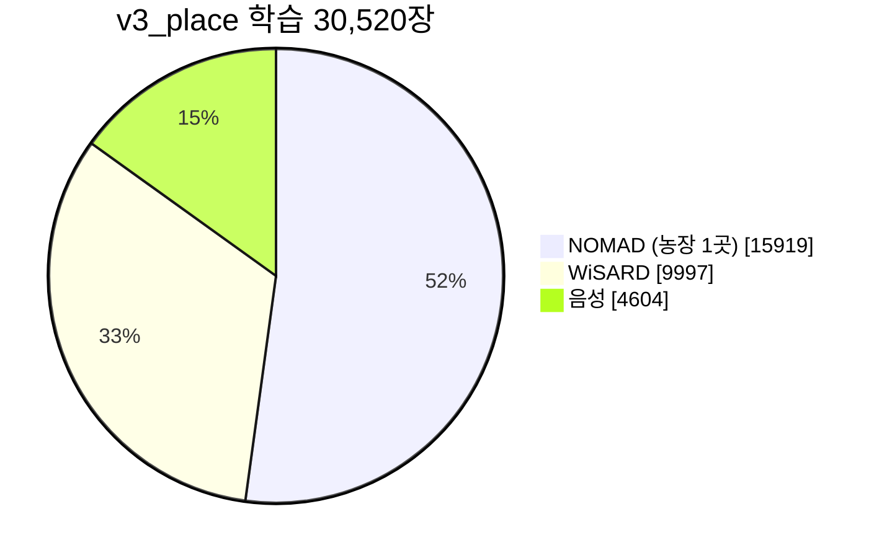

> [!summary] 7종 확보 · **학습(비스듬 / 수직)** 과 **판정(장소 분리)** 역할을 v6 기준으로 나눴다
> 원칙: 판정용 장소는 학습에 한 장도 넣지 않는다 · 원본·파생물은 git 에 올리지 않는다

> [!summary] 지금 (11-01) — **학습 = v12 (출처 11개 · 18,601 창)** · **판정 = 학습에 안 쓴 장소 3셋 + 외부 실사진** · 원본 · 파생물은 git 에 안 올림
> 데이터 구성 원본 설명 → [[17 v12 데이터 재구성 - 파이프라인 점검 (10-12)]] · 아래 「역할 지도 (v6)」 는 09월 판

## 1. 지금 학습 데이터 — v12 (10-12 · 배포 v12_f91_swa)

| 출처 | 학습 창 예산 | 시점 · 지역 | 비고 |
|---|---:|---|---|
| [[VisDrone]] 비스듬 · 수직 | 3,000 · 1,200 | 중국 도시 | val 은 학습 밖 (평가 test_visdrone) · 무시 영역 가림 |
| [[NOMAD]] | 3,000 | 미국 농장 · 가림 · 누움 | 배우 096~100 은 학습 밖 (val · test_nomad) |
| [[WiSARD]] | 2,800 | 미국 숲 · 산지 | Carnation · Karen = 평가 (test_v2) |
| [[AI-Hub 182 조난자 수색]] | 2,500 | 한국 · 90° | 산악5 · 저수지1 = 평가 (test_kr) |
| HERIDAL · SARD | 1,600 · 1,500 | 크로아티아 · 야생 | ⚠ 평가 분할까지 학습에 씀 (test_sard · test_heridal 은 참고만) |
| [[Archangel]] (Real) | 1,500 | 미국 · 15~50 m · 원 궤도 | 마네킹 · 합성은 안 씀 |
| LADD | 900 | 러시아 숲 · 수직 | 뒤 30 % = 평가 (test_ladd_h) · 학습 몫 거의 다 씀 |
| [[NII-CU]] · [[Unicamp-UAV]] | 500 · 450 | 일본 45° · 브라질 비스듬 | NII-CU flight3 = 평가 |

- 규칙: **확대 금지** (원본보다 크게 안 키움 · INTER_AREA) · 시퀀스 상한 · 잘린 사람 가림 · 음성 ≈ 3 % · 평가 장소 제외 · 반복 = 목록 95 % 무작위 (시드 91 · 92 · 93)

## 2. 평가셋 (모두 학습에 안 쓴 장소)

| 셋 | 출처 · 조건 | 쓰는 곳 |
|---|---|---|
| **test_obl** · **test_v2** · **test_kr** | Okutama 비스듬 · WiSARD 숲 · AI-Hub 한국 | **공식 판정 (NFR-V03)** |
| test_auair | AU-AIR 도로 (사람 없는 장) | 오탐 (≤ 1 건/장) · 사람 AP 는 안 봄 (정답 박스 어긋남) |
| **test_sar · test_sar45** | **UAV-SAR** (DJI · 15 · 30 m × 45° · 90° · 300장 · CC BY 4.0 · 11-01) | 우리 조건과 가장 비슷한 외부 실사진 |
| test_visdrone · test_nomad · test_ladd_h · test_nii · test_cy | VisDrone val · NOMAD 097 · 100 · LADD 뒤 30 % · NII-CU · Cyprus | 기성 모델 비교 (11-01) |
| test_sard · test_heridal | SARD test · HERIDAL test | ⚠ v12 학습에 씀 → 참고만 |
| 누움 묶음 (`lying_bench`) | Okutama 누움 236 (53명) · UE 누움 841 · NOMAD 작은 누움 · 벤치 | 누움 판정 · 반복 폭 7.9 %p |
| 자세 · 화질 (`pose_bench`) | Okutama 자세별 · UE · JPEG · WebP · 720p · 흐림 | 자세별 · 전송 화질 |
| **Archangel-Mannequin** (`mannequin_bench`) | 실제 드론 · 45° · 15~50 m · 마네킹 누움 31만 · 무릎 29만 · 서기 58만 (어안 · 25~45 px) | 박스 모양 자세 (누움 vs 서기 AUROC 0.86~1.00) · 누움 탐지 0.06~0.48 (11-01) |

## 3. 받아 두었지만 학습에 안 쓴 것 · 후보 (11-01)

> 11-11 추가로 받은 것 (TinyPerson · RGBTDronePerson · VisDrone MOT) · 못 받은 것 → [[추가 데이터 받기 (11-11)]]

| 데이터 | 상태 | 판단 |
|---|---|---|
| Archangel-Mannequin (서버) | 평가에만 씀 | 누움 실영상 · 학습 후보 (마네킹 · 어안 위험 → 반복 · 오탐 기준으로 판정) |
| Archangel-Synthetic 표본 4,608장 (서버) | 안 씀 | 전체 440만 장은 로그인 필요 · 합성 |
| UAV-SAR (서버) | 평가 전용 | 300장뿐 · 학습 안 함 |
| POG (풀밭 사람 2,892장 · 고도 · 각도 메타데이터) | 안 받음 | 라이선스 표기 없음 |
| VTSaR (RGB-열 · 누운 요구조자 포함) | 안 받음 | 바이두 전용 · 자세 라벨 없음 |
| Roboflow lying-person (1,117장 · 서버 `data/raw/rf/`) | ❌ | 지상 근접 (요가 · 체조) |
| 기성 가중치 13개 (`data/raw/ext_det/`) | 비교만 | AerialPerson (HERIDAL · LADD · NOMAD · SARD 전용 · 혼합) · AeroNova · VisDrone 3 → [[실험 - 기성 모델 대 우리 모델 (데이터셋 12개 · 11-01)]] |

## 역할 지도 (v6 · 60° 운용 · 09월 판)

## 한 표

| 데이터 | 나라 · 지형 | 시점 | 고도 | 해상도 | 규모 | v6 역할 |
|---|---|---|---|---|---|---|
| [[Unicamp-UAV]] | 브라질 · 캠퍼스 | **정면 비스듬** | ≈30 m | 3840×2160 | 6,500장 · 58,555명 | 🟢 학습 (비스듬) |
| [[VisDrone]] | 중국 · 도시 | 비스듬 63 % | 다양 | 최대 2000×1500 | 비스듬 179 시퀀스 · 4,974장 | 🟢 학습 (비스듬 · 사람만) |
| [[AI-Hub 182 조난자 수색]] | **한국** · 저수지·평지·산악 · 겨울 | **90° 확정** | 10~40 m | 3840×2160 | 5곳 확보 | 🟢 학습 3곳 · 판정 2곳 |
| [[WiSARD]] | 미국 워싱턴주 · 산지 · 가을·겨울 | 섞임 (수직 67 %) | — | 1920×1080 ~ 4096×2160 | 9곳 · 39 비행 | 🟢 학습 7곳 · 판정 2곳 |
| [[NOMAD]] | 미국 · 농장 1곳 · 여름 | 수직~약간 | 거리 10~90 m | 5472×3078 | 배우 100명 | 🟡 v6 학습 · v7 에서 뺌 · **v9 가림·누움·숨음 2,383** (09-29 시험) |
| [[NII-CU]] | 일본 · 야구장·숲 가장자리 · 겨울 | **45° 비스듬** | 20~50 m | 3840×2160 | 크롭 2,055 · 사람 8,035 | ➖ v8 에 넣었으나 ±0 → 최종에 안 씀 |
| AI-Hub 190 (자율주행드론) | 한국 울산·제주 · 관광지·도심·산림 | 45° · 60° | **60~80 m** | 3840×2160 | 사람 1,657 (관광지 등) · **1920 기준 18 px** · 산림지 사진 36만 장에 사람 294명 (23 px) | ❌ 09-28 승인 · 운용 범위 밖 · 학습 안 씀 |
| HERIDAL · [[SARD]] | 크로아티아 야생 · 산지 | 수직 · 섞임 | — | 4000×3000 · — | 크롭 1,086 · 1,976 | 🟢 학습 (v7) |
| [[Okutama-Action]] | 일본 · 공원 | 비스듬 66 % | 10~45 m | 3840×2160 → 1280×720 | 비스듬 16 시퀀스 27,612 프레임 | 🔵 **판정 전용** |
| [[SARD]] | 채석장·풀밭·숲·도로 | 수직 위주 | 약 20 m | 1920×1080 | 1,980장 (프레임 무작위 분할) | ⚪ 보류 |

## 지금 학습셋 (`v3_place`) 은 한쪽으로 쏠려 있다

- 양성의 **61 %** 가 NOMAD 한 장소 → 장소 일반화 실패의 1번 원인 → [[장소 일반화 - NFR-V03 0.22]]
- v6 목표: **비스듬 ≥50 %** · 장소당 상한 3,000 · 음성 5 %

## 원천별 시점 (박스 크기–y 상관으로 추정)

| 원천 | 사람 박스 | 비스듬 | 수직 | 태그 신뢰 |
|---|---:|---:|---:|---|
| Okutama | 1,049,298 | **65.7 %** | 34.3 % | ✅ |
| VisDrone | 144,607 | **63.2 %** | 36.8 % | 🟡 순위만 |
| AI-Hub 182 | 325,057 프레임 | 0 % | **100 %** | ✅ 파일명 확정 |
| WiSARD | 46,660 | 33.1 % | 66.9 % | 🟡 지형 경사 교란 |
| NOMAD | 43,487 | 44.9 % | 55.1 % | ❌ 잡음 |

→ 근거 [[마운트각 태그 검증 - Okutama]] · [[9.23 마운트각 태그 육안 검토]]

## 더 찾을 곳

- [[후보 - 비스듬 시점 데이터셋]] — Manipal-UAV (신청 대기 · 최대 6개월) · Archangel · HERIDAL
- [[Archangel]] — 🔄 받는 중 (10-06) · 실제 사람 비스듬 자세 (서기 · 무릎 · 누움 · 기어감) · 고도 15~50 m · 방위 360°
- [[후보 - 자세 라벨 항공 데이터셋 (10-06)]] — **DetReIDX** (피치 30/60/90° · 앉음 · 쓰러짐) · **Archangel** (포털 있음 · 서기/웅크림/엎드림 + 고도·방위) · AIST 후쿠시마 (도움 필요 상태 라벨) · VisDrone people (보유 · 약한 라벨)
- **AI-Hub 190 (008.자율주행드론)** — 한국 · 카메라 25~90° (45° 2,116 · **60° 706** 파일) · 고도 20~100 m · 관광지·도심지·**산림지(울산 60 m 45°)** · 전체 **4.8 TB** (라벨 138 GB)
  - 09-25 목록 확인 · **다운로드는 홈페이지 신청·승인 필요** → 승인되면 `aihub190_dl.sh` 가 라벨(산림지 45° → 60° 387개 ≈ 32 GB)부터 자동으로 받는다
- [[검토 후 제외한 데이터셋]]
- 받는 법 → [[데이터 다운로드]]
