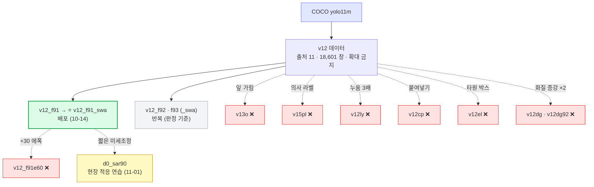
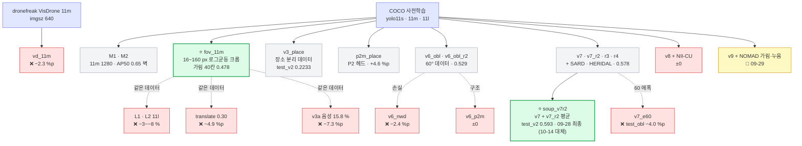
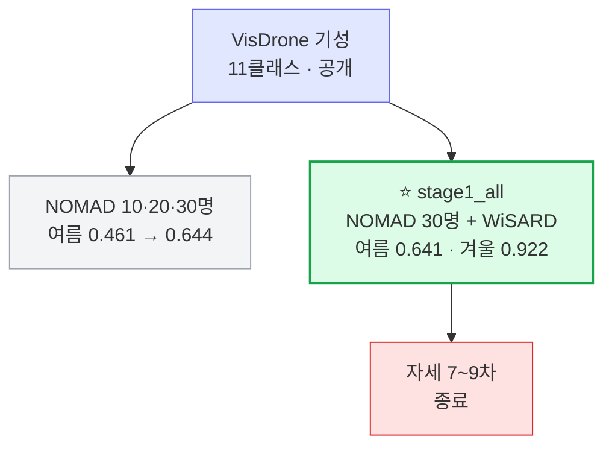

> [!summary] 어떤 가중치가 어디서 나왔나 — **서버 계보(현행)** 와 **노트북 계보(08월 · 보관)** 는 이어지지 않는다
> **지금 배포 = `v12_f91_swa` (10-14 · 임계값 0.20)** · 09-28 최종이던 soup_v7r2 는 대체됨 → 아래 「v12 계보」
> 캔버스 → [[가중치 계보.canvas|가중치 계보 캔버스]] (09월까지)

## v12 계보 (10-12~ · 지금)

| 이름 | 날짜 | 바꾼 것 (v12_f91 대비) | 숲 · 비스듬 · 한국 AP50 | 도로 오탐 | 판정 |
|---|---|---|---|---|---|
| **v12_f91_swa** | 10-12~14 | 데이터 v12 (95 % 시드 91) · 에폭 26~29 평균 | **0.659 · 0.616 · 1.000** | 0.55 | ⭐ **배포** · TensorRT 20.6 ms |
| v12_f92_swa · f93_swa | 10-13~14 | 같은 설정 반복 (시드 92 · 93) | 반복 폭 안 | 0.54 · 0.78 | 판정 기준 (세 회 평균) |
| v12_f91e60 | 10-14 | +30 에폭 (lr 0.002) | 비스듬 −2.4 · 숲 −1.9 %p | | ❌ |
| v13o · v15pl | 10-15~17 | 잎 가림 합성 · 의사 라벨 | 한국 −0.5 %p 유의 | ↑ | ❌ |
| v12ly_swa | 10-30 | 누운 사진 3배 | 비스듬 +3.9 · 누움 그대로 | 1.21 | ❌ (참고 후보) |
| v12cp_swa · v12el_swa | 10-31 | 누운 사람 붙여넣기 · 회전 박스 타원 | 숲 −4.9 · −1.9 %p | 1.89 · 1.39 | ❌ |
| v12dg_swa · v12dg92_swa | 11-01 | 화질 열화 증강 (반복 2) | 비스듬 +1.6 · WebP 누움 −16 %p | 1.79 · 1.86 | ❌ |
| d0_sar90 | 11-01 | f91 에서 UAV-SAR 90° 150장 + v12 600 · 10 에폭 | 평가 중 | | 연습 (보고만) |

- 판정 · 결과 원장 → [[_학습 큐]] · 같은 틀 비교 (기성 13 포함) → [[실험 - 기성 모델 대 우리 모델 (데이터셋 12개 · 11-01)]]
- 파일: `drone_yolo/runs_person/<이름>/weights/best.pt` (git 밖) · 엔진 `v12_f91_swa/weights/best.engine`

## 서버 계보 1기 (09-11~10-11 · COCO 에서 새로 출발 · v12 이전)

| 이름 | 날짜 | 모델 · 입력 | 바꾼 것 | val mAP50 | 판정 지표 | 판정 |
|---|---|---|---|---:|---|---|
| E1 | 09-11 | 11s · 960 | 첫 서버 학습 | 0.632 | — | 참고 |
| M1 · M2 | 09-12~15 | 11m · 1280 | + SARD (M2) | 0.651 · 0.645 | — | 0.65 벽 |
| fov_11s | 09-16 | 11s · 1280 | 크롭 16~160 px 로그균등 | 0.422 | — | 11m 에 밀림 |
| **fov_11m** | 09-16 | 11m · 1280 | 〃 | 0.478 | 가림 40칸 재현율 **0.478** | ⭐ 옛 기준선 |
| L1 · L2 | 09-18~20 | **11l** · 1280 | 모델 확대 · + AI-Hub | 0.473 · 0.479 | 상대 −3~−8 % · ±0 | ❌ |
| e1_translate30 | 09-21 | 11m | translate 0.30 | 0.460 | −4.9 %p | ❌ |
| v3a_11m_neg | 09-22 | 11m | 음성 15.8 % | 0.444 | −7.3 %p | ❌ |
| vd_11m | 09-22 | 11m | VisDrone 사전학습 출발 | 0.463 | −2.3 %p | ❌ |
| v3_place | 09-23 | 11m · 1280 | **장소 분리 데이터** | 0.440 | test_v2 AP50 0.2233 | 첫 정직한 기준선 |
| p2m_place | 09-23~24 | 11m-P2 · 1280 | P2 헤드 (stride 4) | — | test_v2 0.2697 | ✅ 옛 데이터에서만 |
| v6_obl · v6_obl_r2 | 09-24~26 | 11m · 1280 | **60° 데이터** (비스듬 ≈50 %) · r2 = 순서만 섞음 | — | test_v2 0.529 · 0.516 | ✅ |
| v6_p2m · v6_nwd | 09-25~26 | 11m(-P2) | P2 · NWD 손실 | — | ±0 · −2.4 %p (test_obl) | ❌ |
| v7 · v7_r2~r4 | 09-26~28 | 11m · 1280 | + SARD · HERIDAL − NOMAD (20,517장) | — | test_v2 0.578 · 0.585 · 0.591 · 0.575 | ✅ |
| v8 | 09-26~27 | 11m | v7 + NII-CU 45° | — | test_v2 0.559 | ➖ |
| **soup_v7r2** | 09-27 | 11m · 가중치 평균 | v7 + v7_r2 | — | **test_v2 0.593 · test_obl 0.633 · test_kr 0.968** | ⭐ 09-28 최종 → 10-14 v12 로 대체 |
| v7_e60 | 09-28~29 | 11m | 60 에폭 | 0.441 (↑) | test_obl **0.5915 (−4.0 %p)** · test_v2 0.5933 | ❌ |
| v9_s31 · v9_s32 · soup_v9x2 | 09-29~10-03 | 11m | v7 + NOMAD 가림·누움·숨음 2,383 | — | 비스듬 0.65 (같은 틀 11-01) · 숲 0.59 · 도로 오탐 1.0~1.7 | ➖ (v12 로) |

- val mAP50 은 **장소가 섞인 크롭 val** — 실전 순위와 반대로 나온 적이 있다 ([[서버 L1 - yolo11l 1280]]). 판정은 오른쪽 열로 한다
- 결과 · 가중치 원본: `drone_yolo/runs_person/<이름>/` (git 밖 · 학습 끝나면 백업)
- 수프(가중치 평균)는 **같은 데이터·설정 반복끼리만** · 조합마다 세 평가셋 + 박스 너비비로 확인 → [[결정 - 최종 탐지 모델 soup_v7r2]]

## 노트북 계보 (08월 · VisDrone 출발 · 보관)

- NOMAD 단계별 모델과 stage1_all 은 **서로 이어 학습한 것이 아니다** — 넷 모두 VisDrone 에서 따로 출발
- 겨울 0.922 는 같은 비행을 시간순으로 자른 평가 → [[겨울 0.922의 한계]]
- 자세 트랙 가중치 → `04 실험/자세 판별 (종료)/` · [[pose3_sn_freeze]]

## 연결

[[stage1_all]] · [[VisDrone 기성 모델]] · [[_실험 색인]] · [[서버 인계]]
