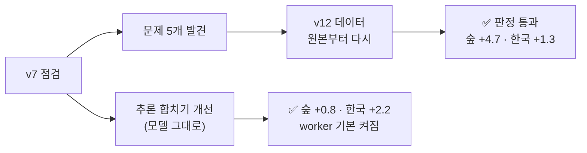

# 비전 파트 진행 상황 (10-14 회의 · 정서인)

> [!summary] 한 줄 — **탐지 모델을 데이터부터 다시 짜서 v7 을 넘었다** (숲 +4.7 · 한국 +1.3 %p) · worker 는 기능 완료, 남은 건 **연동 3가지** (탐지 켜기 · pose · 모델 id)
> **중간발표 목표 = 실기체 없이 UE 에서 전 과정 완료** (UE 비행 → 탐지 → 좌표 → 후보 → 상태 · 색 → 관제) · 10-28 · **수치 동결 10-24 18:00**
> ⚠ 지금 가장 큰 구멍: **UE 비행 녹화를 서버 비전에 한 번도 넣어 보지 못했다** (도구는 준비 · `ue_flight_sequence.py` → `ue_vision_eval.py`) · 상세는 [[17 v12 데이터 재구성 - 파이프라인 점검 (10-12)]] · [[16 v7 넘기 - 파이프라인 검토 (10-11)]]

## 1. 요구사항 현황 (요구명세서 v1.7)

| ID | 기준 | 지금 | 상태 |
|---|---|---|---|
| NFR-V01 추론 시간 | ≤ 30 ms / 1080p | **18.9 ms** (타일 4장 · TensorRT · 3090) · 합치기 개선은 시간 영향 없음 | ✅ |
| NFR-V02 처리량 | ≥ 5 FPS | 탐지만 50 FPS 급 · 전체 연결 (추적 · 좌표 · 상태) 측정은 2주차 | 🔄 |
| **NFR-V03 정확도** | AP50 ≥ 0.80 | 한국 수직 **1.00** ✅ · 비스듬 0.63 · 숲 0.64~0.66 (v12) — 숲 · 비스듬은 미달 | ⚠ |
| NFR-V04 좌표 | 수평 10~15 m | 시뮬 비행 중앙 0.68 · P95 1.16 m ✅ · ⚠ 캠퍼스 기복: 평지 가정 P95 41.8 m → **DEM 쓰면 20.7 m** | ⚠ DEM 필요 |
| NFR-V05 임계값 | F2 · 기본 0.15 | v12 는 재현율 ↑ 정밀도 ↓ → **임계값 다시 맞춰야** | 🔄 |
| NFR-V06 오탐 | ≤ 1 건/장 | 사람 없는 장 **0.29~0.42** (v7 0.46) · 도로 장면 (AU-AIR) **3.2 → 1.2** | ✅ |

## 2. 이번 주 핵심 — 탐지 모델 v7 → v12

**v7 데이터에서 찾은 문제**
- 확대된 흐린 사람 — VisDrone 크롭 90 % 를 최대 2배로 키움 (평가 · 운용은 원래 해상도)
- 장면 중복 — Unicamp **영상 3개가 학습셋의 22 %**
- 라벨 오염 — 「라벨 없는 프레임」 에 실제 사람 (NOMAD · WiSARD · HERIDAL 13~22 %) 이 음성으로 섞임 · VisDrone 무시 영역 (군중) 이 배경으로
- 안 쓴 데이터 — 비스듬 자연 지형 (NOMAD · Archangel) · 한국 수직 (AI-Hub 8곳 중 3곳만)

**v12 = 출처 11개 · 18,601장** — 확대 금지 · 영상마다 상한 · 오염 음성 제거 · 무시 영역 가림 · 비스듬 50 % · 한국 수직 14 %

| AP50 (평가셋 = 학습에 없는 장소) | 숲 test_v2 | 비스듬 test_obl | 한국 test_kr |
|---|---|---|---|
| v7 (단일 4개 평균) | 0.600 | 0.611 | 0.987 |
| soup_v7r2 (지금 배포) | 0.611 | 0.633 | 0.990 |
| **v12 (단일 2개 평균)** | **0.648** | 0.623 | **1.000** |
| v12 − v7 평균 (95 % 구간) | **+4.7** (+1.4 ~ +8.0) | +1.1 (구분 안 됨) | **+1.3** (+0.6 ~ +1.8) |

- 작은 사람이 특히 좋아짐 — 24 px 미만 재현율 0.3 → **0.53** · 고고도 황무지 (Karen) 0.23 → **0.34**
- 평가 방식도 바로잡음 — ① 타일 경계에서 잘린 박스 지우기 (모든 모델 +) ② 숲 평가셋 라벨 구멍 → 무시 영역 ③ 「운 좋은 수프 하나」 대신 **여러 번 학습한 평균끼리** 비교

## 3. 실시간 서비스 (worker)

| 기능 | 상태 |
|---|---|
| 탐지 (타일 4장 · TensorRT · 경계 합치기 개선) | ✅ 기본 켜짐 (파이프라인 1.1) |
| 좌표 (발끝 광선 × 지면 · 오차 타원 · 보류 사유) | ✅ · DEM 연결은 중간발표 뒤 |
| 후보 기억 · 추적 · 상태 (누움 점수 AUROC 0.92~0.95) | ✅ |
| 상의 색 · 인상착의 비교 (순위 보조) | ✅ |
| 재관측 제안 `REVIEW_BEARING` (방위 ±90°) | ✅ · 경로 계획 담당에 형식 전달 필요 |
| 근거 클립 (`clip_asset_id`) | ⏳ 남음 |

## 4. 팀에 요청 (막힌 것) — UE 전 과정 기준

1. **UE 담당** — UE 비행 녹화 1회 (45° · 16/20 m 지그재그 · 1080p 초당 10장 · 자세별 배우 · 노트북 `ue_flight_sequence.py --passive`) → 서버로 → 비전 전 과정 측정 (`ue_vision_eval.py` · 탐지 · 좌표 · 후보 · 상태 · 시간 한 번에) — **이번 주 안**
2. **SIM 연결** — UE 프레임이 SIM 분석 작업으로 들어오는 경로 · 프레임마다 pose · vision 컨테이너 GPU (지금 CPU 1 · 512 MB)

3. **통합** — REAL vision 이 지금 **결과 전송기만** 돌고 있음 → 탐지 (`vision_ingest`) + GPU 켜기 · `model_config_id` 등록
4. **백엔드** — 프레임 응답에 **`pose` (위경도 · 고도 · 자세 · 짐벌)** 가 없음 → 없으면 좌표 전부 보류
5. **경로 계획** — 재관측 형식 (`REVIEW_BEARING` · standoff 16~20 m · 10초 머물기) 반영
6. (중간발표 뒤) 실촬영 케이스 · 5 m DTM — UE 범위 밖이라 뒤로

## 5. 결정 요청

- **배포 모델 soup_v7r2 → v12 교체** — 후보 `v12_f91_swa` · `v12_f92_swa` · 운용 임계값을 평가셋 · val · UE 로 다시 정해 하나로 제안 (추가 학습은 멈추고 임계값 · UE 측정 먼저)
- 숲 · 비스듬 AP50 0.80 미달 설명 방식 — 평가셋이 운용 (16~20 m · 사람 60~100 px) 보다 훨씬 작은 사람이 많다 (숲 24 px 미만 21 %) · 운용 크기 50~80 px 재현율은 0.81~0.84

## 6. 남은 2주

| 기간 | 할 일 |
|---|---|
| 10-14 ~ 18 | **UE 녹화 → 비전 전 과정 측정 (최우선)** · v12 최종 후보 + 임계값 (평가셋 + **UE 로도** 확인) · TensorRT 재측정 · SIM 연결 (UE 프레임 → 분석 → 후보 API) |
| 10-19 ~ 24 | UE 시연 시나리오 리허설 (관제 화면에 후보 · 좌표 · 상태가 뜨는지) · NFR 판정표를 **UE 측정값**으로 · **10-24 18:00 동결** |
| 실기체 · 자체 촬영 | 중간발표 범위 밖 → 뒤로 (자체 촬영 평가셋 · O1 미세조정 · 관절점 K2c) |
| 중간발표 뒤 | DEM 연결 · 관절점 자세 모듈 · 증류 (FlyPose 선생 · 비상업 연구 허용) · 사람 크기 물체 오탐 (수레 · 상자) |

## 7. 발표에 쓸 근거

- 데이터만 다시 짜서 숲 +4.7 %p (모델 · 설정 그대로) — 「무엇이 문제였나」 를 숫자로
- 공개 항공 검출기 4종 비교 — VisDrone 상위 모델은 **수직으로 본 사람을 거의 못 찾음** (한국 ≈ 0) → 자체 학습이 맞다
- 좌표: 평지 가정은 캠퍼스 기복에서 P95 41.8 m → DEM 필요
- 자세: 관절점을 쓰면 「서기처럼 보이는 누움」 AUROC 0.61 → 0.81 (UE)

## 연결

[[_학습 큐]] · [[다음 할 일]] · [[17 v12 데이터 재구성 - 파이프라인 점검 (10-12)]] · [[16 v7 넘기 - 파이프라인 검토 (10-11)]] · [[결정 - 최종 탐지 모델 soup_v7r2]] · [[외부 항공 검출기 비교 - FlyPose · VisDrone YOLO (E1 · E1b)]] · [[좌표 평지 가정 vs DEM - 캠퍼스 지형 모의 (G1)]] · [[관절점으로 자세 판정 - FlyPose · ViTPose · RTMPose (C4 · K1~K3)]]
