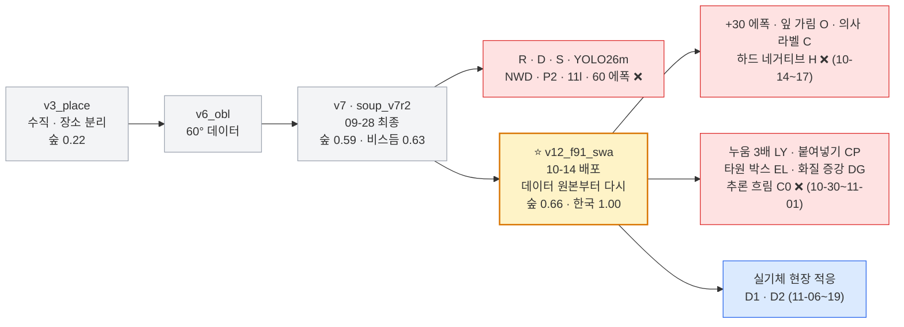

> [!summary] 비전 학습 · 평가 계획의 입구 — **지금 할 일 → [[23 다음 학습 계획 (11-01)]]** · 판정 기준 · 결과 원장 → [[_학습 큐]]
> - **배포 모델**: `v12_f91_swa` (10-14) · 숲 0.659 · 비스듬 0.616 · 한국 1.000 · 20.6 ms · 도로 오탐 0.55 건/장 → [[결정 - 배포 탐지 모델 v12_f91_swa · 임계값 0.20]]
> - **11-01 판단**: 공개 데이터 위 학습 바꾸기는 거의 다 막힘 (v12 위 증강 4종 · 추론 흐림 모두 ❌) · 기성 모델 13개도 v12 를 못 넘음 (LADD 하나 빼고) → **다음 = 실기체 데이터 (현장 적응 D1 · D2)**
> - 지난 판 (v7 · soup_v7r2 기준) → [[00 학습 계획 한눈에 (10-04 판)]]

## 1. 지금 보는 문서 (11-01)

| 문서 | 무엇 | 상태 |
|---|---|---|
| **[[23 다음 학습 계획 (11-01)]]** | C0 → D0 → (U) → D1 · D2 실기체 적응 · 11-21 동결 | 🔄 C0 ❌ · D0 평가 |
| [[22 다음 학습 검토 (10-31)]] | 누움 지표 반복 폭 · 자세별 · 전송 화질 | ✅ |
| [[21 누운 사람 강건성 - 진단 · 문헌 · 파이프라인 점검 (10-30)]] | 누움 진단 · 문헌 · CP · EL · 우리 조건에선 누움 1.00 (UAV-SAR) | ✅ |
| [[20 최종발표 · 실기체 비전 계획 (10-30)]] | 11-25 최종발표 · 페어 · 실기체 일정 · 실기체 판정 기준 | 🔄 |
| [[_학습 큐]] | **모든 실험의 사전 판정 기준 · 결과 원장** (최신이 위) | 🔄 |
| [[실험 - 기성 모델 대 우리 모델 (데이터셋 12개 · 11-01)]] | 공개 가중치 13개 vs 우리 21개 · 12셋 | ✅ |

## 2. 계획 문서 전체 (번호순)

| # | 문서 | 상태 | 지금 쓰는 내용 |
|---|---|---|---|
| 01 | [[01 기준 요건 확정안]] | ✅ 기준 | 카메라 · 렌즈 · 짐벌 · 고도 (마운트는 45° 로 바뀜 → [[결정 - 기본 마운트각 45°]]) |
| 02 | [[02 학습 계획 v6 (60° 기준)]] | ↪ 지난 | v6 → v7 → v12 로 이어짐 |
| 03 | [[03 9.30 설계명세서 병행 일정]] | ↪ 지난 | 9월 일정 |
| 04 | [[04 상의 색상 비교]] | ↪ 대체 | Lab 규칙 → SigLIP 2 ([[결정 - 상의 색 SigLIP 2 제로샷 (worker 1.3)]]) |
| 05 | [[05 실기체 적용 - 자체 촬영]] | 📝 쓰는 중 | 장소 A · B (학습) / C (시험) 나누기 규칙 |
| 06 | [[06 요구조자 상태 인지 계획]] | ✅ worker 1.2 반영 | 박스 모양 자세 + 멈춘 시간 → 등급 (관절점은 K2c 대기) |
| 07 | [[07 객체지향 설계 v2 - 상태 인지 반영]] | ✅ 설계 | |
| 08 | [[08 자세 판별 학습 계획]] | ⛔ 종료 | 자세 분류기 → 장소 바뀌면 무너짐 |
| 09 | [[09 자세 데이터 확보 - UE · 높은 곳 촬영 · UAV-Human]] | ↪ 지난 | |
| 10 | [[10 작업·학습 계획 - 중간발표까지 (10-04)]] | ↪ 지난 | 중간발표 (10-28) 까지 |
| 11 | [[11 자세 판별 - 방식 · 기하 원리 · 오차 · 개선]] | 참고 | 박스 모양 자세의 원리 |
| 12 | [[12 비전 다음 계획 - 중간발표까지 (10-07)]] | ↪ 지난 | |
| 13 | [[13 시연 환경 시험 데이터 촬영 계획 (10-07)]] | 📝 쓰는 중 | 실기체 촬영 방법 |
| 14 | [[14 촬영 체크리스트 - 자세 × 가림 (10초)]] | 📝 쓰는 중 | 실기체 누움 장면 코드 |
| 15 | [[15 비전 할 일 - 설계명세서 · 드라이브 기준 (10-09)]] | ↪ 지난 | |
| 16 | [[16 v7 넘기 - 파이프라인 검토 (10-11)]] | ✅ 완료 | 타일 경계 합치기 I1 → v12 로 |
| 17 | [[17 v12 데이터 재구성 - 파이프라인 점검 (10-12)]] | ✅ **지금 데이터** | v12 = 출처 11개 · 18,601 창 |
| 18 | [[18 UE 비전 전 과정 검증 (10-14)]] | ✅ | UE 10회 전 과정 |
| 19 | [[19 상의 색 판별 개선 계획 (10-17)]] | ✅ 완료 | → 결정 SigLIP 2 |
| 20~23 | 위 1절 | 🔄 | |
| — | `지난 계획/` · `9.21 아이디어/` | ↪ 지난 | 9월 S0~S8 · v4 · v5 · 문헌 대조 |

## 3. 실제로 간 길 (탐지 모델)

## 4. 판정 규칙 (모든 실험 공통)

- 판정은 **학습에 안 쓴 장소** 로만 — test_obl (Okutama 비스듬) · test_v2 (WiSARD 숲 · 경계 합치기 · 무시 영역) · test_kr (AI-Hub 한국)
- **판정 기준은 돌리기 전에** [[_학습 큐]] 에 적는다 · 한 번에 하나만 바꾼다
- 같은 설정도 다시 학습하면 흔들린다 (AP 최대 3.4 %p · **누움 뜸 표준편차 7.9 %p**) → **반복 2회 평균 대 v12 세 회 평균** (`compare_means.py`)
- 함께 보는 것: 도로 오탐 (AU-AIR · ≤ 1 건/장) · 누움 묶음 (`lying_bench.py`) · 자세별 · 화질 (`pose_bench.py`) · 외부 실사진 UAV-SAR (`bench_all.py`)

## 5. 운용 화면 기하 (45°)

![[fig_45도_화면기하.svg]]

- 화면 위 = 먼 쪽 · 아래 = 가까운 쪽 → 상하 반전 증강 끔 · 16~20 m 에서 사람 키 50~100 px

## 연결

[[00 홈]] · [[_학습 큐]] · [[_실험 색인]] · [[_결정 색인]] · [[성능 요구사항 한눈에]] · [[다음 할 일]]
