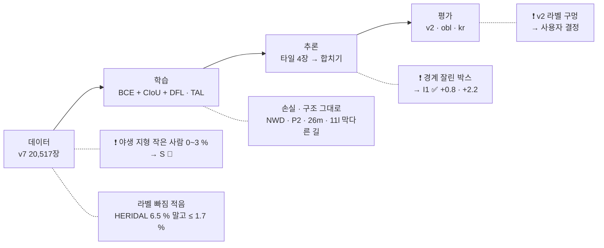

> [!summary] 「v7 을 넘을 모델」 을 만들려고 **데이터 · 손실 · 학습 설정 · 추론 · 평가** 를 다시 봤다
> - **I1 ✅ 추론 합치기** — 타일 경계에서 잘린 박스 지우기 · 가중치는 soup_v7r2 그대로 · **test_v2 0.593 → 0.601 · test_kr 0.968 → 0.990** (둘 다 유의) · 확인한 모델 5개 × 세트 4개 모두 올랐다
> - **S 🔄 학습** — 야생 지형의 작은 사람 2,991장 더하기 · 반복 ×2 → 수프 · 10-12 저녁 판정 ([[_학습 큐]] 「10-11~12 V」)
> - 손실 · 구조는 **그대로** — 남은 위치 오탐은 손실로 고칠 종류가 아니다 (잘린 박스 · 라벨 습관 · 라벨 구멍)
> - ⚠ **test_v2 라벨 구멍** — test_v2 상위 검출의 오탐 대부분이 Carnation_Inspire 의 라벨 없는 진짜 사람이다 → 무시 영역을 넣을지는 사용자 결정

## 1. 어디서 지나 — soup_v7r2 vs FlyPose 검출기 vs 둘의 앙상블

| AP (IoU 0.3 · **0.5** · 0.7) | test_v2 (숲) | test_obl (비스듬) | test_kr (한국 수직) |
|---|---|---|---|
| soup_v7r2 | 0.708 · **0.593** · 0.278 | 0.838 · **0.633** · 0.161 | 0.971 · **0.968** · 0.833 |
| FlyPose 검출기 | 0.794 · **0.655** · 0.331 | 0.874 · **0.669** · 0.168 | 0.936 · **0.912** · 0.706 |
| 앙상블 (WBF 간이) | **0.682** | **0.678** | **0.988** |

- 앙상블이 세 세트 모두 둘보다 높다 → 두 모델이 서로 다른 것을 안다 (FlyPose = TinyPerson 등 11종 학습) · 다만 두 모델을 같이 돌리면 탐지 시간이 약 43 ms 라 NFR-V01 (≤ 30 ms) 을 넘는다 → KD 후보
- test_v2 장소별 AP50: Karen 0.23 vs FlyPose **0.35** · Carnation_0025 0.75 vs **0.82** · Carnation_0023 **0.85** vs 0.77 · Carnation_Inspire 0.62 = 0.62 → FlyPose 는 **작은 사람이 많은 곳**에서 이긴다

## 2. 데이터

| 사람 긴 변 (모델 입력 px) | < 24 | 24~36 | 36~50 | 50~80 | 80+ |
|---|---|---|---|---|---|
| **test_v2** | **21 %** | 21 % | 22 % | 23 % | 13 % |
| **test_obl** | 8 % | **34 %** | 39 % | 19 % | 0 % |
| test_kr | 0 % | 11 % | 22 % | 31 % | 36 % |
| v7 학습 전체 (8.8만 명) | 9 % | 22 % | 27 % | 29 % | 13 % |
| └ VisDrone (도시 · 사람의 53 %) | 14 % | 27 % | 29 % | 24 % | 7 % |
| └ **WiSARD · HERIDAL · SARD (야생)** | **0~3 %** | 5~19 % | 17~31 % | 36~38 % | 13~41 % |
| **S (small_v11 · 2.9만 명)** | **55 %** | 30 % | 9 % | 6 % (50 이상) | — |

- 작은 사람은 도시 거리 (VisDrone) 에만 있다 → 숲 · 황무지의 작은 덩어리는 배경으로 배운다 · Karen = 고고도 수직 황무지 · 사람 10~20 px
- WiSARD 를 원래 크기로 자르기 (T1) 는 크기가 거의 안 바뀐다 (중앙 64.7 vs 71.5 px · 원본 창이 1280×720 보다 작게 줄지 않음) → **취소** · 대신 2×2 칸에 **줄여 넣기** (S)
- 그림을 1.5배 키워 추론하면 작은 사람 재현율은 오르지만 (v2 < 24 px 0.36 → 0.43) AP 는 −2.5 %p · Karen 그대로 → 크기만이 아니라 **작은 사람의 생김새를 못 배운 것**
- 라벨 빠짐 (FlyPose 검출기 확신 ≥ 0.7 · 정답과 IoU < 0.3 · 출처마다 600장): HERIDAL 후보/정답 6.5 % (대부분 진짜 사람) · VisDrone 1.2 % · 나머지 ≤ 1.7 % · 음성 크롭 후보는 거위 같은 FlyPose 오탐 → 주원인 아님

## 3. 손실 · 할당 · 구조 — 그대로

| 확신 ≥ 0.5 오탐 (soup_v7r2) | test_v2 | test_obl | test_kr |
|---|---|---|---|
| 맞음 | 2,301 | 3,925 | 979 |
| 위치 어긋남 · 정답은 이미 짝 (그중 **타일 경계 잘림**) | 57 (**46**) | 48 (0) | 51 (**50**) |
| 위치 어긋남 · 정답 놓침 | 292 | 642 | 0 |
| 배경 | 191 | 147 | 3 |

- 위치 오탐의 원인: **타일 경계 잘림** (→ I1 에서 해결) · Okutama 의 넓은 박스 습관 (obl 위치 오탐의 너비비 중앙 0.74) · test_v2 라벨 구멍 → 박스 손실 (CIoU · DFL) 을 바꿔서 고칠 종류가 아니다
- 작은 사람용 손실 · 구조는 이미 막다른 길 — NWD −2.4 %p · P2 ±0 · YOLO26m 맞바꿈 · 11l 손해 ([[_실험 색인]])
- 할당 (TAL) 은 GT 안에 앵커 중심이 있어야 해서 8 px 미만 사람은 감독이 약하다 → **S 에서 작은 사람이 오르면** 그때 P2 · 할당을 S 데이터 위에서 다시 (한 번에 하나)

## 4. 학습 설정

- 지금: yolo11m (COCO) · 1280 · 30 에폭 · SGD 0.01 · mosaic 1.0 · close_mosaic 0 · scale 0.3 · translate 0.15 · degrees 10 · 수프 (반복 평균)
- 막다른 길: 60 에폭 · translate 0.30 · close_mosaic · VisDrone 사전학습 · 음성 15.8 % · 공통 출발 미세조정 수프
- 진짜 반복 = 목록 95 % 무작위 뽑기 (ultralytics 가 목록을 이름순 정렬 → 시드 · 순서는 효과 없음) · 반복 폭 obl 3.1 · v2 2.9 · kr 1.2 %p
- 안 해 본 것: `scale 0.5` (작은 쪽 확대 증강 — S 와 겹침 · S 결과 뒤) · `multi_scale` (1280 에서 최대 1920 → 메모리 초과)

## 5. 추론 — I1 타일 합치기 ✅

| 합치기 규칙 (soup_v7r2 · AP50) | test_ladd | test_nii | test_cy | → test_v2 | → test_kr |
|---|---|---|---|---|---|
| NMS 0.6 (지금) | 0.675 | 0.786 | 0.307 | 0.593 | 0.968 |
| 중심 소유 (타일 사분면) | 0.658 | 0.775 | 0.300 | | |
| **경계 잘린 박스 지우기 (edge)** | **0.678** | **0.788** | **0.308** | **0.601** (+0.3 ~ +1.1) | **0.990** (+1.0 ~ +3.4) |

- 고른 법: soup_v7r2 가 안 본 1920×1080 세트 3개에서 규칙을 고르고 → 평가셋엔 한 번 적용 (괄호 = 짝 부트스트랩 95 % 구간 %p)
- 모델 5개 (v7 · v7_r2 · v10_f61 · v10_f62 · soup_v7r2) 모두 올랐다: test_v2 +0.5~+1.0 · test_kr +1.5~+2.2 · test_ladd +0.3~+0.6 · test_nii +0.1~+0.3 %p
- 코드: `tile_merge.py` · `eval_test_v2.py --merge edge` (태그 `_edge`) · worker 반영은 사용자 확인 뒤 (`deploy/vision_worker` 타일 합치기)
- 그 밖: NMS 0.5~0.7 은 세트마다 다름 · 1.5배 확대 추론 v2 손해 · 앙상블은 시간 초과

## 6. 평가 — test_v2 라벨 구멍

- Carnation_Inspire: 정답 중심 x 는 1~99 % 가 241~1570 · **x > 1600 정답 0** ↔ 우리 확신 ≥ 0.5 배경 오탐 중 27건이 그 띠
- 확신 ≥ 0.8 배경 오탐 74건 중 **68** 이 Carnation_Inspire · 상위 검출을 눈으로 보면 빨간 · 파란 옷의 **누운 사람 · 걷는 사람** (라벨 없음) · 정답 박스가 사람보다 훨씬 크거나 밀린 것도 섞임
- 뜻: 사람을 확신 있게 잘 찾는 모델일수록 v2 에서 손해를 본다 (v9 누움 ↑ 인데 v2 −2.0 이었던 것과 맞을 수 있음)
- 안: 라벨 구멍을 **무시 영역**으로 (그 안의 검출은 맞음도 오탐도 아님) — 두 모델의 오탐 합집합을 눈으로 확인해 정함 · 평가셋을 바꾸는 일이라 **사용자 결정** · 바꾸면 지난 모델을 모두 다시 잼 (덤프로 몇 분)

## 7. 다음

1. **S 판정 (10-12 저녁)** — PASS 면 soup_v11s + I1 = 새 후보 (교체는 사용자 확인 · 10-24 동결)
2. KD 설계 — 앙상블 선생 (soup_v7r2 + FlyPose) 의 의사 라벨 · FlyPose 가중치 라이선스 먼저 확인
3. S 가 작은 사람에서 오르면 → P2 · 할당을 S 데이터 위에서 (한 번에 하나)

## 연결

[[_학습 큐]] · [[결정 - 최종 탐지 모델 soup_v7r2]] · [[외부 항공 검출기 비교 - FlyPose · VisDrone YOLO (E1 · E1b)]] · [[NWD·P2 효과 없음 - 원인 분석]] · [[타일 추론]] · [[NFR-V03 탐지 정확도]] · 코드 `dump_dets.py` · `analyze_dets.py` · `diag_tile_merge.py` · `tile_merge.py` · `diag_missing_labels.py` · `diag_scale_infer.py` · `make_v11_small.py` · `chain_s.sh` · `diag_small.py`
