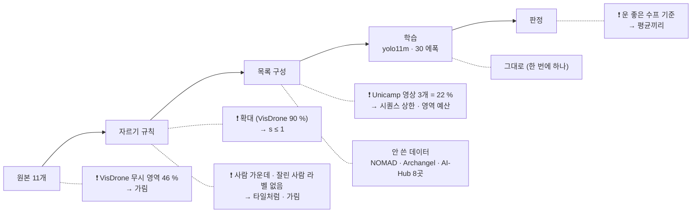

> [!summary] 「데이터셋 구성부터 다시」 (사용자 10-12) — v7 파이프라인을 원본부터 다시 보고 **v12 를 새로 짰다**
> - v7 의 큰 문제 셋: **확대된 흐린 사람** (VisDrone 크롭 90 % 확대) · **장면 중복** (Unicamp 영상 3개 = 학습셋 22 %) · **라벨 위생** (VisDrone 무시 영역 · 잘린 사람)
> - 판정 방식도 고침: 같은 설정 v7 4회가 test_obl 0.604 ~ 0.631 로 흔들려 **운 좋은 수프 하나와 비교하면 손해처럼 보인다** → **단일 학습 평균끼리** 비교 (`compare_means.py`)
> - v12 = 출처 11개 · **18,601 창** · 확대 금지 · 시퀀스 상한 · 무시 영역 · 잘린 조각 가림 · 타일처럼 창 · 영역 예산 · 음성 3.2 % (믿을 수 있는 출처만) → 학습 2개 (`chain_r12.sh` · 10-12 18:32 시작) → **10-13 오전 판정** ([[_학습 큐]] 「10-12 v12」)
> - **✅ 결과 (10-13)** — 평균[v12 2] vs 평균[v7 4]: test_v2 **+4.7** (+1.4 ~ +8.0) · test_kr **+1.3** (+0.6 ~ +1.8) · test_obl +1.1 (구분 안 됨) → PASS · Karen 0.23 → 0.34 · 24 px 미만 재현율 0.3 → 0.53 · AU-AIR 오탐 3.2 → 1.2 건/장 · FiftyOne `train_v12` (19,698 창)
> - ⚠ 빌드 중 발견: NOMAD · WiSARD · HERIDAL 의 **라벨 없는 프레임에 사람이 있다** (라벨을 안 단 것) — v7 의 WiSARD 음성 10 % 도 오염

## 1. 점검 — 무엇이 잘못돼 있었나 (v7 · 20,517장)

| # | 문제 | 근거 (숫자) |
|---|---|---|
| ① | **확대된 흐린 사람** — 크롭 규칙이 사람 31~94 px 로 맞추며 최대 2배 키움 | VisDrone 원본 사람 중앙 **23 px** → 크롭 90 % 확대 · 58 % 는 2배 상한 · Unicamp 39 % · SARD 38 % · HERIDAL 28 % 확대 — 평가 · 운용은 원래 해상도 (타일 1:1) |
| ② | **장면 중복** | Unicamp-UAV = **영상 3개** (DJI_0083 · 0084 · 0085) 인데 4,610장 = 학습셋 **22 %** · AI-Hub 3곳 2,009장 · WiSARD 비행당 77장 |
| ③ | **VisDrone 무시 영역** (군중 · 먼 곳) 안 사람이 배경으로 | 비스듬 그림 4,974장 중 **46 %** 에 무시 영역 (중앙 넓이 약 65×65 px) |
| ④ | **잘린 사람** — 크롭 가장자리에서 보이는 넓이 < 50 % (WiSARD 40 %) 면 라벨만 지우고 그림은 남김 | 학습 증강 (mosaic) 은 10 % 까지 라벨로 둠 → 서로 어긋남 |
| ⑤ | **사람 가운데 크롭** | 사람 하나를 창 가운데 15~85 % 에 둠 · 추론 타일은 사람이 어디든 |
| ⑥ | **안 쓴 데이터** | NOMAD 2만 (비스듬 자연 · v7 에서 뺌) · Archangel · AI-Hub 182 학습 가능 8곳 4.6만 (3곳만 씀) · VisDrone 수직 3,655 · LADD · NII-CU |
| ⑦ | 음성 4.4 % · 물체 음성 없음 | test_v2 확신 높은 오탐 대부분이 **수레 · 상자 · 표지물** ([[16 v7 넘기 - 파이프라인 검토 (10-11)]] §6) |
| ⑧ | best.pt 고르기 | val 최고가 26~30 에폭 · 마지막과 차 ≤ 0.004 → **문제 아님** |

### 판정 방식

| 같은 설정 4회 (v7) | test_obl | test_v2 | test_kr |
|---|---|---|---|
| v7 · v7_r2 · v7_r3 · v7_r4 | 0.631 · 0.604 · 0.605 · 0.606 | 0.578 · 0.585 · 0.591 · 0.575 | 0.966 · 0.968 · 0.954 · 0.970 |
| soup_v7r2 (v7 + v7_r2) | **0.633** | 0.593 | 0.968 |

- soup_v7r2 는 가장 높은 1회차 (0.631) 를 품어 test_obl 기준이 높다 → 새 데이터 반복을 수프와 비교하면 손해처럼 보인다
- 예: **S** (작은 사람) test_obl — 수프 대비 −1.6 · −3.1 %p (유의) ↔ **v7 단일 4개 평균 대비 −0.2 (구분 안 됨)** · v10 (+LADD) 평균 대비 +0.6 (구분 안 됨)
- 반복 수프는 BN 통계가 어긋나 자주 못 만든다 (v10 · S mean_z 0.30)
- → **주 판정 = 단일 학습 평균끼리** (`compare_means.py` · 같은 블록 짝 부트스트랩) · 반복 폭 절반 (2 대 4 평균의 흔들림 ≈ 단일 짝의 0.61 배) · 보조 = 한 학습 안 마지막 5 에폭 평균 (`swa_ckpt.py` · BN 이 맞물림)

## 2. v12 규칙 (`make_v12_data.py`)

| | v7 | **v12** |
|---|---|---|
| 배율 | 사람 31~94 px 로 맞춤 · 최대 2배 확대 | **확대 금지 s ≤ 1** · 큰 원본만 줄여서 (더 높이서 찍은 화질) · VisDrone 은 원래 크기 |
| 창 위치 | 사람 하나를 가운데 | **그림 전체에서 고르게** (사람이 가장자리에도) |
| 잘린 사람 | < 40~50 % 면 라벨만 지움 | **≥ 25 % 는 잘린 박스로 라벨 · 그 아래는 가림** (창 평균색) |
| VisDrone 무시 영역 | 그대로 (배경) | **가림** |
| 시퀀스 | 영상당 3,000 상한 | **영상 · 비행 · 고도×시각마다 상한 · 시간 고르게** |
| 음성 | 4.4 % (WiSARD 빈 프레임 10 % 포함 — 사람 섞임) | **3.2 %** — 라벨이 빠짐없는 출처의 빈 프레임 · 라벨된 프레임의 빈 자리만 · 모델로 한 번 훑어 거름 (§3) |
| val | val_v6b (v6 크롭) | **val_v12** — 학습과 안 겹치는 시퀀스 (VisDrone val · Unicamp 0085 · NOMAD 배우 096~100 · WiSARD 비행 3 · AI-Hub 저수지1) |

### 출처 · 영역 (양성 창 예산)

| 영역 | 출처 (예산) | 배율 규칙 |
|---|---|---|
| 비스듬 도시 | VisDrone 비스듬 3,000 · Unicamp 450 (영상당 150) · NII-CU 500 (flight3 = test_nii 제외) | 원래 크기 0.8~1 · 사람 24~80 / 20~80 px |
| 비스듬 자연 | **NOMAD 3,000** (배우×고도 232 시퀀스 · 배우 096~100 은 val) · SARD 1,500 · **Archangel 1,500** | 사람 18~100 · 20~90 px · 원래 크기 |
| 수직 도시 | VisDrone 수직 1,200 | 원래 크기 |
| 수직 자연 | WiSARD 2,800 (29 비행 · Karen · Carnation 제외) · HERIDAL 1,600 · LADD 900 (뒤 30 % = test_ladd_h 제외) | 1080p 로 맞춘 뒤 0.67~1 · 사람 16~72 · 16~64 px |
| **수직 한국** | **AI-Hub 182 8곳 2,500** (251 시퀀스 · 산악5 = test_kr · 저수지1 = val 제외) | 1080p 로 맞춘 뒤 0.67~1 |

- 결과 숫자 (창 수 · 사람 크기 분포 · 영역 비율) → `metrics/v12_data_stats.json` (아래 §3 에 채움)

## 3. 만든 결과 (`metrics/v12_data_stats.json`)

| | v7 | **v12** |
|---|---|---|
| 학습 창 | 20,517 | **18,601** (양성 18,002 · 음성 599 = 3.2 %) |
| val | val_v6b | val_v12 1,097 |
| 확대된 창 | 약 40 % (VisDrone 90 %) | **0** (배율 중앙: VisDrone 0.94 · NOMAD · Archangel 1.0 · SARD 0.67 · WiSARD 0.56 · HERIDAL 0.47 · AI-Hub 0.42) |
| 영역 (양성 창) | 비스듬 47 % (도시만) | 비스듬 자연 32 % · 수직 자연 29 % · 비스듬 도시 18 % · 한국 수직 14 % · 수직 도시 7 % |
| 사람 (긴 변 px) | < 24 9 % · 24~36 22 % · 36~50 27 % · 50~80 29 % · 80+ 13 % | < 16 14 % · 16~24 22 % · 24~36 26 % · 36~50 19 % · 50~80 14 % · 80+ 5 % (VisDrone 군중이 사람 수의 60 %) |
| 가림 | 없음 | VisDrone 무시 영역 1,808 창 · 잘린 조각 · 10 px 미만 사람 |

### 빌드 중 고친 것

- **10 px 미만 사람은 가림** — 첫 빌드에서 16 px 미만이 20 % (VisDrone 군중) · 운용 · 평가 밖의 극단
- **양성 창 위치** — 큰 그림 (NOMAD 5472×3078) 에서 아무 데나 놓으면 사람이 안 걸림 → 사람 하나가 온전히 드는 위치들 중 고르게 (창 안 어디에나)
- ⚠ **「라벨 없는 프레임」 = 사람 없는 프레임이 아니다** — NOMAD · WiSARD · HERIDAL 의 빈 프레임 음성 창을 soup_v7r2 로 훑으니 확신 ≥ 0.5 검출이 22 · 15 · 13 % · 눈으로 보면 거의 다 **진짜 사람** (라벨을 안 단 프레임) → 이 출처들의 빈 프레임 음성 863장을 뺌 · 라벨이 빠짐없는 출처 (VisDrone · Unicamp · NII-CU · LADD · AI-Hub) 와 라벨된 프레임의 빈 자리만 · 그래도 확신 ≥ 0.5 검출 있으면 버림 (31장) — **v7 도 WiSARD 빈 프레임을 음성 10 % 로 섞었다** (`wisard_prep` NEGATIVE_RATIO)
- 양성 창 안 라벨 없는 검출 (확신 ≥ 0.6 · 라벨과 IoU < 0.1): NOMAD 4.0 · HERIDAL 3.1 · NII-CU 3.1 · LADD 2.5 % of 라벨 — 절반쯤 진짜 사람 (NOMAD 촬영 인원 등) · 절반은 물체 (개 · 배낭 · 타이어) → 이번엔 그대로 (다음 판 후보: 선생 의사 라벨)

## 4. 그대로 둔 것

- 모델 yolo11m (COCO) · `v6_oblique.yaml` · imgsz 1280 · 30 에폭 · SGD 0.01 · mosaic 1.0 · scale 0.3 — **데이터만 바꾼다** (한 번에 하나)
- 추론 = 타일 4장 + 경계 잘린 박스 지우기 (I1) · test_v2 무시 영역

## 연결

[[_학습 큐]] (10-12 v12) · [[16 v7 넘기 - 파이프라인 검토 (10-11)]] · [[02 학습 계획 v6 (60° 기준)]] · [[결정 - 최종 탐지 모델 soup_v7r2]] · 코드 `make_v12_data.py` · `compare_means.py` · `swa_ckpt.py` · `chain_r12.sh`
