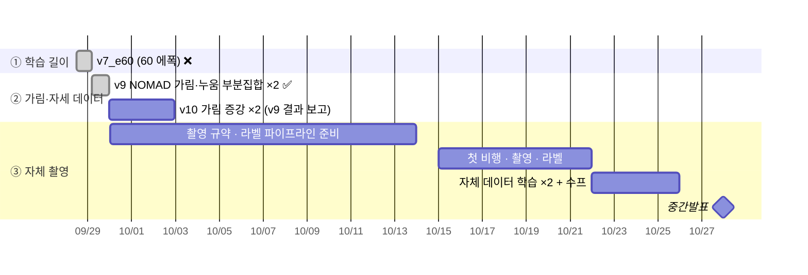
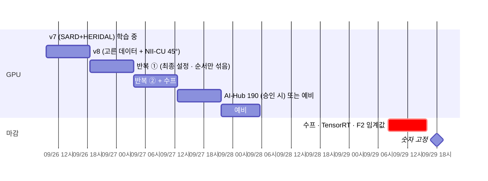
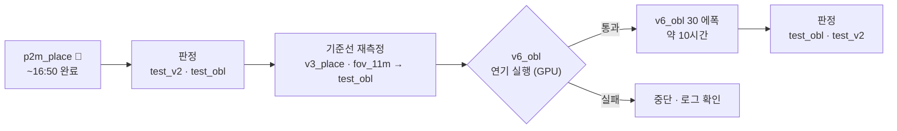

> [!summary] **예약된 학습과 설정값** — 앞으로 학습 계획은 여기에 적는다
> 지금: **C (의사 라벨) ❌ FAIL (한국 −0.5 %p · 도로 오탐 ↑) · R (ReID 후보 잇기) ❌ FAIL 아슬 (20 m 후보 −28.5 % · 섞임 10→8 · IDF1 0.61→0.65)** · H (하드 네거티브) 학습 전 중단 (절반 이상이 라벨 안 된 사람)** · G (후보 묶기 규칙) ❌ FAIL (20 m 후보 −26 % · IDF1 그대로) · O (잎 가림 증강) ❌ FAIL (10-15 · 숲 · 비스듬 +0.8 구분 안 됨 · 한국 −0.5 유의)** · 배포 v12_f91_swa · 0.20 (10-14 확정) · **v12 ✅ PASS** (v2 +4.7 · kr +1.3 · obl +1.1 %p — 평균 대 평균) → `chain_r12d.sh` (10-13 22:25~): 세 번째 반복 v12_f93 (~10-14 05시) → v12_f91 +30 에폭 ❌ FAIL (obl −2.4 · v2 −1.9 %p · 30 에폭 유지) · 임계값 스윕 → v12 운용 **0.20** 제안 · S ❌ · A 멈춤 · test_v2 무시 영역 ✅ (10-12) · I1 타일 합치기 ✅ (v2 +0.8 · kr +2.2) · 최근: G1 좌표 DEM 모의 ✅ · K3 관절점 15종 · E1 · E1b 외부 검출기 (soup_v7r2 유지) · 다음: K2c (자체 촬영) · G1 다시 (5 m DTM) · (GPU 10-09 20:21 복구 — 드라이버 자동 업그레이드 → 모듈 다시 올림 · hold) (`chain_sd` 10-09 05:22 끝 · D 전부 FAIL → soup_v7r2 유지) · 다음 후보: R1 (진짜 추적 재점수) · O1 (자체 촬영 뒤) · **탐지 학습 멈춤** (10-06 22시 · 사용자 지시 — GPU 를 상태 판단 모델 비교에) · 지난: `chain_r6.sh` 중단 · `chain_r.sh` → `chain_r3.sh` (R2 · R3 · R5 모두 FAIL → **soup_v7r2 유지**) · 진행 로그 `logs/QUEUE.md` · 결과 `metrics/AUTO_RESULT_*.md`
> 각 단계는 **실패해도 다음으로 넘어간다** (GPU 를 쉬게 두지 않는다) · 작업 전체 계획 → [[10 작업·학습 계획 - 중간발표까지 (10-04)]]

## 10-29 K — 상의 색 판별 개선 (사용자 「색 구분 다양한 방법으로」 · 계획 [[19 상의 색 판별 개선 계획 (10-17)]] · 판정 기준은 돌리기 전에 적음 10-29)

- 평가셋 (돌리기 전에 고정)
  - **U = UAV-Human 속성 시험셋** (드론 · 시험 사람 30명 · 학습 89명과 겹침 0) — 상의 색 번호 ↔ 색 대응은 10-29 사진으로 확인 (01 빨강 · 02 검정 · 03 파랑 · 04 초록 · 05 여러색 · 06 회색 · 07 흰 · 08 노랑 · 09 갈색 · 10 보라 · 11 분홍) · **05 여러색 뺌** · 10색 · 색마다 최대 120장 (사람마다 고르게 · 시드 0)
  - 크롭은 원본 (키 중앙 410 px) 을 **운용 크기로 줄임** — 사람 키 **72 px** (주 판정 · 16~20 m) · 48 · 120 px (보고만) · 프레임 통계는 크롭 자체 (UAV-Human 은 전체 프레임 없음)
  - **N = NOMAD 42명** (기존 `eval_color.py` 캐시 · 1080p · V 판정기 고르는 데 이미 씀 → 참고 · 학습 없는 방식의 손해 확인용) · 지표 = 한 장 1순위 · 누적 1순위 · 찾는 사람 순위
  - UE S4 · 디관 사람 라벨은 이번엔 없음 (뒤에 · 디관 라벨은 사용자 손 필요)
- 지표: U **색 균형 1순위 (10색 평균 · 판정 불가 = 오답으로 셈)** = 주 · 판정된 것만 1순위 따로 · 1·2순위 · 색별 · 혼동 · 판정 불가율 / N 위 3개 / 후보 하나당 ms
- 구간: **사람 단위 블록 부트스트랩** 95 % (U 30명 · N 42명) · 짝 차이 (같은 크롭)
- 방식 (기준 = **V10** 지금 worker)
  - 학습 없음: A1 색 이름표 (w2c) · A2 국소 화이트밸런스 (사람 둘레) · A3 사람 마스크 (YOLO11n-seg · SegFormer 상의) · B1 SigLIP 2 제로샷 · 조합
  - 학습: B2 SigLIP 2 특징 + 선형 (UAV-Human **학습셋만** · 여러 키로 줄여 학습 · 설정은 학습셋 안 사람 나눠 교차검증으로 고름 — U 는 판정에만)
- **채택 (학습 없음)**: U 색 균형 1순위 **+10 %p 이상 · 구간 > 0** 그리고 N 한 장 1순위 유의한 손해 없음 (구간 상한 ≥ 0) 그리고 ≤ 5 ms/후보
- **채택 (B2 학습)**: 위 + **N 한 장 1순위 구간 > 0** (U 는 같은 데이터 분포라 부풀려짐 → 다른 드론 데이터에서 올라야 일반화로 봄)
- 공통: 찾는 사람 순위 (N) 중앙 나빠지지 않음 · 주황 · 남색은 U · N 모두 0명 → 판정 밖 (UE 12색 스윕 때)
- 통과해도 worker 교체는 사용자 결정
- ⚠ 사후 추가 (결과 본 뒤 · 사용자 제안 10-29): **L Lab 계열** — L1 CLAHE (L 만) · L2 Lab 규칙 (채도 있으면 어두워도 검정 안 보냄 · 빛번짐 L > 95 뺌) · L3 둘 다 · L4 표 가중 없음 → 같은 기준으로 판정
- **결과 (10-29 · `color_lab.py` · `metrics/color_lab.json` · U 1,092장 × 키 3종 · N 3,279장 · GrabCut 시드 고정 = worker 와 같은 출력 확인)** — 구간 = V10 대비 짝 · 사람 블록 95 %
  | 방식 | U72 색 균형 1순위 | N 한 장 1순위 | ms/명 | 판정 |
  |---|---|---|---|---|
  | V10 (worker) | 0.286 | 0.336 | 10.4 (CPU) | 기준 |
  | V10 − 노출 | 0.345 [+0.9 ~ +11.8] | 0.306 [−6.1 ~ −0.3] | | ❌ N 손해 |
  | A1 w2c (4종) | 0.28 ~ 0.30 | 0.25 ~ 0.32 (손해) | | ❌ |
  | A2 국소 화이트밸런스 | 0.283 | 0.336 | | ❌ ±0 |
  | A3 YOLO11n-seg 마스크 | 0.284 | 0.353 [+0.4 ~ +2.7] | 25.8 | ❌ +10 미달 |
  | A3 SegFormer 상의 | 0.288 | 0.324 | | ❌ |
  | L2 Lab 규칙 (최고 Lab) | 0.372 [+0.8 ~ +16.9] | 0.300 [−8.6 ~ +0.7] | | ❌ +10 미달 · 흰 → 파랑 (그늘 푸른빛이 채도로 잡힘) |
  | L1 · L3 · L4 | 0.35 ~ 0.36 | 0.28 ~ 0.31 | | ❌ |
  | **B1 SigLIP 2 제로샷 · 상의 크롭** | **0.508 [+12.7 ~ +30.6]** | **0.410 [−0.9 ~ +15.6]** | **1.5 (GPU · 묶음)** | **✅ PASS** (+22.2 %p · N 손해 없음 · ≤ 5 ms) · 찾는 사람 순위 중앙 9.5 → 5.5 · 누적 0.404 → 0.495 |
  | B1 사람 크롭 · 문장2 | 0.49 · 0.48 | 0.40 · 0.37 | | ✅ 통과 (상의보다 낮음) |
  | B2 SigLIP + 선형 · 상의 (학습 89명) | 0.482 [+3.8 ~ +31.1] | 0.363 [−4.7 ~ +10.3] | 1.4 | ❌ 학습 기준 (N 구간 > 0) 미달 · 제로샷보다 낮음 |
  - B1 상의 색별 (U72 · V10 → B1): 빨강 0.32 → 0.70 · 노랑 0.08 → 0.63 · 분홍 0.02 → 0.46 · 흰 0.00 → 0.35 · 초록 0.00 → 0.16 · 갈색 0 → 0.25 · 검정 0.90 → 0.75 ↓ · 파랑 0.23 → 0.35 (남색으로 38) / N: 흰 0.20 → 0.62 · 초록 0.08 → 0.37 · 분홍 0 → 0.39 · **검정 0.58 → 0.35 ↓ · 빨강 0 → 0.01 (분홍 · 보라로)** · 보라 0.03 → 0.12
  - ⚠ U 보라는 시험셋 1명 (12장) 뿐 · 주황 · 남색 정답 0 · 여러 방식을 같은 두 셋에서 비교 → 최종 확인은 안 본 셋 (UE 12색 · 디관 라벨) 필요
  - worker 교체 (SigLIP 2 base · 375 MB · GPU) 는 사용자 결정
- **10-29 2차 (사용자 「확인 평가 실행 + 추가 개선 다 해보자」 · 결과 보기 전에 적음)**
  - **고르기 = U · N 만** (개발 셋) — C 계열 (개선 시도) 중 「U72 색 균형 + N 한 장 1순위」 평균이 가장 높은 1개 = **C 최선** · 단 U · N 어느 쪽도 B1 상의보다 유의하게 낮으면 안 됨
  - **확인 = 안 본 셋 2개** (고르는 데 안 씀 · 한 번만 잼)
    - **P = PETA** (지상 CCTV 10개 출처 · 상의 색이 하나인 사람만 · 11색 · 색마다 ≤ 150장 · 사람마다 고르게 · 키 72 px 로 줄임) — 시점이 달라 (지상) 일반화 확인용
    - **D = 디관 사진 사람** (21장 · 배포 탐지 박스 · 상의가 보이는 사람) — 라벨은 Claude 가 **예측을 보지 않고** 크롭만 보고 달고 사용자가 검수 (검수 전 = 잠정) · 사람 단위 구간
  - 확인 판정: **B1 상의 · C 최선 각각 V10 대비 P 와 D 색 균형 1순위 구간 > 0** 이면 확인 ✅ · B1 ↔ C 최선 차이는 보고만 (구간 > 0 이면 C 최선 우선)
  - C 계열 (개선 시도): C1 문장 여러 개 평균 · C2 색 이름 동의어 (남색 · 베이지 · 자주 …) · C3 SigLIP + 규칙 (V10 · Lab) 확률 섞기 · C4 클래스 치우침 보정 (UAV-Human 학습셋으로 12개 편향만 맞춤) · C5 배경 지우기 (사람 마스크 밖 회색) · C6 색 보정 (화이트밸런스 · 노출) 뒤 SigLIP · C7 큰 SigLIP 2 (large · so400m) · C8 제로샷 + 선형 섞기 · C9 B2 조명 흔들기 증강
  - **결과 (10-29 · 개발 셋 U · N)** — 평균 = (U72 색 균형 + N 한 장 1순위) / 2 · B1 상의 = 0.459
    | 방식 | U72 | N | 평균 | ms/명 | B1 대비 (U72 · N) |
    |---|---|---|---|---|---|
    | **C7 so400m + C4 편향** | **0.570** | **0.450** | **0.510** | 8.2 ❌ (> 5) | [−0.9 ~ +12.4] · [−1.9 ~ +9.7] 구분 안 됨 |
    | C4 편향 + B2 선형 평균 | 0.554 | 0.398 | 0.476 | 1.4 | 구분 안 됨 |
    | C8 B1 + B2 선형 평균 | 0.533 | 0.418 | 0.476 | 2.8 | 구분 안 됨 |
    | C7 large + C4 편향 | 0.557 | 0.392 | 0.475 | 7.2 ❌ | 구분 안 됨 |
    | C8 × V10 (기하 0.7) | 0.491 | 0.442 | 0.467 | 13.2 (규칙 CPU) | 구분 안 됨 |
    | C4 편향만 | 0.544 | 0.385 | 0.465 | 1.5 | 구분 안 됨 |
    | C3 B1 × V10 0.7 | 0.486 | 0.435 | 0.461 | 11.8 | 구분 안 됨 |
    | C1 문장 묶음 · C2 동의어 · C1+C2 | 0.46 ~ 0.50 | 0.36 ~ 0.40 | 0.41 ~ 0.45 | | 나쁨 쪽 |
    | C5 배경 회색 · C6 색 보정 | 0.42 · 0.50 | 0.38 · 0.39 | 0.40 · 0.45 | | 나쁨 쪽 |
    | C3 B1 × Lab · C9 증강 선형 · C7 large · so400m (편향 없음) | 0.45 ~ 0.50 | 0.34 ~ 0.42 | 0.39 ~ 0.45 | | |
    - 규칙상 **C 최선 = so400m + 편향** (평균 최고 · B1 보다 유의하게 낮지 않음) — 단 8.2 ms 로 속도 기준 밖 · B1 을 유의하게 넘는 C 는 없음
  - **확인 (P · D 한 번만 · `metrics/color_lab_confirm.json`)** — 색 균형 1순위 [V10 대비 짝 95 %]
    | 방식 | P PETA (1,606장 · 11색) | D 디관 (106명 · 잠정 라벨) | D 한 장 1순위 |
    |---|---|---|---|
    | V10 | 0.270 | 0.314 | 0.736 (검정 73 % 를 다 검정이라 함) |
    | **B1 SigLIP 상의** | **0.558 [+25.8 ~ +31.6] ✅** | **0.721 [+1.7 ~ +56.1] ✅** | 0.651 (검정 → 남색 26/77) |
    | C 최선 so400m + 편향 | 0.559 [+25.9 ~ +31.8] ✅ | 0.483 [+5.4 ~ +42.4] ✅ | 0.736 |
    | (참고 · 사전 등록 밖) C4 + 선형 | 0.467 | 0.498 | 0.792 |
    - **B1 확인 ✅ · C 최선 확인 ✅** (둘 다 V10 대비 P · D 구간 > 0) · B1 ↔ C 최선: P 같음 · D 는 B1 이 색 균형 높고 C 가 한 장 높음 → 우열 없음 → **속도 (1.5 vs 8.2 ms) 로 B1**
    - B1 약점 (디관): **검정 → 남색** 26/77 · 흰 → 회색 · 파랑 — 남색 ↔ 검정은 찾는 색 질의에서 순위로 일부 흡수 · 고치려면 새 셋에서 다시 판정 (확인 셋으로 맞추지 않음)
    - ⚠ D 라벨 = Claude 잠정 (사용자 검수 전) · D 남색 1명 · 빨강 3명 · 같은 사람이 여러 사진에 나와 사진 단위 묶음으로 구간
- **10-29 3차 — 검정 → 남색 보정 (사용자 「2 · 3 ㄱㄱ」 · V 라벨 · 결과 보기 전에 적음)**
  - 새 확인 셋 **V = 디관 영상 5개** (10-23 · 10-26 촬영 · 사진 D 와 다른 날) — 배포 탐지 + 추적 · 추적마다 가장 큰 박스 1장 (확신 ≥ 0.5 · 10장 이상 추적 · 키 ≥ 30 px · 화면 끝 아님) · 75명 (같은 사람이 추적 번호를 바꿔 두 번 나올 수 있음 → **영상 단위 묶음**으로 구간) · 라벨 = Claude 가 예측 안 보고 · 잠정
  - **F1 남색 문턱**: 제로샷 로짓에서 남색 − 검정 > δ 일 때만 남색 · 아니면 검정 · δ = UAV-Human **학습셋** 검정 사진의 남색 판정률 ≤ 5 % 가 되는 가장 작은 값 (확인 셋 안 봄)
  - 비교: V10 · B1 · B1+F1 · C 최선 (so400m + 편향) · 지표 = 색 균형 1순위 (V10 대비 · B1 대비 짝 구간) · 검정 → 남색 수 · 남색 ↔ 검정을 같은 것으로 본 1순위 (참고)
  - **F1 채택**: V 에서 B1 대비 색 균형 1순위 손해 없음 (구간 상한 ≥ 0) **그리고** 검정 → 남색이 줄어듦 · D 는 이미 본 셋이라 보고만
  - **결과 (10-29 · V 45명 = 검정 29 · 흰 12 · 회 2 · 빨강 1 · 분홍 1 · 30명 제외 · `metrics/color_lab_confirm.json` 「V」)** · δ = **0.95** (학습셋 검정 600장 남색 판정 6.7 % → 5.0 %)
    | 방식 | V 색 균형 | V 한 장 | V 검정 → 남색 | D 색 균형 (보고만) | D 검정 → 남색 |
    |---|---|---|---|---|---|
    | V10 | 0.422 | 0.667 | 0/29 | 0.314 | 0/77 |
    | B1 | 0.878 [V10 대비 −16.0 ~ +64.7] | 0.733 | 2/29 | 0.721 | 26/77 |
    | **F1 B1 + 남색 문턱** | **0.885** [B1 대비 **0.0 ~ +3.3**] | 0.756 | **0/29** | 0.744 [B1 대비 +1.0 ~ +4.6] | **16/77** |
    | so400m + 편향 | 0.609 | 0.756 | | | |
    - **F1 ✅ 통과** (B1 대비 손해 없음 · 검정 → 남색 2 → 0) · D 에서도 26 → 16 · 남색 1명은 그대로 맞음
    - ⚠ V 는 영상 5개 묶음 · 빨강 · 분홍 1명 → V10 대비 구간이 넓어 (−16 ~ +65 %p) V 만으론 B1 우위 판정 불가 — B1 의 확인은 P · D 로

## 10-12 v12 — 데이터셋을 원본부터 다시 (사용자 「데이터셋 구성부터 다시 · 모든 파이프라인 검토」 · 판정 기준은 돌리기 전에 적음 · 10-12 17:5x) → [[17 v12 데이터 재구성 - 파이프라인 점검 (10-12)]]

| 항목 | 내용 |
|---|---|
| 점검 (v7) | ① **확대된 흐린 사람** — VisDrone 크롭 90 % 확대 (58 % 는 2배 상한 · 원본 사람 중앙 23 px → 46 px) · Unicamp 39 · SARD 38 · HERIDAL 28 % ② **장면 중복** — Unicamp 영상 3개 = 학습셋 22 % · AI-Hub 3곳 · WiSARD 비행당 77장 ③ VisDrone **무시 영역** (비스듬 그림 46 %) 안 군중이 배경 ④ 크롭 가장자리 **잘린 사람** (< 40~50 %) 이 라벨 없이 남음 ⑤ 사람 중심 크롭 ⑥ 비스듬 자연 지형 · 한국 수직을 거의 안 씀 (NOMAD 2만 · Archangel · AI-Hub 8곳 4.6만) ⑦ best.pt = 마지막 에폭 (선택 문제 없음) |
| 판정 방식 점검 | 같은 설정 v7 4회 test_obl **0.604 ~ 0.631** · soup_v7r2 는 가장 높은 1회차를 품음 → 수프 대비 「유의한 손해」 가 평균 대비로는 사라짐 (S test_obl: 수프 대비 −1.6 · −3.1 → v7 단일 4개 평균 대비 **−0.2 구분 안 됨**) · 반복 수프는 BN 거리로 자주 못 만듦 (v10 · S) |
| 바꾸는 것 | **학습 데이터 전체** (v7 → v12 · 데이터 묶음 하나로 판정) — 모델 · 설정 (`v6_oblique.yaml`) · 30 에폭 · 증강 그대로 |
| v12 규칙 | 확대 금지 (s ≤ 1 · INTER_AREA) · 시퀀스 (영상 · 비행 · 고도×시각) 상한 · VisDrone 무시 영역 가림 · 잘린 조각 (보이는 넓이 < 25 %) 가림 · 창 위치를 그림 전체에서 고르게 · 영역 예산 (비스듬 도시 · 비스듬 자연 · 수직 도시 · 수직 자연 · 한국 수직) · 음성 ≈ 8 % (같은 그림의 빈 창) · 평가셋 제외 (WiSARD Karen · Carnation · AI-Hub 산악5 · LADD 뒤 30 % · NII-CU flight3 · Okutama) · val_v12 (학습과 겹치지 않는 시퀀스) |
| 만든 결과 | **18,601 창** (양성 18,002 · 음성 599 = 3.2 %) · val_v12 1,097 · 확대 0 · 비스듬 50 % · 빌드 중 NOMAD · WiSARD · HERIDAL 「빈 프레임」 에 사람이 있어 그 음성 863장 뺌 → [[17 v12 데이터 재구성 - 파이프라인 점검 (10-12)]] §3 |
| 반복 | train_v12 95 % 무작위 뽑기 시드 91 · 92 (17,671장) → v12_f91 · v12_f92 · `--set save_period=1` (에폭마다 저장) · `chain_r12.sh` (10-12 18:32 시작 · f91 연기 통과) |
| **★ 판정** | **평균[v12_f91 · f92] vs 평균[v7 · v7_r2 · v7_r3 · v7_r4]** (`compare_means.py` · 같은 블록 짝 부트스트랩 2,000) · test_obl · test_v2_edge_ign · test_kr_edge · **PASS** = 한 평가셋 이상 구간 > 0 그리고 평균 차 > **반복 폭 절반** (obl 1.6 · v2 1.7 · kr 0.6) 그리고 어디서도 구간 < 0 없음 |
| 반복 폭 절반인 이유 | 단일 대 단일 차의 학습 흔들림 ∝ √2 σ · 2개 평균 대 4개 평균 ∝ √(1/2 + 1/4) σ = 0.61 배 → 절반으로 반올림 |
| 보조 (설명용 · 판정 아님) | 학습 안 평균 (마지막 5 에폭 · `swa_ckpt.py`) · 반복 수프 (BN 거리 < 0.25 일 때) vs soup_v7r2 옛 규칙 · 크기별 재현율 · 장소별 AP · AU-AIR 사람 없는 장 오탐 |
| 시간 | 학습 2개 × 약 8.5 h → 10-13 정오 |

## 10-17 T — 나무 줄기 오탐 줄이기 (worker 규칙 · 사용자 승인 · 기본 끔 · 판정 기준은 돌리기 전에 적음 10-17)

- 근거: 노트북 Kumoh 녹화 (route_132434) 순항 오탐 34 중 대부분 = 화면 가장자리에 닿은 줄기 밑동 (로컬 세션 확인 위 28 · 왼 1) · 실연 run 7e161b29 후보 22 중 근거 1개짜리 14
- T1 가장자리 박스: 박스가 영상 경계 `VISION_EDGE_MARGIN_PX` 안에 닿으면 탐지 · 추적은 유지 · 후보 · 관측 안 만듦 (stats `edge_dets`) · 네 변 모두 (아래 = 발 잘림 → 좌표도 틀림)
- T2 확정된 후보만 보내기: `VISION_EMIT_CONFIRMED_ONLY=1` → 후보 기억의 기존 확정 규칙 (3 s 안 서로 다른 프레임 2장) 을 넘은 뒤부터 관측을 보냄 (stats `unconfirmed_dets`)
- 판정 (재생 · `tests_edge_confirm.py`):
  - route_132434 순항 관측 34 → **≤ 6** (T1+T2) · 저고도 막기와 함께
  - UE S1~S4 (16 · 20 m · 사람 있음 · 정답 박스): **배우 단위 재현율 (관측이 한 번이라도 나간 배우 / 보인 배우) 손해 0** · 첫 관측까지 시간 중앙 +1 s 이하 · 박스 단위 관측 재현율은 줄어드는 만큼 보고만 (가장자리 정답 박스 몫)
  - 둘 중 하나라도 어기면 그 규칙은 기본 끔 그대로 · 통과해도 켜는 건 사용자 결정
- 안 하는 것 (이번): 가장자리 탐지가 오래 이어지면 재관측 요청 (worker 가 재관측 API 를 부르지 않음 · 백엔드 계약 필요)
- **결과 (10-17 · `tests_edge_confirm.py` · `metrics/edge_confirm_replay.json` · UE 0.5 s 솎음 8장면 · 배우 48)**
  | | route 관측 (사람 없음) | 배우 재현율 | 첫 관측 지연 중앙 | 박스 재현율 | UE 오탐 관측 |
  |---|---|---|---|---|---|
  | 기준 | 34 (후보 20) | 48/48 | 0.0 s | 0.919 | 876 |
  | **T1 가장자리 3 px** | **1** (후보 1) | **48/48** | 0.5 s (장면별 최대 +1.0) | 0.871 (−4.8 %p · 가장자리 정답 몫) | 567 (−35 %) |
  | T2 확정만 | 14 | 48/48 | 6.25 s ❌ | 0.320 ❌ | 91 |
  | T1+T2 | 0 | 47/48 ❌ | 6.5 s ❌ | 0.305 | 79 |
  - **T1 ✅ 통과** (관측 ≤ 6 · 배우 손해 0 · 지연 +0.5 s ≤ 1) → 켤지는 사용자 결정 · 기본 끔 그대로
  - **10-17 사용자 결정: T1 켬 (SIM 환경 변수 `VISION_EDGE_MARGIN_PX=3`) · T2 끔** → 통합 담당 반영 대기
  - **T2 ❌ 기각** — 0.5 s 간격에선 후보가 장마다 쪼개져 (화면 IoU 묶기 · 추적 끊김) 확정 규칙을 거의 못 넘음 → 진짜 사람 관측까지 막힘. 후보 쪼개짐 (사람당 후보 3~5) 이 먼저 풀려야 의미 있음

## 10-15 C — 선생 모델 의사 라벨 (v15pl · 사용자 지시 · 판정 기준은 돌리기 전에 적음 10-15)

| 항목 | 내용 |
|---|---|
| 노리는 것 | 학습 창 안 **라벨 안 된 사람** (10-15 H 에서 확인: 탈것 위 사람 · 라벨 빠진 보행자 · NOMAD 양성 창 약 4 %) 을 배경으로 배우는 것 → 미탐 ↓ |
| 바꾸는 것 하나 | v12 학습 창의 **라벨만** — 선생 3개 (v12_f91 · f92 · f93 swa) 중 **2개 이상이 IoU ≥ 0.5 로 같이 잡고 평균 확신 ≥ 0.5** 인 박스가 기존 라벨과 안 겹치면 (IoU < 0.3 · 기존 박스 안 50 % 미만) 라벨로 추가 · 가림 사각형 (화소 표준편차 < 4) 위 · 긴 변 10 px 미만은 뺌 · 창 · 목록 · 모델 · 설정 그대로 |
| 반복 | v12 와 같은 95 % 목록 (시드 91 · 92) → v15pl_f91 · f92 → 학습 안 평균 (swa) |
| **★ 판정** | **평균[v15pl_f91_swa · f92_swa] vs 평균[v12_f91_swa · f92_swa · f93_swa]** · PASS = 한 평가셋 이상 구간 > 0 그리고 차 > 반복 폭 절반 (obl 1.6 · v2 1.7 · kr 0.6) 그리고 어디서도 구간 < 0 없음 |
| 확인 | 추가 라벨 표본을 눈으로 확인 (사람이 아닌 것이 섞이면 문턱을 올리고 학습 전에 고침 · 고친 내용은 여기 적음) |
| 참고 | AU-AIR 사람 없는 장 오탐 · UE S1 · S4 재현율 |
| 위험 | 선생이 학습 데이터에서 배운 오탐이 라벨로 굳음 (확증 편향) · 선생과 학생이 같은 구조 |
| 시간 | 선생 추론 ≈ 1 h (10-15 22시 끝) · ⚠ **학습을 바로 못 걸어 GPU 약 19 h 놀음** · **10-16 17:1x `chain_c.sh` 시작** (연기 통과) → 10-17 오전 판정 |
| 실제 데이터 (학습 전 확인) | 추가 박스 **1,770** (창 1,044 · 음성 창 → 양성 7) · 출처 VisDrone 1,439 · HERIDAL 121 · SARD 61 · Unicamp 51 · LADD 46 · WiSARD 26 · 나머지 ≤ 11 · 표본 32장 눈으로: 대부분 라벨 안 된 보행자 · 탈것 탄 사람 · 일부 애매 (그루터기 · 검은 물체 · 가방) — 하드 네거티브 (H) 와 반대로 「진짜 사람」 쪽 |

> [!fail] **결과 (10-17 07:17 · `chain_c.sh`) — ❌ FAIL** (평균[v15pl swa 2] vs 평균[v12 swa 3] · 반복 폭 절반)
> | | test_obl | test_v2 (edge+무시) | test_kr (edge) |
> |---|---|---|---|
> | v15pl_f91_swa · f92_swa | 0.626 · 0.631 | 0.649 · 0.622 | 1.000 · 0.990 |
> | 평균 차 (95 % 구간) | +0.5 (−0.2 ~ +1.3) 구분 안 됨 | −0.2 (−1.6 ~ +1.2) 구분 안 됨 | **−0.5 (−0.5 ~ −0.0) 유의 손해** |
> - 참고 · 도로 장면 (AU-AIR) 사람 없는 장 오탐 (0.15): v12 1.21~1.23 → **3.04 · 1.47 (늘어남)** — 선생이 탈것 탄 사람 · 물체 일부를 사람으로 굳힘
> - 채택 안 함 · v12_f91_swa 유지

## 10-17 B — BoT-SORT ReID 켜기 (UE · 사용자 지시 · 판정 기준은 돌리기 전에 적음 10-17)

| 항목 | 내용 |
|---|---|
| 바꾸는 것 하나 | worker 추적기 BoT-SORT `with_reid` 끔 → **켬** · 외형 모델 ① `yolo26s-reid.onnx` (ultralytics 공식 사람 ReID) ② `yolo11s-cls.pt` (ImageNet 분류 · 일반 특징) · 문턱은 기본값 (외형 0.8 · 겹침 0.5) — 고르지 않음 |
| 방법 | `ue_group_dump.py` 로 UE 8회 (16 · 20 m) 다시 덤프 → 후보 규칙은 지금 worker 그대로 (`ue_group_eval` 기준선) |
| **★ 판정 (8회 모두 · 고르는 단계 없음)** | PASS = **추적 IDF1 ↑ 그리고 사람당 후보 ↓ 그리고 섞인 후보 늘지 않음** (16 m · 20 m 각각) |
| 참고 | 한 장 추적 시간 (ReID 크롭 계산) · 10-03 Okutama Q1 에서 「탐지기 특징 ReID」 는 꺼짐과 같았음 |

> [!fail] **결과 (10-17 · UE 8회) — ❌ FAIL (두 모델 모두 · 거의 변화 없음)**
> | | 추적 IDF1 (16 · 20 m) | ID 바뀜 | 사람당 후보 | 섞인 후보 | 추적 시간 |
> |---|---|---|---|---|---|
> | 끔 (지금) | 0.462 · 0.363 | 198 · 310 | 4.41 · 4.77 | 14 · 10 | — |
> | 켬 · yolo26s-reid (공식 사람 ReID) | 0.470 · 0.370 | 222 · 344 | 4.53 · 4.80 ❌ | 14 · 10 | 29 ms (CPU · onnxruntime GPU 안 됨) |
> | 켬 · yolo11s-cls (분류 특징) | 0.470 · 0.372 | 229 · 334 | 4.45 ❌ · 4.76 | 12 · 10 | 21 ms |
> - 추적 IDF1 +0.01 뿐 · ID 바뀜은 오히려 늘고 · 후보는 그대로 → Okutama Q1 (10-03) 과 같은 결론
> - 이유: BoT-SORT 의 외형은 **보관 중인 추적 (≈ 3 s) 안에서만** 짝을 고르는 데 쓰임 · UE 에서 끊김은 대부분 3 s 넘는 공백 · 좌표 보류에서 생김 → 후보 단계 외형 (R) 이 더 효과 (섞임 10 → 8 · IDF1 0.61 → 0.65)
> - 꺼 둔 채 유지

## 10-15 R — 외형 (ReID) 으로 후보 잇기 (사용자 지시 · 16 m 로 고르고 20 m 로 판정 · 판정 기준은 고르기 전에 적음 10-15)

| 항목 | 내용 |
|---|---|
| 노리는 것 | G 에서 남은 원인 — 추적 ID 가 바뀌면 그 사람 탐지가 **남의 후보에 붙음** · 오래 놓친 뒤 다시 잇기 |
| 외형 특징 | 탐지 크롭마다 ① **색 히스토그램** (HSV · 몸통 가운데) ② **DINOv2-S 임베딩** (크롭 224) — 후보마다 이동 평균 |
| 쓰는 곳 | ① 추적기가 붙이려는 후보와 외형이 너무 다르면 거부 ② 좌표 문 안 후보 여럿이면 외형 가까운 쪽 ③ 놓친 시간이 길어도 외형이 아주 가까우면 문을 넓혀 다시 잇기 — 문턱은 16 m 로만 고름 |
| 비교 기준 | 지금 worker 규칙 (G 기준선) |
| **★ 판정 (20 m 4회 · 한 번만)** | G 와 같은 셋 — **사람당 후보 평균 ↓ 30 % 이상 · 섞인 후보 늘지 않음 · 후보 IDF1 ↑** |
| 참고 | 외형 계산 시간 (탐지 하나당 ms) — worker 에 넣으려면 한 장 ≤ 200 ms 안 |

- **16 m 로 고른 규칙 (10-15 23시 · 20 m 는 아직 안 봄)**: G 규칙 (문 max(2 m, 3·√σ²합) · 짝 한꺼번에 · 보류 위치는 같은 사람 판단에만 σ × 1.5) + **외형 = 색 히스토그램 · DINOv2 평균** · 짝 비용 = 거리/문 + 0.5 × 외형 거리 · 외형 거리 ≤ 0.2 면 문 4배 (다시 잇기) · 외형 거부는 안 씀 (16 m 에서 이득 없음)
- 16 m (고른 곳): 사람당 후보 4.41 → **2.80** (−37 %) · 섞인 후보 14 → 9 · IDF1 0.592 → 0.649 · 외형 계산 탐지당 1.7~3.8 ms (DINOv2-B · 3090)

> [!fail] **20 m 판정 (10-15 23시 · 한 번) — ❌ FAIL (셋 중 둘)**
> | 20 m 4회 | 지금 규칙 | R 규칙 | 기준 | |
> |---|---|---|---|---|
> | 사람당 후보 | 4.77 | 3.41 (**−28.5 %**) | −30 % 이상 | ❌ (1.5 %p 모자람) |
> | 섞인 후보 | 10 | **8** | 늘지 않음 | ✅ |
> | 후보 IDF1 | 0.613 | **0.647** | ↑ | ✅ |
> - G (규칙만) 보다 낫다: G 는 20 m 후보 −26 % · 섞임 그대로 · IDF1 그대로 → 외형을 더하니 섞임 · IDF1 이 좋아짐
> - 기준을 바꾸지 않으므로 FAIL 로 기록 · 채택 여부는 사용자 판단 (나빠진 지표는 없음)

## 10-15 G — 후보 묶기 개선 (CPU · 16 m 로 고르고 20 m 로 판정 · 판정 기준은 고르기 전에 적음 10-15)

| 항목 | 내용 |
|---|---|
| 문제 (U 결과) | 사람당 후보 5.7~10.6 (기준 ≤ 1.2) · 이웃끼리 같은 후보 (S4) · 걷는 사람 가림 뒤 새 후보 (S2) → 색 · 누움 판단도 후보 단위라 같이 무너짐 |
| 방법 | `ue_group_dump.py` — UE 8회 (S1~S4 × 16 · 20 m) 를 worker 와 같은 탐지 · 추적 · 좌표로 한 번 덤프 → 후보 묶기 규칙만 바꿔 CPU 로 다시 돌림 (`ue_group_eval.py`) |
| 바꿔 볼 것 | ① 좌표 문 크기 (최소 m · σ 배수) ② 같은 프레임 탐지 ↔ 후보 짝을 한꺼번에 (헝가리안 · 가까운 쪽 우선) ③ 추적기가 붙이려는 후보가 좌표상 너무 멀면 거부 ④ 걷는 사람 속도로 위치 예측 ⑤ 좌표 보류 탐지가 새 후보를 덜 만들게 |
| 고르기 | **16 m 4회만** 보고 한 묶음 (규칙 조합) 선택 |
| **★ 판정 (20 m 4회 · 한 번만)** | PASS = 지금 규칙 대비 **사람당 후보 평균 ↓ 30 % 이상** · **남과 섞인 후보 (두 배우가 각각 5장 이상) 늘지 않음** · **후보 단위 IDF1 ↑** — 셋 다 |
| 참고 | 상의색 1순위 · 누운 사람 URGENT/HIGH 도달 (후보 · 추적 단위) · S2 가림 뒤 같은 후보 |
| 채택 | PASS 면 우리 worker + `integration_v1_2` 같이 고침 → 팀 반영 요청 |

- **16 m 로 고른 규칙 (10-15 21시 · 20 m 는 아직 안 봄)**: 좌표 문 = max(2 m, 3 × √(σ후보² + σ탐지²)) · 같은 프레임 짝 한꺼번에 (헝가리안) · **좌표 보류 탐지도 위치가 있으면 같은 사람 판단에만** (σ × 1.5 · 보고는 보류 그대로) · 추적 거부 · 속도 예측은 끔 (16 m 에서 손해)
- 원인 확인 (16 m): 지금 규칙에서 새 후보의 **29/36 이 「좌표 보류」 탐지** (지그재그 회전 기울기 · 발끝 화면 끝) → 화면 겹침으로만 잇다 실패
- 16 m 결과 (고른 곳): 사람당 후보 4.41 → 3.17 · 섞인 후보 14 → 9 · 후보 IDF1 0.59 → 0.65

> [!fail] **20 m 판정 (10-15 21시 · 한 번) — ❌ FAIL** (셋 다 필요)
> | 20 m 4회 | 지금 규칙 | 새 규칙 | 기준 |
> |---|---|---|---|
> | 사람당 후보 | 4.77 | 3.55 (**−26 %**) | −30 % 이상 ❌ |
> | 섞인 후보 | 10 | 10 | 늘지 않음 ✅ |
> | 후보 IDF1 | 0.613 | 0.612 | ↑ ❌ |
> - 후보는 줄지만 같은 사람의 탐지가 남의 후보에 잠깐씩 붙는 것 (추적 ID 바뀜 → 그 추적의 후보로 감) 은 그대로 → 규칙만으로는 한계 · 다음은 외형 (ReID · 상의색) 으로 같은 사람 확인
> - 채택 안 함 · worker 그대로

## 10-15 H — 틀린 탐지 되먹이기 (하드 네거티브 · v14hn · 사용자 「ㄱㄱ」 · 판정 기준은 돌리기 전에 적음 10-15)

| 항목 | 내용 |
|---|---|
| 노리는 것 | 사람 크기 물체 오탐 (수레 · 상자 · 표지물 · 도로 시설물) → 같은 재현율에서 정밀도 ↑ · AP ↑ |
| 바꾸는 것 하나 | v12 학습 목록에 **하드 네거티브 창 ≈ 600장 추가** (음성 3.2 % → 약 6 %) · 양성 · 모델 · 설정 (`v6_oblique.yaml` · 30 에폭) 그대로 |
| 하드 네거티브 고르기 | 학습 분할 프레임에서 **사람과 안 겹치는 창** (v12 와 같은 창 규칙 · 무시 영역 가림) — 라벨이 빠짐없는 출처 (VisDrone · Unicamp · NII-CU · LADD · AI-Hub) + WiSARD 라벨된 프레임의 빈 자리 → **v12_f91_swa 확신 0.25 ~ 0.5 검출이 있는 창만** (0.5 이상은 라벨 없는 사람일 수 있어 버림 · v12 규칙과 같음) · 출처당 상한 · 눈으로 표본 확인 뒤 학습 |
| 반복 | v12 와 같은 95 % 목록 (시드 91 · 92) + 같은 하드 네거티브 → v14hn_f91 · f92 → 학습 안 평균 (swa) |
| **★ 판정** | **평균[v14hn_f91_swa · f92_swa] vs 평균[v12_f91_swa · f92_swa · f93_swa]** (`compare_means`) · PASS = 한 평가셋 이상 구간 > 0 그리고 차 > 반복 폭 절반 (obl 1.6 · v2 1.7 · kr 0.6) 그리고 어디서도 구간 < 0 없음 |
| 참고 (판정 아님) | AU-AIR 사람 없는 장 오탐 (v12 1.21~1.23) · test_v2 정밀도 / 재현율 @0.20 · UE S5 빈 장면 오탐 |
| 위험 | 음성이 많으면 재현율 ↓ (옛 음성 15.8 % 실패) → 6 % 근처로 제한 · 하드 네거티브 안 라벨 없는 사람 |
| 시간 | 데이터 ≈ 1 h · 학습 2회 ≈ 14 h → 10-16 오전 |

> [!warning] **학습 전에 중단 (10-15 20시)** — 하드 네거티브의 **절반 이상이 실제 사람**
> - 후보 음성 창 5,162 → v12 확신 0.25~0.5 검출이 있는 창 334 (VisDrone 220 · Unicamp 40 · LADD 25 · WiSARD 22 · NII-CU 17 · AI-Hub 10) — 계획 600 보다 적음 (v12 오탐이 원래 적음)
> - 표본 32장 눈으로 확인: **자전거 · 오토바이 탄 사람** (VisDrone 은 사람이 아니라 탈것으로 라벨) · 라벨 안 된 보행자 · 작은 사람 가림 사각형 위 검출 → 진짜 물체는 LADD · AI-Hub · 일부 표지물 정도 (≈ 70장 이하)
> - 그대로 넣으면 「사람 = 배경」 을 배움 → 학습 안 함 (GPU 14 h 아낌) · `logs/v14hn_preview.jpg`
> - 배운 것: 「라벨이 빠짐없는 출처」 도 **탈것 위 사람은 라벨이 없다** → 물체 음성은 학습 출처에서 자동으로 캐면 안 되고, 사람이 없는 장면 (빈 도로 · 빈 숲) 을 따로 모으거나 눈으로 걸러야 함

## 10-14 O — 나무 잎 가림 합성 증강 (v13occ · 사용자 「새로운 시도」 · 판정 기준은 돌리기 전에 적음 10-14)

| 항목 | 내용 |
|---|---|
| 노리는 것 | 나무 · 잎에 일부 가린 사람 미탐 — UE S4 (나무 아래) 키 40~80 px 재현율 0.73 · 숲 test_v2 AP50 0.66 |
| 바꾸는 것 하나 | v12 학습 창 중 **자연 출처 (NOMAD · WiSARD · HERIDAL · SARD · Archangel · LADD · AI-Hub) 양성 창 30 %** (3,871창 · 박스 5,246 · 도시 장면은 뺌 — 데이터 확인 뒤 학습 전에 고침) 에서 사람 박스 1~3개 위에 **잎 · 가지 조각**을 불규칙 모양 (흐린 잡음 문턱) 으로 덮음 · 박스 넓이의 **20~60 %** · 키 16 px 이상 박스만 · 라벨 그대로 · 창 수 · 목록 · 모델 · 설정 (`v6_oblique.yaml` · 30 에폭) 그대로 |
| 잎 조각 | v12 학습 창 중 자연 출처 (NOMAD · WiSARD · HERIDAL · SARD · Archangel · LADD) 의 **사람 박스와 안 겹치는** 초록 · 질감 영역 (git 밖 · 학습에만) |
| 반복 | v12 와 같은 95 % 목록 (시드 91 · 92 → 같은 창에 같은 가림) → v13o_f91 · v13o_f92 · 에폭마다 저장 → 학습 안 평균 (swa) |
| **★ 판정** | **평균[v13o_f91_swa · f92_swa] vs 평균[v12_f91_swa · f92_swa · f93_swa]** (`compare_means` · 블록 짝 부트스트랩) · PASS = test_v2_edge_ign 또는 다른 평가셋 구간 > 0 **그리고** 차 > 반복 폭 절반 (obl 1.6 · v2 1.7 · kr 0.6) **그리고** 어디서도 구간 < 0 없음 |
| 참고 (판정 아님) | UE S4 · S1 (16 · 20 m) 키 40~80 px 재현율 · AU-AIR 사람 없는 장 오탐 · 크기별 재현율 |
| 위험 | 가림이 너무 쉽거나 (사람 위 초록 덩어리 = 사람이라고 배움 → 오탐 ↑) 너무 어려움 → AU-AIR 오탐 · test_obl 같이 봄 |
| 시간 | 데이터 ≈ 1 h · 학습 2회 ≈ 14 h → 10-15 저녁 · **10-14 22:08 `chain_o.sh` 시작** (연기 통과) · 실제 덮음 비율 중앙 0.39 (10~90 % 0.24~0.56) · 조각 박스의 1.1~1.8 배 · 테두리 직선 없게 |

> [!fail] **결과 (10-15 12:14 · `chain_o.sh`) — ❌ FAIL** (평균[v13o swa 2] vs 평균[v12 swa 3] · 반복 폭 절반)
> | | test_obl | test_v2 (edge+무시) | test_kr (edge) |
> |---|---|---|---|
> | v13o_f91_swa · f92_swa | 0.622 · 0.641 | 0.649 · 0.642 | 1.000 · 0.989 |
> | 평균 차 (95 % 구간) | +0.8 (−0.2 ~ +1.3) 구분 안 됨 | +0.8 (−0.6 ~ +1.8) 구분 안 됨 | **−0.5 (−0.6 ~ −0.0) 유의 손해** |
> - 참고 · UE 키 40~80 px 재현율 (v12_f91_swa → v13o 두 개): S4 16 m 0.73 → 0.75 · S4 20 m 0.82 → 0.83 · S1 16 m 0.79 → 0.82~0.83 · S1 20 m 0.87 → 0.87 — 조금 오르지만 작음
> - 참고 · 도로 장면 (AU-AIR) 사람 없는 장 오탐 (0.15): v12 1.21~1.23 → **0.69 · 1.04** (줄어듦)
> - 해석: 숲 · 비스듬 쪽으로 기울지만 반복 폭 안 · 한국 수직 (f92 0.989) 에서 손해 → 채택 안 함 · v12_f91_swa 유지

## 10-14 U — UE 에서 비전 전 과정 검증 (중간발표 · 사용자 지시 · 판정 기준은 찍기 전에 적음 10-14)

> [!warning] **결과 (10-14 15시 · 10회 7,520장)** → [[18 UE 비전 전 과정 검증 (10-14)]]
> ✅ 시간 (탐지 20~24 ms · 한 장 38~51 ms) · 좌표 (중앙 0.7~1.4 · P95 ≤ 4.3 m) · 빈 장 오탐 ≤ 0.5 · 열린 땅 재현율 0.93~0.98 · 인상착의 green (20 m 대상 0.80 · 다른 사람 0.07)
> ❌ 추적 IDF1 0.24~0.63 · 사람당 후보 5.7~10.6 · 누움 AUROC 0.55~0.77 · 상의색 1순위 0.30~0.48 · 나무 아래 (S4) 재현율 0.76~0.82 · 상의색 v14 는 20 m 에서 그대로 → 채택 안 함

| 항목 | 내용 |
|---|---|
| 환경 | 로컬 C:\work SIM (UE 5.5.4 · Cosys-AirSim · **KumohMinimal = 금오공대 캠퍼스 · 90 m DEM**) · 팀 코드 · 설정은 그대로 두고 **측정용 별도 캡처** (정지 → 한 걸음 → 캡처 · 가상 10 fps · 1080p · HFOV 80.2° · 짐벌 45° · 고도 16 · 20 m) · 시연은 팀 SITL 그대로 |
| 사람 | Mixamo 8~10명 · 상의 재질 색을 판별 12색 중 서로 다르게 · 서기 · 걷기 · 앉기 · 웅크림 · 누움 (손 흔들기 · 기어가기는 추가 다운로드 필요) |
| 시나리오 | S1 기본 (6명 · 지그재그) · S2 추적 (걷는 3명 엇갈림 · 가림 들어갔다 나옴) · S3 요구조자 (15초 넘게 누움 2 · 그중 1은 시선 방향 · 앉음 · 걷기 · 웅크림) · S4 상의색 (8색 8명 · 찾는 색 지정) · S5 빈 장면 |
| 모델 · 설정 | v12 후보 (`v12_f91_swa` 등 · 10-14 오후 확정) · 운용 임계값 **0.20** · worker 와 같은 코드 (`ue_vision_eval.py` · 경계 합치기 켬) |

| 판정 (UE · 시나리오별) | 기준 | 근거 |
|---|---|---|
| 탐지 (참고) | 사람 키 40 px 이상 재현율 ≥ 0.90 · 사람 없는 장 오탐 ≤ 1 건/장 | NFR-V06 · 공식 정확도는 실사진 평가셋 3개 |
| 시간 | 탐지 p50 ≤ 30 ms (TensorRT) · 한 장 전체 p50 ≤ 200 ms (≥ 5 FPS) | NFR-V01 · V02 |
| 좌표 | 안정 프레임 수평 오차 중앙 ≤ 5 m · P95 ≤ 15 m | NFR-V04 |
| 추적 · 후보 | IDF1 ≥ 0.70 · 사람당 후보 ≤ 1.2 · 남의 후보에 합쳐짐 0 | |
| 요구조자 판단 | 15초 넘게 누운 사람 → 등급 상위 (URGENT/CHECK 중 높은 쪽) · 누움 점수로 누움 vs 그 밖 AUROC ≥ 0.85 · 시선 방향 누움 → 재관측 `REVIEW_BEARING` 제안 | 10-07 V4 0.916 |
| 상의색 | 후보 누적 1순위 맞음 ≥ 0.70 · 1·2순위 ≥ 0.85 · 찾는 색 = 해당 사람 MATCH · 다른 사람 MATCH ≤ 20 % | 10-09 C1 (AUROC 0.77) |

- **S4 질의 대상 (데이터 보기 전 10-14 확정)**: 주 판정 = `Person_Standing_04` **green** (Ch41 · 가림 없음) · 보조 = 8색 각각을 찾는 색으로 한 번씩 (red · orange · yellow · green · blue · purple · white · black) → 대상 MATCH 율 · 다른 사람 MATCH 율 평균 · red (Ch02) 는 일부 프레임 나무 잎 가림이라 보조에서만 본다
- **고치기 규칙 (10-14 14:4x · 16 m 결과를 본 뒤 · 20 m 결과는 아직 안 봄)**: 16 m 판정은 v12 · worker 그대로 한 값을 **1차 결과로 고정** · 모듈 (상의색 · 추적 · 자세) 을 고친다면 **16 m 로만 고르고 20 m 로 판정** (20 m 는 고친 판으로 한 번만 돌림) · 고치기 전 판의 20 m 값도 같이 적는다
- **상의색 고침 v14 (10-14 15시 · 16 m + NOMAD 로 고름)**: 노출 맞춤을 **밝히기만** (배율 1~2 · 원래 0.7~2) + 화이트밸런스 끔 · 원인 = UE 풀밭이 밝아 0.7 배로 어둡히면 빨강 · 노랑 · 주황이 검정 · 정답 박스 16 m 배우 누적 1순위 **9/24 → 17/24** · 1·2순위 15/24 → 21/24 · NOMAD 실사진 42명은 거의 그대로 (한 장 1순위 0.387 → 0.383 · 누적 0.424 → 0.413 · 1·2순위 0.556 → 0.567) → **20 m 로 판정** (`ue_vision_eval.py --color v14`) · ⚠ S1_a20 결과 한 줄을 v14 를 정하기 전에 봤다 (base 판 · 고르는 데는 안 씀)
- 못 미치면 그대로 보고 (기준을 바꾸지 않음) · 원인 (탐지 · 추적 · 색 · 자세) 을 FiftyOne `ue/<run>` 으로 같이 본다
- 채점 도구: `ue_vision_eval.py` (10-14 추가 — 추적 IDF1 · ID 바뀜 · 상의색 정확도 · 움직이는 배우 프레임별 위치 · `--conf`)
- **10-14 형식 시험 S1_a16_test** (30초 · 301장 · 판정에 안 씀 · 옛 Idle 대용 자세): 좌표 안정 중앙 **1.53 · P95 4.92 m** · 사람 없는 장 오탐 0.45 · 재현율@0.20 0.62 (키 20~40 px 0.41) · 오탐 = 나무 줄기 · 가지 (확신 0.20~0.28) · 추적 IDF1 0.35 (ID 바뀜 22 · ⚠ 채점 오류 — 「14」↔「14.0」 를 바뀜으로 셈 · 고친 뒤 TensorRT 로 IDF1 0.41 · 바뀜 10 · 배우당 2.67 · 끊김 11번 모두 2.6~20 s (화면 밖 · 추적 보관 3 s 초과) · 같은 후보로 다시 이음 0.45) · 상의색 1순위 2/6 → 본 촬영 (S1~S5 × 16 · 20 m · Mixamo Idle · 손 흔들기 · 기어가기 추가) 받으면 판정
- 촬영 도구 (로컬 · a0e26e3): `ue_tools/ue_vision_scenarios.py` · `ue_vision_level.py` · `ue_vision_capture.py` · `configs/settings_vision_eval.json` — 팀 파일 수정 없음 · 금오공대 KumohMinimal 위 VisionEval 레벨

## 10-13 E — v12_f91 에서 30 에폭 더 (사용자 제안 · `chain_r12c.sh` · f93 뒤 자동 · 판정 기준은 돌리기 전에 적음 10-13 21:4x)

| 항목 | 내용 |
|---|---|
| 바꾸는 것 하나 | v12_f91 (30 에폭 끝) 가중치에서 **30 에폭 더** — 같은 목록 (train_v12_f91) · lr0 **0.002** (처음의 1/5) · warmup 1 · 나머지 v6_oblique 그대로 · 에폭마다 저장 → 마지막 에폭 평균 |
| ⚠ 앞선 근거 | v7 60 에폭 (처음부터) test_obl **−4.0 %p** 로 기각 · 공통 출발 미세조정 수프 (R2) obl −5.2 → 늘린 학습은 Okutama 에서 손해 본 적이 있다 · v12 val mAP50 은 24→30 에폭 0.798 → 0.804 로 거의 평평 |
| **판정** | v12_f91e60_swa vs **v12_f91_swa** (같은 출발 · 짝 부트스트랩) · `judge_pairs --band=test_obl:3.1,test_v2_edge_ign:3.3,test_kr_edge:1.2` PASS = 한 평가셋 이상 구간 > 0 그리고 차 > 반복 폭 그리고 유의 손해 없음 |
| 시간 | 10-13 21:5x 한 번 멈춤 (사용자 · 임계값 시험) → 22:25 `chain_r12d.sh` 로 다시 (f93 처음부터 → +30 에폭) · 결과 10-14 13시 전후 |

> [!fail] **결과 (10-14 12:16 · `chain_r12c.sh`) — ❌ FAIL** · 30 에폭 유지 (09-29 60 에폭 기각과 같은 방향)
> | v12_f91e60_swa − v12_f91_swa | test_obl | test_v2 (edge+무시) | test_kr (edge) |
> |---|---|---|---|
> | AP50 (+30 에폭 swa) | 0.592 | 0.640 | 1.000 |
> | 차 (95 % 구간) | **−2.4** (−3.3 ~ −1.4) 유의 손해 | **−1.9** (−4.1 ~ −0.5) 유의 손해 | −0.0 |
> - 단일 마지막 에폭 (v12_f91e60) 도 obl 0.611 · v2 0.645 → 평균보다 나을 것 없음
> - 교훈: 낮은 lr 로 이어 학습해도 val 쪽으로 기울고 장소 분리 평가셋은 손해 → **학습 길이는 30 에폭 고정**

> [!done] **v12 결과 (10-13 08:58 · `chain_r12.sh`) — ✅ PASS** (평균[v12 단일 2] vs 평균[v7 단일 4] · 반복 폭 절반)
> | | test_obl | test_v2 (edge+무시) | test_kr (edge) |
> |---|---|---|---|
> | v7 단일 4개 평균 | 0.611 | 0.600 | 0.987 |
> | v12_f91 · f92 | 0.616 · 0.630 | **0.655 · 0.641** | **1.000 · 1.000** |
> | 평균 차 (95 %) | +1.1 (−0.8 ~ +2.7) | **+4.7 (+1.4 ~ +8.0)** | **+1.3 (+0.6 ~ +1.8)** |
> - 학습 안 평균 (마지막 에폭 26~29): v12 단일보다 obl +0.3 (유의) · v2 +0.2 · 무너짐 없음 → f91_swa 0.616 · 0.659 · 1.000 · **f92_swa 0.635 · 0.640 · 1.000**
> - soup_v7r2 와 직접: f92_swa obl +0.2 (구분 안 됨) · v2 +2.9 (−1.4 ~ +6.7) · kr +1.0 (유의) · f91_swa v2 **+4.8 (유의)** · obl −1.8 (경계)
> - Karen 0.23 → **0.34** · Carnation_0025 0.73~0.76 → **0.81~0.83** · test_v2 24 px 미만 재현율 0.30~0.37 → **0.52~0.55** · AU-AIR 사람 없는 장 오탐 3.21 → **1.21~1.23 건/장**
> - **세 번째 반복 (10-14 05:22)** v12_f93 obl 0.627 · v2 0.616 · kr 1.000 (swa 0.622 · 0.613 · 1.000) · **세 반복 학습 안 평균 vs v7 평균: v2 +3.7 (+0.3 ~ +7.0) · kr +1.3 (+0.6 ~ +1.8) · obl +1.3 (−0.5 ~ +3.1)** → 세 회차로도 유의 이득 유지 · v2 는 회차 차가 큼 (0.613~0.659)
> - 반복 수프는 BN 거리 0.31 로 건너뜀 · 다음: 세 번째 반복 v12_f93 (`chain_r12b.sh` · 10-13 21시~) → 교체 후보 고르기 (사용자 확인 · 10-24 동결)

> [!note] 10-12 17:4x S 최종 ❌ (정정 기준 · 두 반복 각각) — test_obl 수프 대비 −1.6 · −3.1 (유의) · v2 무시 −0.2 · +0.4 · kr +1.0 · −0.0 · BN 거리 0.30 → 수프 없음 · 단 **v7 단일 4개 평균 대비 test_obl −0.2 (구분 안 됨)** → 판정 방식 점검으로 이어짐 · AU-AIR 사람 없는 장 오탐 3.21 → 1.27 · 2.69 건/장
> A (Archangel) 는 v12 에 들어가므로 **멈춤** (10-12 17:4x · v11a_f81 1에폭 중)
> - **사후 (판정 바꾸지 않음)** — S 평균 vs v7 단일 4개 평균 (`compare_means`): test_obl −0.2 (−1.1 ~ +0.5) · test_v2 무시 +1.1 (−0.7 ~ +2.9) · **test_kr edge +0.8 (+0.3 ~ +1.5 · 유의)** → 평균 기준이면 S 는 손해가 아니고 한국 수직에서 작게 이득 · v7 단일 4개: obl 0.631 · 0.604 · 0.605 · 0.606 · v2 무시 0.598 · 0.602 · 0.608 · 0.594 · kr edge 0.989 · 0.990 · 0.979 · 0.990

## 10-11~12 V — v7 넘기: 파이프라인 검토 → I1 추론 합치기 · S 작은 사람 데이터 (S 판정 기준은 돌리기 전에 적음 · 10-11 23:4x · 체인 23:51 시작)

| 진단 (10-11 · 덤프 `dump_dets.py` → `analyze_dets.py` · `diag_*.py`) | 내용 |
|---|---|
| 오탐 | 확신 ≥ 0.5 오탐은 대부분 **위치 어긋남** · 「정답은 이미 짝」 쪽은 거의 **타일 안쪽 경계에서 잘린 박스** (kr 51 중 50 · v2 57 중 46) |
| test_v2 상위 검출 | 상위 100 중 오탐 28 (FlyPose 6) · 확신 ≥ 0.8 배경 오탐 74 중 68 이 Carnation_Inspire — ⚠ **10-12 정정**: 눈으로 다 보니 대부분 **물체** (파란 수레 · 노란 장난감 차 · 주황 상자 · 표지물) = 진짜 오탐 · 라벨 구멍은 ① Carnation_Inspire 오른쪽 띠 (x ≥ 1605 · 라벨 작업 화면이 잘림) ② 흩어진 사람 14 트랙 (+ 애매 27) → 아래 「무시 영역」 |
| 학습 라벨 빠짐 | FlyPose 검출기 (확신 0.7) 로 v7 크롭 훑기 — 정답 대비 HERIDAL 6.5 % · 나머지 ≤ 1.7 % → 주원인 아님 |
| 작은 사람 | v7 학습 사람 24 px 미만 9 % — 거의 VisDrone (도시) · **야생 지형 출처 (WiSARD · HERIDAL · SARD) 0~3 %** ↔ test_v2 21 % (Karen 30 % · AP 0.23) · obl 24~36 px 34 % · FlyPose 검출기가 이기는 곳 = Karen +12 · Carnation_0025 +7 %p · obl 36 px 미만 재현율 |
| 그 밖 | NMS 0.5~0.7 셋마다 다름 · 그림 1.5배 키워 추론 v2 −2.5 (Karen 그대로) · WiSARD 원래 크기 크롭 (T1) 은 크기가 거의 안 바뀜 (중앙 64.7 vs 71.5 px) → **T1 취소** |

### I1 — 타일 합치기 바꾸기 (추론 · 같은 가중치 · `tile_merge.py` · `eval_test_v2.py --merge edge`) — ⚠ 사후 기록

- 규칙: NMS 0.6 뒤 · 자기 타일 안쪽 경계에 3 px 안으로 닿은 박스가 **다른 타일의 더 큰 박스 안에 60 % 이상** 들어가면 지우고 점수는 큰 박스로 (max)
- 고른 법: soup_v7r2 가 안 본 1920×1080 셋 (test_ladd · test_nii · test_cy) 에서 base · own (중심 소유) · edge → **edge 가 셋 다 최고** (+0.1~+0.3) · own 은 셋 다 손해 → edge 하나를 평가셋에 한 번
- ⚠ 판정 기준을 미리 적지 않았다 (진단 중 바로 잼) — 대신 규칙 · 매개변수는 조정셋에서만 정했다

> [!done] **I1 결과 — ✅ 채택 후보 (worker 반영은 사용자 확인 뒤)**
> | soup_v7r2 | NMS 0.6 (지금) | + edge | 차 (95 % 구간) |
> |---|---|---|---|
> | test_v2 | 0.5927 | **0.6010** | +0.8 %p (+0.3 ~ +1.1) |
> | test_kr | 0.9680 | **0.9899** | +2.2 %p (+1.0 ~ +3.4) |
> | test_obl | 0.6331 | 0.6331 | 타일 없음 |
> - 같은 가중치라 반복 폭 규칙은 해당 없음 · 박스 수십 개 후처리라 시간 영향 없음 · 음성 프레임 오탐은 줄기만 함 (박스를 지우기만)
> - 앞으로 탐지 판정은 test_v2 · test_kr 을 `--merge edge` 로 (태그 `test_v2_edge` · `test_kr_edge`) · 옛 방식도 같이 남김

### S — 야생 지형의 작은 사람 더하기 (`make_v11_small.py` → `chain_s.sh`)

| 항목 | 내용 |
|---|---|
| 바꾸는 것 하나 | 학습 목록 = v7 (20,517) + **small_v11 2,991장** — 1280×720 캔버스를 2×2 칸 (640×360) 으로 · 칸마다 HERIDAL · SARD · WiSARD (v7 이 쓴 비행 20개 · 평가셋 장소 Karen · Carnation 제외) 원본 한 장을 **줄여** (INTER_AREA = 더 높이서 찍은 화질) · 사람 29,055명 · 긴 변 사분위 16.8 / 22.7 / 30.5 px (24 px 미만 55 %) |
| 나머지 | v7 과 같음 — yolo11m.pt (COCO) · `v6_oblique.yaml` · imgsz 1280 · 30 에폭 · SGD 0.01 · val_v6b |
| 진짜 반복 | 목록 95 % 무작위 뽑기 시드 71 · 72 (`chain_util mklistf`) → v11s_f71 · v11s_f72 |
| 평가 | test_obl (한 장) · test_v2 · test_kr 은 **`--merge edge`** (옛 방식도 기록) · 기준 = soup_v7r2 `--merge edge` (I1) |
| ~~판정 (10-11)~~ | ~~soup_v11s vs soup_v7r2 `--band=test_obl:3.1,test_v2_edge:2.9,test_kr_edge:1.2`~~ → 아래 10-12 정정 |
| **판정 (10-12 00:3x 정정 · S 결과를 하나도 보기 전)** | 수프 soup_v11s (BN 거리 mean_z < 0.25 · 붕괴 없음 = kr 이 두 반복 평균보다 3.4 %p 넘게 낮지 않음) 가 soup_v7r2 대비 **test_obl · test_v2_edge_ign (edge + 무시 영역) · test_kr_edge** 에서 `judge_pairs --band=test_obl:3.1,test_v2_edge_ign:3.3,test_kr_edge:1.2` **PASS** = 한 평가셋 이상 구간 > 0 그리고 차 > 반복 폭 그리고 어디서도 유의 손해 없음 · 수프를 못 만들면 두 반복이 **각각** PASS 일 때만 · v2 반복 폭 3.3 = v10_f61 ↔ f62 를 무시 영역으로 다시 잰 차 (옛 2.9) · 정정 이유 = 사용자 결정 「라벨 구멍은 무시 영역」 · `chain_s.sh` 는 옛 기준 줄도 남김 → 정정 판정은 `chain_arch.sh` 첫 단계 (S') |
| 설명용 (판정 아님) | Karen · Carnation_0025 AP · 크기별 재현율@0.15 (< 24 · 24~36) · test_v2 음성 프레임 오탐 · test_auair 사람 없는 장 오탐 (질감 오탐이 늘었나) |
| 예상 · 위험 | 작은 사람 (Karen · 0025 · obl 24~36) ↑ · 위험 = 풀 · 돌 질감 오탐 ↑ · kr (큰 사람) 영향 적음 |
| 시간 | 학습 2개 × 약 9.5 h (목록 22,333장) + 평가 → 10-12 저녁 |

### 무시 영역 — test_v2 라벨 구멍 (10-12 · 사용자 결정 · `ignore_regions.py` · `eval_test_v2.py --ignore data/test_v2/ignore_v1.json` → 태그 `_ign`)

| 항목 | 내용 |
|---|---|
| ① 평가 구역 | Carnation_Inspire 는 **x < 1605 만** — 정답 x2 최대 1605 (1603~1605 에서 잘린 박스 여러 개) · 띠 안에 라벨 없는 누운 사람 (눈으로 확인) · 검출은 구역으로 자르고 넓이 50 % 넘게 밖이면 세지 않음 |
| ② 무시 박스 | 후보 = soup_v7r2 (edge) · v10_f62 (edge) 확신 ≥ 0.5 또는 FlyPose 포함 두 모델 이상 · 모든 정답과 IoU < 0.1 → 465개 → 트랙 321 → **대표 크롭을 모델 · 점수 없이** 눈으로: **사람 14 · 애매 27 · 물체 280** → 사람 + 애매 트랙 박스 52개 (1.2배) 무시 |
| 채점 | 짝 없는 검출이 구역 밖이거나 무시 박스에 50 % 이상 들어가면 맞음도 오탐도 아님 · 정답 수 그대로 |
| 물체 280 | 파란 수레 (트랙 약 45) · 노란 장난감 차 · 주황 상자 · 노란/흰 표지물 · 의자 · 차 · 나뭇가지 · 바위 · 개 · 밝은 풀 덤불 (Karen 정답 0 장) → **그대로 오탐** = 우리 모델의 진짜 약점 (사람 크기 물체) |

> [!done] **무시 영역 효과 (AP50 · edge 합치기 위에서)** — soup_v7r2 0.6010 → **0.6110** (+1.0 · 95 % +0.5 ~ +1.8) · v7 +1.1 · v7_r2 +1.0 · v10_f61 +1.6 · v10_f62 +2.0 · FlyPose +1.2 %p — 후보를 고를 때 안 쓴 모델 (v7 · f61) 도 비슷하게 올라 고른 쏠림은 작다 · Carnation_Inspire 장소 AP 0.619 → 0.664
> - v2 반복 폭 다시: v10_f61 ↔ f62 = 3.0 (edge) → **3.3 %p** (edge + 무시) → 판정 반복 폭 3.3

### A — Archangel-Real 더하기 (`make_v11_arch.py` → `chain_arch.sh` · S 체인 끝나면 자동 시작 · 판정 기준은 돌리기 전에 적음 10-12 00:0x)

| 항목 | 내용 |
|---|---|
| 왜 | 운용 조건 (16~20 m · 45° 비스듬) 에 가장 가까운 공개 **실사람** 데이터 · 탐지 학습엔 처음 · test_obl 24~36 px 재현율 0.59 가 가장 큰 구멍 · 누움 · 무릎 · 기어감 자세 |
| 바꾸는 것 하나 | 학습 목록 = v7 + **arch_v11 3,149장** (영상 80편 · 주석 프레임만 1초 간격 · 영상당 ≤ 40 · 원래 크기 1280×720 창 · 그 프레임 사람 주석 전부 · 사람 12,274명 · 긴 변 사분위 35 / 43 / 51 px · 서기 5,960 · 무릎 2,622 · 누움 2,595 · 기어감 478 · 걷기 619) |
| 나머지 · 반복 · 평가 · **판정** | S 와 같음 (10-12 정정 기준) — v7 설정 · 95 % 뽑기 시드 81 · 82 → v11a_f81 · f82 · 수프 soup_v11a (BN · 붕괴 확인) 가 soup_v7r2 대비 `judge_pairs --band=test_obl:3.1,test_v2_edge_ign:3.3,test_kr_edge:1.2` PASS |
| 예상 · 위험 | obl ↑ (비스듬 · 작은 사람 · 누움) · 위험 = **들판 한 곳 · 배우 몇 명** (배경 다양성 없음 → 옮겨가지 않을 수 있음) · 저녁 긴 그림자 |
| 시간 | S 체인 뒤 (10-12 저녁) → 학습 2개 × 약 9.5 h → 10-13 오후 |

- 다음 후보 (S 학습 중 설계 · 기준은 시작 전에): **KD** — soup_v7r2 + FlyPose 검출기 앙상블 (WBF 간이 · 세 평가셋 모두 둘보다 높음: v2 0.682 · obl 0.678 · kr 0.988) 을 선생으로 의사 라벨 → yolo11m 학생 (FlyPose 가중치 라이선스 확인 필요) · **test_v2 라벨 구멍** — 무시 영역 추가안 (평가셋을 바꾸는 일 → 사용자 결정)

## 10-11 G1 — 좌표: 평지 가정 vs DEM (캠퍼스 지형 모의 · 판정 기준은 돌리기 전에 적음)

| 항목 | 내용 |
|---|---|
| 왜 | GeoResolver 는 평지 가정 (이륙점 높이) 이 기본 · DEM 을 넣는 길 (`terrain=`) 은 있음 (10-05 팀 시뮬 0.68 m 는 UE 지면 = DEM 이라 DEM 이 틀릴 일이 없던 조건) → **실제 캠퍼스 기복에서 평지 가정이 얼마나 틀리고 · 가진 DEM 이 얼마나 줄이나** |
| 지형 「참」 | Copernicus GLO-30 (30 m · 공개 · **DSM = 건물 · 나무 포함**) 를 캠퍼스 땅으로 본다 (근사 — 국토지리정보원 5 m DTM 이 들어오면 바꿈) |
| 추정 | ① 평지 (이륙점 높이 + 고도) ② 팀 DEM (`drone-dev` 지형 타일 · 원본 90 m · 10 m 재표집) ③ GLO-30 을 90 m 로 뭉갠 것 (해상도 몫) — 각 추정은 자기 DEM 의 이륙점 높이 + 고도로 기체 높이를 잡음 (높이 기준 차는 상쇄) |
| 기하 | 이륙점 20곳 (캠퍼스 핵심 구역 무작위) · 기체는 이륙점 기준 반경 200 m 안 25 m 간격 · 고도 16 · 20 m (기압 = 이륙점 기준) · 마운트 45° · 방위 8 · 화면 점 3×3 (발끝 화소) · 기체가 그 자리 지면 위 8 m 미만이면 뺌 |
| 지표 · 판정 | 「참」 교차점과의 수평 오차 중앙 · P95 · **DEM 도입 권고 = 평지 P95 > 3 m 그리고 팀 DEM 이 평지 P95 를 30 % 이상 줄임** · 아니면 평지 유지 (지형보다 자세 · GPS 오차가 크다) |

> [!done] **G1 결과 (10-11 06:4x · `coord_dem_sim.py` · 광선 428,832) — ✅ DEM 도입 권고** (평지 P95 41.8 m > 3 · 팀 DEM 이 P95 를 50 % 줄임 · 줄임 비율 95 % 0.36 ~ 0.57)
> | 수평 오차 (「참」 = GLO-30) | 중앙 | P95 |
> |---|---|---|
> | 평지 가정 (지금 worker) | 5.1 m | **41.8 m** |
> | 팀 DEM (원본 90 m) | 3.3 m | 20.7 m |
> | GLO-30 을 90 m 로 뭉갬 | 2.6 m | 14.9 m |
> - 원인: 캠퍼스가 기복이 크다 — 이륙점 대비 기체 아래 땅 높이 차 |Δh| 중앙 8.3 · P90 29.7 · 최대 67.7 m (반경 200 m 안) · 기압 고도는 이륙점 기준이라 언덕 위 · 아래로 가면 실제 지면 고도가 달라진다 → 평지 오차 ≈ Δh ÷ tan(내려다보는 각)
> - 고도 16 · 20 m 차이 없음 · 오차 거의 전부 지형 몫
> - ⚠ 「참」 이 30 m **DSM** (건물 · 나무 포함) 이라 건물 옥상 · 숲 지붕도 땅으로 친 근사 → 다음: **국토지리정보원 5 m DTM** (사용자 다운로드) 로 「참」 바꾸고 · 실제 비행 + GNSS 정답 (자체 촬영) 으로 확인
> - worker 에 넣으려면: GeoResolver `terrain=` (이미 있음) 에 DEM 타일 연결 · **이륙점 위경도 (home)** 를 프레임 pose 에 받아야 함 (높이 기준 = 이륙점 땅) · vision 컨테이너에 DEM 파일 마운트

## 10-10 K3 — 관절점 모델 15종 비교 (YOLO-pose · RTMPose · RTMO · ViTPose · FlyPose) (판정 기준은 돌리기 전에 적음)

| 항목 | 내용 |
|---|---|
| 모델 | YOLO-pose 11s · 11m · 11x · 26x (Ultralytics · COCO) · RTMPose s · m · x (OpenMMLab · body7 = COCO 등 7개) · RTMO s · m · l (한 번에 찾기 · body7) · ViTPose S · B · L (원본 COCO · easy_ViTPose ONNX) · FlyPose S · H (ViTPose + UAV-Human 미세조정) — 모두 ONNX / .pt 만 받음 (설치 없음 · rtmlib 소스 경로로) |
| 넣는 법 | 위에서 내려 찍는 모델 (RTMPose · ViTPose · FlyPose) = 정답 박스 + 각자 공식 여백 (rtmlib 1.25 · FlyPose 1.1) · 한 번에 찾는 모델 (YOLO · RTMO) = K1 방식 크롭 (여백 0.5 · 긴 변 256) 에서 IoU 최대 사람 · **못 찾으면 틀림 (A) · 정보 없음 = 평균 대체 (B)** |
| A 관절 정확도 | FlyPose-104 (실제 항공 정답 193명 · 높이 1080 으로) · 몸통 4점 OKS ≥ 0.5 비율 — 전체 · 서기 · 땅 누움 13 · 크기 |
| B 자세 가르기 | **세로 ≥ 가로 구역만** (박스가 서기처럼 보이는 곳) · 특징 = 박스 2 + **물리 4 (몸통 · 다리 기울기 · 길이)** · 로지스틱 · ① Archangel 회차 5겹 교차검증 (누움 900 · 서기 3,000 무작위) ② **Archangel 로 맞추고 UE 에서 시험** (누움 2,246 · 서기 2,385) · 기준 = 박스만 |
| 판정 | **순위 = B② (UE) AUROC** (우리 도메인에 가장 가까움) · 동률이면 A · 박스만 대비 · FlyPose-H 대비 짝 부트스트랩 (UE 사진 블록 · Archangel 회차 블록) 1,000회 · **K2c 후보 = UE 1위 + 1위와 0.02 안에서 가장 빠른 것** (한 크롭 ms · 3090) |
| ⚠ | B② 의 물리 특징은 K2b 탐색에서 UE 를 보고 고른 것 → 모델끼리 비교에는 공정하지만 「물리 특징 채택」 판정은 자체 촬영 (K2c) 에서 |

> [!done] **K3 결과 (10-10 04:5x · `kp_k3.py` · 15종 · 약 1시간 반) — 1위 FlyPose-H · 「0.02 안 가장 빠름」 ViTPose-B (3.9 ms)**
> | 모델 | FlyPose-104 몸통 OKS 전체 · 서기 · 땅 누움 | B① Archangel | **B② UE** | − FlyPose-H (UE 95 %) | ms |
> |---|---|---|---|---|---|
> | 박스만 | — | 0.752 | 0.611 | — | — |
> | **FlyPose-H** | 0.548 · 0.679 · 0.673 | **0.909** | **0.805** | — | 15.1 |
> | ViTPose-B (COCO) | 0.517 · 0.610 · 0.635 | 0.873 | 0.789 | −0.024 ~ −0.008 | **3.9** |
> | ViTPose-S | 0.513 · 0.620 · 0.558 | 0.827 | 0.785 | −0.028 ~ −0.013 | 2.8 |
> | RTMPose-m | 0.461 · 0.557 · **0.750** | 0.856 | 0.785 | −0.028 ~ −0.013 | 3.6 |
> | ViTPose-L | 0.535 · 0.648 · 0.712 | 0.892 | 0.784 | −0.029 ~ −0.013 | 8.5 |
> | RTMPose-s | 0.474 · 0.604 · 0.500 | 0.846 | 0.781 | −0.032 ~ −0.017 | 2.7 |
> | RTMPose-x | 0.478 · 0.571 · 0.769 | 0.833 | 0.778 | −0.034 ~ −0.019 | 7.9 |
> | YOLO26x-pose | 0.258 · 0.341 · 0.250 | 0.813 | 0.719 | −0.095 ~ −0.076 | 12.2 |
> | RTMO-l · s · m (CPU) | 0.31 · 0.37 · 0.35 | 0.81 · 0.82 · 0.80 | 0.696 · 0.670 · 0.667 | | 165 · 43 · 91 |
> | YOLO11m · 11x · 11s | 0.25 · 0.25 · 0.19 | 0.79 · 0.77 · 0.79 | 0.691 · 0.684 · 0.664 | | 8 · 13 · 7 |
> | FlyPose-S | 0.161 · 0.207 · 0.212 | 0.756 | 0.606 | | 2.6 |
> - **모든 위에서 내려 찍는 모델 (ViTPose · RTMPose · FlyPose-H) 이 박스만보다 크게 낫다** (UE +0.16 ~ +0.21 · Archangel 도 전부 구간 > 0) — 물리 특징 4개 + 찾음 지름길 차단에서도
> - 1위 FlyPose-H 는 UE 에서 2위권보다 유의하게 높지만 차이는 **0.01~0.03** · 속도는 4~5배 느림 → 「0.02 안 가장 빠름」 = ViTPose-B (3.9 ms) · ViTPose-S · RTMPose-m 은 0.0202 차로 경계 밖 (사실상 같은 무리)
> - 한 번에 찾는 모델 (YOLO-pose · RTMO) 은 크롭에서 사람을 놓치고 (Archangel 6~42 %) 관절도 약해 0.66~0.72 — 후보 박스가 있는 우리 구조에는 위에서 내려 찍는 모델이 맞다
> - FlyPose-S 는 이번에도 박스만보다 못함 (K1b 와 같음) — 공개 가중치 문제로 보임 · 쓰지 않음
> - **K2c (자체 촬영) 후보**: FlyPose-H (정확) · ViTPose-B (빠름 · COCO 공개 · 라이선스 Apache-2.0) — 둘 다 물리 특징 4개로

 공개 VisDrone 검출기 mAP 상위 3개 vs soup_v7r2 (판정 기준은 돌리기 전에 적음)

| 항목 | 내용 |
|---|---|
| 모델 | HF `dronefreak/visdrone-*` 모델 모음 (AGPL-3.0 · VisDrone2019 · imgsz 640 · 300 에폭) 의 **mAP50 1~3위**: YOLOv9e (40.0) · YOLO11x (38.4) · YOLO26x (38.3) — VisDrone 은 우리 평가셋 (WiSARD · Okutama · AI-Hub) 과 겹치지 않음 |
| 사람 | VisDrone 의 pedestrian + people 두 클래스를 사람 하나로 (같은 박스 겹침은 NMS 0.6 로 하나) |
| 주 조건 | **우리 운용 방식 그대로** — 타일 4장 1280×720 · imgsz 1280 · FP16 · NMS 0.6 · conf ≥ 0.01 (test_obl 은 1280×720 한 장) · 보조: 한 장 통째 imgsz 1280 |
| 채점 · 판정 | E1 과 같음 — 101점 AP50 · 같은 블록 짝 부트스트랩 · **「외부가 낫다」 = 한 평가셋 이상 구간 > 0 그리고 어디서도 유의하게 나쁘지 않음** |

> [!failure] **E1b 결과 (10-10 03:3x · `eval_external_yolo.py`) — ❌ 공개 VisDrone 검출기 3개 모두 soup_v7r2 보다 유의하게 낮음**
> | AP50 (우리 운용 방식 타일 4장) | test_v2 (숲) | test_obl (비스듬) | test_kr (한국 · **수직 90°**) |
> |---|---|---|---|
> | **soup_v7r2** | **0.593** | **0.633** | **0.968** |
> | YOLOv9e-VisDrone (mAP50 1위) | 0.457 (−13.6 %p) | 0.540 (−9.3) | 0.001 (−96.7) |
> | YOLO11x-VisDrone (2위) | 0.424 (−16.8) · 통째 0.524 (−6.9) | 0.546 (−8.7) | 0.008 |
> | YOLO26x-VisDrone (3위) | 0.469 (−12.4) · 통째 0.536 | 0.554 (−7.9) | 0.022 |
> - test_kr ≈ 0 은 버그가 아님 — 수직으로 내려다본 사람을 사람으로 보지 않는다 (샘플 5장 사람 예측 0건 · 비스듬 도시 영상으로만 학습)
> - VisDrone 모델은 타일보다 통째 (imgsz 1280) 가 낫다 (640 학습 · 사람이 크게 보이는 쪽에 맞춤)
> - 정리: 공개 검출기 4종 중 우리를 이긴 곳은 **FlyPose 검출기의 test_v2 · test_obl 뿐** (여러 항공 데이터 섞음) · VisDrone 단일 학습 모델은 수색 구조 시점에 약하다 → **soup_v7r2 유지** · 우리 데이터 (수직 · 누움 · 한국) 가 차별점

 우리 데이터 (UE) 로 K2 바깥 확인 · 외부 항공 검출기와 비교 (판정 기준은 돌리기 전에 적음 · 10-10 02:1x)

| # | 무엇 | 데이터 | 판정 (미리 정함) |
|---|---|---|---|
| **K2b** | K2 로지스틱 (A 박스 · B 박스 + FlyPose-H 관절) 을 **Archangel 전부로 맞추고 UE level01 에서 시험** (UE 는 학습에 안 씀) | UE level01 크롭 (우리 합성 · 서기 3,251 · 누움 6,564 · 긴 변 ≥ 45 · 누움 세로≥가로 2,246) · `rel_az` 로 **시선 방향 누움** (몸 방향과 보는 방향 차 ≤ 20° 또는 ≥ 160°) 따로 | 사진 블록 (촬영 장면 번호) 부트스트랩 1,000회 · **통과 = 세로≥가로 구역 AUROC (B − A) 구간 > 0** · 보조: 전체 · 시선 방향 누움 vs 서기 |
| **E1** | 외부 항공 사람 검출기 = **FlyPose 검출기** (RT-DETRv2-S · VisDrone · Manipal · HIT-UAV · TinyPerson · SeaDronesSee · HERIDAL · VTSaR 등 11종으로 학습 — **우리 평가셋 3개와 겹치지 않음**: test_v2 = WiSARD · test_obl = Okutama · test_kr = AI-Hub) vs **soup_v7r2** | test_v2 (1,407) · test_obl (960) · test_kr (994) · 우리와 같은 정답 · IoU 0.5 · 101점 AP50 · 같은 블록 | **주 = 공식 전처리** (한 장 통째 1280×1280 으로 늘림 · BGR /255 · 점수 전 구간) · 보조 = 우리 방식 타일 4장 · RGB 로 넣기 (민감도) · 블록 짝 부트스트랩 1,000회 (`compare_ci` 와 같은 블록) · **「외부가 낫다」 = 한 평가셋 이상 AP50 차 구간 > 0 그리고 어디서도 유의하게 나쁘지 않음** (우리 교체 규칙과 같음) · 그렇다면 교체 · 묶음 (앙상블) 을 따로 검토 · 아니면 soup_v7r2 유지 |

> [!warning] **E1 결과 (10-10 03:0x · `eval_external_det.py` · FlyPose 검출기 TensorRT 24 ms/장) — 맞바꿈 → soup_v7r2 유지 (교체 규칙 불통과)**
> | AP50 (짝 · soup_v7r2 대비) | test_v2 (WiSARD) | test_obl (Okutama) | test_kr (AI-Hub · 한국) |
> |---|---|---|---|
> | soup_v7r2 (우리) | 0.593 | 0.633 | **0.968** |
> | FlyPose 검출기 공식 | **0.657** (+2.2 ~ +9.9 %p) | **0.674** (+2.4 ~ +5.6) | 0.915 (**−8.5 ~ −3.0**) |
> | RGB 로 (민감도) | 0.663 (+3.0 ~ +10.1) | 0.676 (+2.5 ~ +5.7) | 0.942 (−4.8 ~ −0.9) |
> | 우리 방식 타일 4장 | 0.695 (+5.7 ~ +13.9) | — | 0.839 (−17.4 ~ −9.4) |
> - 규칙 「한 평가셋 이상 > 0 그리고 어디서도 유의 손해 없음」 → **test_kr 유의 손해 → 교체 안 함** (우리가 R5 · D 에서 기각한 맞바꿈과 같은 모양)
> - AP 이득은 **높은 정밀도 구간** 에서 온다 — test_v2 정밀도 ≥ 0.85 에서 재현율 FlyPose 0.44 vs 우리 0.00 (우리는 확신 높은 오탐이 있다) · 우리 운용점 근처 (정밀도 0.68) 재현율은 0.70 vs 0.68 로 비슷
> - 사람 없는 장 오탐 (test_v2 음성 41장): FlyPose 문턱 0.3 7.4 · 0.5 1.1 · 0.7 0.05 건/장 vs 우리 0.15 에서 0.46 → 운용하려면 문턱 ≥ 0.5
> - 두 모델 묶음 (앙상블) 은 탐지 시간이 24 ms 늘어 NFR-V01 (≤ 30 ms) 을 넘는다 → 하려면 「후보 확인용 2차 의견」 처럼 일부에만 · 중간발표 뒤 검토
> - ⚠ FlyPose 가중치 = 폼 필수 동의 「I agree to use FlyPose for non-commercial and research purposes only」 (10-12 확인) → 캡스톤 연구 · 비상업은 됨 · 상업 배포 · 판매엔 못 씀 (증류한 학생 모델도 같은 조건으로 다룬다)

> [!failure] **K2b 결과 (10-10 02:2x · `kp_posture_k2b.py`) — ❌ K2 판정기 (박스 + 관절 51특징) 는 우리 UE 로 안 옮겨간다**
> | UE level01 (학습에 안 씀) | 박스만 (A) | + 관절 51 (B) | B − A 95 % | 누움을 서기로 A → B |
> |---|---|---|---|---|
> | 세로≥가로 (주 · 누움 2,246 · 서기 2,385) | 0.626 | 0.601 | −0.038 ~ −0.011 | 67 % → **100 %** |
> | 시선 방향 누움 vs 서기 | 0.786 | 0.738 | −0.059 ~ −0.038 | 19 % → 97 % |
> - 원인: **관절 확신값 지름길** — 몸통 확신 평균 Archangel 0.38 · UE 0.70 → Archangel 에서 「확신 낮음 = 누움」 을 배워 UE (CG 사람이라 확신 높음) 에서 거의 다 서기로 · K2 의 큰 이득 (0.785 → 0.969) 일부가 이 지름길 (yolo 「못 찾음」 과 같은 종류)
> - **탐색 (결과 본 뒤 · 판정 아님)**: 관절을 **물리 특징 4개** (몸통 기울기 · 길이 · 다리 기울기 · 길이 · 박스 긴 변 기준) 로 줄이면 — Archangel 회차 CV 세로≥가로 0.754 → 0.883 · **UE 0.626 → 0.808** (옮겨감) · 좌표 34 만은 UE 0.530 (과적합) · UE 는 이제 본 데이터 → **K2c (물리 특징 4개) 는 자체 촬영 (건물 B) 으로 판정** (기준은 촬영 데이터 들어오기 전에 적음)

## 10-10 K2 — FlyPose-H 관절점이 「서기처럼 보이는 누움」 을 박스보다 잘 가르는가 (판정 기준은 돌리기 전에 적음 · 10-10 02:0x)

> [!info] 준비 (10-10) — FlyPose-H TensorRT (TRT 11.3 · FP32 · 3090) **한 장 14.1 ms** · ONNX 와 히트맵 최대 차 1e-4 · 최댓값 위치 17/17 같음 → 재관측 크롭용 속도 기준 (≤ 20 ms) 통과 · 엔진 `data/raw/flypose/checkpoints/pose/flypose_h/flypose_h_fp32_3090.engine` (git 밖)

| 항목 | 내용 |
|---|---|
| 데이터 | Archangel-Real 크롭 (`data/pose_eval/archangel_real` · 실제 사람 · 고도 15~50 m · 원 궤도 = 방위 360°) · **서기 vs 누움 · 긴 변 (1080) ≥ 45 px** — 서기 13,042 · 누움 4,194 (영상 64) · 무릎 · 기어감은 뺌 |
| 관절점 | FlyPose-H (공식 전처리 · 크롭 안 사람 박스 = 가운데 긴 변 128/1.5 px · 가로세로는 w1080 : h1080) |
| 비교 | A = 박스 2특징 [log(세로/가로) · log(긴 변)] (worker 와 같은 특징) · B = A + 관절 17점 (박스 기준 정규화 좌표 34 + 확신 17) — 둘 다 같은 로지스틱 · **영상 묶음 5겹 교차검증** (같은 영상이 학습 · 평가에 같이 안 들어감) 의 바깥 예측 |
| 지표 | P(누움) 누움 vs 서기 AUROC — **주: 박스가 서기처럼 보이는 구역 (세로 ≥ 가로) 안** · 보조: 전체 · 크기 (45~61 · 61~81 · ≥ 81) |
| 판정 | 영상 블록 짝 부트스트랩 1,000회 · **통과 = 세로 ≥ 가로 구역 AUROC (B − A) 구간 > 0 그리고 전체 (B − A) 구간 아래 끝 > −0.01** → 중간발표 뒤 「재관측으로 가까이 볼 때만 H 로 자세 재확인」 모듈 · 실패면 관절점 트랙 닫음 |

> [!done] **K2 결과 (10-10 02:1x · `kp_posture_k2.py` · 4분 35초) — ✅ 통과** · 크롭 17,236 (영상 78)
> | 누움 vs 서기 AUROC | 박스만 (A) | + FlyPose-H 관절 (B) | B − A 95 % | 누움을 서기로 (0.5) A → B |
> |---|---|---|---|---|
> | **세로 ≥ 가로 (주 · 누움 900 · 서기 13,036)** | 0.785 | **0.969** | **+0.146 ~ +0.223** | 77 % → 35 % |
> | 전체 | 0.954 | 0.993 | +0.028 ~ +0.053 | 17 % → 8 % |
> | 긴 변 45~61 · 61~81 · ≥81 | 0.945 · 0.968 · 0.985 | 0.989 · 0.999 · 1.000 | — | 19 → 10 · 13 → 3 · 5 → 0.5 % |
> - **보조 (판정 뒤 · `kp_posture_k2_extra.py`)** — ① 회차 (16) 단위로 나눠도 (같은 사람이 여러 영상에 나와서): 세로≥가로 0.754 → **0.947** (+0.125 ~ +0.265) ② **yolo11m-pose 관절도 이점** 0.888 (+0.092 ~ +0.180) — 단 yolo 는 누운 사람을 크롭에서 16 % 만 찾는다 (서기 91 %) → 「못 찾음」 자체가 누움 신호로 쓰인 몫이 큼 · H 가 더 낫고 더 곧다
> - 뜻: **시선 방향 누움을 관절점이 상당 부분 푼다** (박스로는 원리상 못 가름) · 남은 것 — 로지스틱을 Archangel 로 맞췄으니 **자체 촬영 (건물 B) 으로 바깥 확인** 필요 · 속도 H 14 ms/크롭 (후보마다 1초에 한 번이면 후보 10명에 GPU 14 %)
> - 다음 (중간발표 뒤 · 동결 10-24 이후): worker 에 「후보 크롭 → H 관절 → 자세 확률」 을 상태 모듈 보조로 · 자체 촬영 S8 · S9 + 시선 방향 누움으로 판정 · 재관측 REVIEW_BEARING 과 함께

 · 관절점 해상도 한계 (판정 기준은 돌리기 전에 적음 · 10-09 22:4x)

> [!warning] 검토에서 고친 전제 (돌리기 전)
> - **C1 은 정답 자세를 색 판정기에 넘겨서 쟀다** (`eval_color` · 누움 = 박스 전체) — worker 는 자세를 안 넘긴다 (`ingest.observe` → `profile(img, box, stats=…)`) → C1 수치 (AUROC 0.766) 는 worker 보다 유리한 조건
> - 「4차 키포인트 재현율 0.2」 는 관절점 검출이 아니라 **쓰러짐 판정** 재현율 · 정답이 NOMAD 활동 구간 라벨 (나중에 라벨 품질로 무효) → 관절점이 안 된다는 근거로 약함
> - FlyPose-104 (5~50 m · 193명 · CC BY 4.0) · FlyPose 가중치 (ViTPose-S/H · UAV-Human 2~8 m 미세조정) 는 **Google 폼 신청** — 볼트의 「GitHub 바로」 는 틀림
> - 운용 사람 크기 (f 1141 · 마운트 45° · 화면 가운데 · 서기 1.7 m): 고도 20 m **48 px** · 16 m 61 · 12 m (재관측 CLOSER) **81** · 8 m 121 (누움 가로 ×1.4)

| # | 무엇 | 데이터 | 판정 (미리 정함) |
|---|---|---|---|
| **C4** | 색 판정 영역을 자세로 고름 — ① 없음 (worker 지금 · 서기 띠 15~60 %) ② 정답 자세 (C1 조건 · **상한**) ③ V3 표시 자세 (NOMAD 밖에서 학습 · 공정한 예측) ④ B0 점수 자세 (NOMAD 로 학습 → 참고만) · 누움 = 박스 전체 ∩ 사람 마스크 | C1 과 같은 NOMAD 42명 캐시 (4,048 크롭 · 서기 210 · 누움 199 묶음) · similar=0 | 배우 블록 짝 부트스트랩 1,000회 · **③ 채택 (worker 가 상태의 자세를 색에 넘김) = AUROC (③ − ①) 구간 > 0 그리고 서기 묶음 AUROC 차 구간이 전부 0 아래가 아님** · ② − ① = 자세 · 몸통 위치를 더 알 때의 최대 이득 (관절점 트랙의 상한) — 0.02 미만이면 색 쪽 관절점은 접음 |
| **K1** | 관절점 해상도 필요조건 — 사람이 작으면 몸통 4점 (어깨 · 골반) 이 잡히는가 | ~~COCO val2017~~ → **NOMAD a10 원본 5472×3078** (항공 비스듬 · 사람 키 ~300 px · 서기 · 누움 · 배우 42명 중 무작위 300명) — COCO 서버 14 KB/s 로 못 받음 (10-09 23:0x 변경 · 돌리기 전) · 정답 = 원본 크기에서 yolo11m-pose 가 몸통 4점 모두 확신 ≥ 0.7 인 사람의 관절 (가짜 정답 · 남은 비율을 자세별로 같이 적음) → 키 30 · 45 · 60 · 80 · 120 px 로 줄였다가 크롭을 키워 추론 (worker 후보 크롭 방식) · yolo11s-pose (4차와 같은 모델) · yolo11m-pose (자기 일치 → 낙관) | 몸통 4점 PCK@0.1 (박스 긴 변 기준 · 키 = 긴 변 — 누움은 몸 길이 · 23:1x 명확히 · 돌리기 전) · **쓸 수 있는 키 = PCK ≥ 0.8 인 가장 작은 키** · > 81 px (재관측 12 m) 이면 **관절점 트랙 중단** · ≤ 61 px 이면 K1b (FlyPose-104 폼 · 항공 시점 · FlyPose ViTPose — onnxruntime 설치는 따로 승인) · 그 사이면 재관측 고도 8~12 m 조건부 |

> [!failure] **K1b 결과 (10-10 01:2x · `kp_flypose.py` · CPU 1분 30초)** — 판정 ① ❌ ② ❌ (**FlyPose-S 는 yolo11m 보다 못함**) · 참고로 넣은 **FlyPose-H 는 크게 나음**
> | 몸통 4점 (193명 · 서기 123 · 땅 누움 13 · 물 18) | PCK@0.1 전체 | 서기 | 수평 (누움+물) | 땅 누움 | OKS≥0.5 전체 | OKS 땅 누움 |
> |---|---|---|---|---|---|---|
> | yolo11m-pose (COCO) | 0.136 | 0.189 | 0.073 | 0.154 | 0.245 | 0.231 |
> | FlyPose-S (ViTPose-S · 항공) | 0.093 | 0.122 | 0.056 | 0.096 | 0.161 | 0.212 |
> | **FlyPose-H (ViTPose-H · 항공 · 참고)** | **0.404** | **0.508** | **0.315** | **0.615** | **0.548** | **0.673** |
> - S − m: 전체 −0.086 ~ −0.008 · 수평 −0.104 ~ +0.050 → ① ② 모두 ❌ → 기준대로 **소형 모델로는 누움 관절점 접음** (박스 + REVIEW_BEARING 유지)
> - H − m: 전체 +0.211 ~ +0.323 · 수평 +0.118 ~ +0.365 · 땅 누움 (13명) +0.292 ~ +0.614 — OKS 로도 같음 · 물속은 H 도 0.10 (못 함)
> - H 크기별 (OKS · 서기): 45~61 px 0.59 · 61~81 0.78 · ≥81 0.77 → 운용 16 m (61 px) 부터 쓸 만한 수준 · 재관측 12 m (81 px) 이면 0.77
> - ⚠ 절대값이 낮은 이유: 사람 정답과 모델의 관절 위치 습관 차 (두꺼운 옷 · 배낭 10~20 px) 를 PCK@0.1 이 틀림으로 침 (K1 은 yolo11m 이 만든 가짜 정답이라 0.95) → **OKS 는 결과를 본 뒤 더한 보조 지표** · 비교 결론은 두 지표가 같음
> - **yolo11m 이 낮은 이유는 대부분 「크롭 안에서 사람을 못 찾음」** — 찾은 비율 77/193 (0.40 · 물 0.22) · 찾은 사람만 보면 몸통 OKS yolo 0.61 vs **같은 사람에서 H 0.72** (서기 0.68 vs 0.79 · 땅 누움 5명 0.60 vs 0.95) → H 는 ① 찾기 단계가 없어 항상 내고 ② 같은 사람에서도 더 정확 (51 `raw/flypose104` 로 확인 · 10-10)
> - 속도: CPU 로 H 502 ms · S 30 ms (한 장) — onnxruntime-gpu 1.22 는 CUDA 12 용인데 drone 환경 torch 는 CUDA 13 라이브러리 → GPU 안 됨 · 설치 없이 TensorRT 로 바꾸거나 CUDA 12 라이브러리 설치 (승인 필요) · ViTPose-H 는 3090 FP16 에서 수 ms 대로 추정 (재관측 크롭만이면 충분)
> - 다음 (제안 · 미정): K2 = FlyPose-H 관절점으로 자세 (특히 시선 방향 누움) 를 박스 판정기보다 잘 가르는가 — Archangel (방위 360° · 누움 마네킹) · 새 기준을 돌리기 전에 적고 진행

> [!todo] **K1b 기준 (10-10 · 돌리기 전에 적음)** — 항공 관절점 모델 (FlyPose) 이 누운 몸통을 더 잘 찾는가
> - 데이터 **FlyPose-104** (실제 항공 · 관절 정답 · 104장 193명 · 사용자 폼 신청 → 서버 `data/raw/flypose` · git 밖) · 그림을 **높이 1080 으로 줄여** worker 크기로 · 정답 박스로 크롭 (탐지기 안 씀)
> - 자세 표시는 **모델을 돌리기 전에** 크롭을 눈으로 봐서 붙임 — 땅에 누움 13 (10·17·23·24·79·111·112·113·170·171·172·173·177) · 물속 수평 18 (15·16·18·19·35·36·48·51·52·53·54·84·85·101·102·103·149·150) · 나머지 서기 (위에서 본 작업자 포함) · 흐린 것은 「애매」
> - 모델: FlyPose-S (ViTPose-S · UAV-Human 미세조정 · 공식 전처리 그대로: 패딩 1.1 · 256×192 · 관절 문턱 0.2) · FlyPose-H (참고) · yolo11s/m-pose (K1 방식)
> - 지표: 몸통 4점 PCK@0.1 (긴 변 · 정답 v>0 점만) — **주: 확신 문턱 없이 (위치만)** · 보조: 모델 자기 문턱 · 크기 (1080 긴 변) <45 · 45~61 · 61~81 · ≥81 · 자세 묶음 서기 / 수평 (누움+물) / 땅에 누움
> - 판정 (그림 블록 부트스트랩 1,000회): ① **수평 몸 PCK (S − yolo11m) 구간 > 0 → K2 (관절점으로 자세) 를 FlyPose-S 로** · 아니면 누움용 관절점은 접고 박스 + REVIEW_BEARING 유지 ② 전체 (S − m) 구간 > 0 이면 서기 관절점도 FlyPose-S 로 ③ 땅에 누움 13명은 표본이 작아 참고 (구간 같이 적음)

> [!done] **K1 결과 (10-09 23:06 · `kp_resolution.py` · 47초)** — 판정 **K1b 로** (서기는 해상도가 막지 않는다) · ⚠ **누움은 해상도가 아니라 모델이 막는다**
> | 몸통 4점 PCK@0.1 (본 실행 · 가짜 정답 126명) | 30 px | 45 | 60 | 80 | 120 |
> |---|---|---|---|---|---|
> | yolo11s-pose 서기 (76) | 0.79 | 0.87 | 0.94 | 0.95 | 0.97 |
> | yolo11s-pose 누움 (50) | 0.41 | 0.56 | 0.68 | 0.74 | 0.83 |
> | yolo11m-pose 서기 (자기 일치) | 0.83 | 0.91 | 0.96 | 0.97 | 0.99 |
> | yolo11m-pose 누움 (자기 일치) | 0.47 | 0.64 | 0.81 | 0.87 | 0.93 |
> - 쓸 수 있는 키 (전체 PCK ≥ 0.8 · 그 위 모두 통과): **m 45 px · s 60 px** → ≤ 61 px → K1b · 보조 실행 (서버에 있는 원본만 · 454명) 도 같음
> - **누움 가짜 정답이 남은 비율 50/85 (59 %) · 보조 170/300 (57 %)** — 원본 ~300 px 에서도 누운 사람 10명 중 4명은 COCO 관절점 모델이 몸통을 못 찾는다 (서기 88~95 %) → 누움에 쓰려면 **항공 관절점 모델** (FlyPose · K1b) 이 먼저
> - 「4차 0.2」 와 달리 **서 있는 사람의 관절점은 운용 크기 (45~60 px) 에서도 잡힌다** · 막는 것은 누운 자세 (COCO 지상 시점에 없는 모습)
> - 표본: NOMAD 원본은 서버에 100명 중 60명분만 — 뽑은 300명 중 129명 파일 없음 (본 실행 171명 시도)
> - **후속 (10-09 23:3x)**: 재관측 `STATE_UNCERTAIN` 을 정지 비행 → **방위 ±90° 바꿔 다시 보기** (`REVIEW_BEARING` · 지금 방위 · 바꿀 방위 2개) — 단위 17/17 · 같은 사진 8장 1초 간격 끝까지: STATE_UNCERTAIN 6건 전부 201 · 방위가 화면 위치 · 좌표와 맞음 · C3 회귀 0 (수치 같음)
> - K1b 대기 — FlyPose 가중치 ([폼](https://docs.google.com/forms/d/e/1FAIpQLSeod94pdwgIum41gbu3f7Q43nv7E2BLDq43WMYY4Fd20gYmVQ/viewform)) · FlyPose-104 ([폼](https://docs.google.com/forms/d/e/1FAIpQLSdu98Ukj6---OFhHWNGc5_PLH8L0RcikVS1voJ7vZNdORFnwg/viewform) · 연구용) 는 사용자 폼 신청 (공개 저장소 [FlyPose](https://github.com/farooqhassaan/FlyPose)) → 받으면 누움 몸통 찾는 비율 (원본 57 %) 이 오르는지 · onnxruntime 설치는 따로 승인

> [!failure] **C4 결과 (10-09 22:48 · `eval_color_posture.py` · 8초)** — ❌ worker 그대로 · **색 쪽 관절점 트랙 접음**
> | 조건 | AUROC 전체 | 서기 | 누움 | 누움 판정 불가 |
> |---|---|---|---|---|
> | ① 자세 없음 (worker 지금) | 0.759 | 0.795 | 0.724 | 0.087 |
> | ② 정답 자세 (C1 조건 · 상한) | 0.768 | 0.795 | 0.739 | 0.020 |
> | ③ V3 예측 자세 | 0.758 | 0.794 | 0.724 | 0.077 |
> - ③ − ① 구간 −0.004 ~ +0.003 → 채택 안 함 · ② − ① = **+0.009** (−0.002 ~ +0.022) < 0.02 → 몸통 위치를 완벽히 알아도 색 비교는 거의 안 오른다 → 색 쪽 관절점 접음
> - C1 정정은 작다 — 정답 자세 유무 차 0.009 · C1 결론은 worker 에도 그대로
> - 곁가지: **박스 모양 자세 판정기가 NOMAD 누운 사람을 거의 못 잡는다** — V3 누움 재현율 0.24 (서기를 누움으로 0.07) · B0 0.30 (NOMAD 로 학습했는데도) → 자세 쪽은 관절점 (K1) 을 볼 이유가 있다

## 10-09 C — 인상착의 비교 (C-0705) · 재관측 제안 (SD-0706) 검증 (판정 기준은 돌리기 전에 적음 · CPU)

| # | 무엇 | 데이터 | 판정 (미리 정함) |
|---|---|---|---|
| **C1** | 인상착의 비교 `AppearanceComparator` — 닮은 색 가산 (similar=0.5) vs 없음 (0 · 기존 match 규칙) | NOMAD 배우 42명 상의 색 정답 · 캐시된 크롭 (eval_color) · worker 와 같은 색 판정기 · 배우×거리×자세 묶음 누적 (= 후보 하나) | 묶음 점수로 "자기 색 묶음 vs 다른 색 묶음" AUROC · 배우 블록 부트스트랩 1,000회 · **similar 채택 = AUROC 차 구간 > 0** (아니면 similar=0) · 같이 기록: 자기 색 MATCH 율 · 다른 색 오일치율 (닮은 색 제외 · 포함) · 거리별 |
| **C2** | 재관측 제안 규칙 단위 시험 | 가짜 후보 (좌표 보류 사유 · 1회 탐지 · 누움 0.5 · 색 판정 불가) | 이유 4개 각각 정확히 1번 · NO_POSE 만이면 GEO_PENDING 안 냄 · 후보당 ≤3 · 임무당 분당 ≤6 · 같은 이유 반복 안 함 |
| **C3** | worker 끝까지 (가짜 REAL 백엔드) | UE level01 20장 + 가짜 자세 · 외형 조건 파일 | 계약 위반 0 · 재관측 요청 전부 201 (후보 없는 요청 0) · 후보당 ≤3 · appearance.match 가 모든 관측에 · SIM 회귀 0 |

> [!done] **C1 · C2 결과 (10-09)**
> - **C1 ❌ similar** — AUROC 0 : 0.766 · 0.5 : 0.760 · 차 구간 −0.036 ~ +0.031 → **similar=0 (기본)** · `metrics/eval_appearance.json`
>   - 자기 색 MATCH 0.38 · MATCH+PARTIAL 0.56 · 판정 불가 0.02 · 다른 색 오일치 0.08 (닮은 색 빼면 0.07)
>   - 거리별 AUROC a10 0.80 → a70 0.72 → **순위 보조로만** (한 번의 판정으로 거르지 않음)
> - **C2 ✅** — 13/13 (`deploy/vision_worker/tests_reobserve.py`)
> - **C3 ✅** (CPU · 장수 줄임 — **GPU 드라이버 불일치**: 10-09 15:37 unattended-upgrades 가 580.173 → 580.178 · 커널 모듈은 그대로 → 모듈 다시 올리기 · 재부팅 전까지 CUDA 불가)
>   | 경우 | 결과 · 관측 | 계약 위반 | 재관측 (전부 201) | appearance.match |
>   |---|---|---|---|---|
>   | 가짜 자세 · UE 10장 · 1초 간격 | 10 · 196 (좌표 전부 VALID) | 0 | 4 (LOW_EVIDENCE) · 후보당 최대 1 | 196/196 (MISMATCH — 빨강 질의 · 장면에 빨강 없음) |
>   | 자세 없음 · 6장 | 6 · 110 (전부 PENDING/NO_POSE) | 0 | 6 (LOW_EVIDENCE) · **GEO_PENDING 0 (NO_POSE 만이라 맞음)** | 110/110 |
>   | SIM 4장 | 4 완료 · 관측 76 | 0 (임대 600 s) | — (SIM 은 안 보냄) | — |
>   - SIM 첫 실행 409 CLAIM_EXPIRED ×4 → CPU 한 장 처리 > 임대 30 s 탓 (임대 600 s 로 다시: 오류 0 · 전부 1회 시도) → 회귀 아님
>   - **GPU 복구 뒤 원래 기준 (20장) 으로 다시 ✅** — 자세 있음 20 · 관측 477 (전부 VALID · 10-07 결과와 같은 수) · 자세 없음 20 · 477 (PENDING) · SIM 20 (**임대 30 s 그대로** · 전부 1회 시도) · 계약 위반 0 · 재관측 6 + 6 전부 201 · 후보당 최대 1 · appearance.match 477/477 · 세 경우 합쳐 60초
>   - 끝까지 시험에서 나온 이유는 LOW_EVIDENCE 뿐 — UE 정지 사진이라 추적 · 멈춤 · 좌표 보류 (자세 있음) 가 안 생김 → 나머지 3개는 C2 단위 시험으로만 확인 · 실제는 UE 비행 영상 · 자체 촬영에서

## 10-08 계획 — 중간발표 (10-24 동결) 까지 돌릴 것 (판정 기준은 돌리기 전에 적음 · 10-08 10:13 시작)

> [!summary] GPU 비어 있음 (10-07 03시~) · 3갈래 — **S 상태 다시 재기 (버그 뒤)** → **D 진짜 반복 탐지** → **O 자체 촬영 미세조정 (10-15~)**
> - 근거: ① 10-07 발견 — 연구 `model.track` 이 추적을 안 했다 → 이력 쓰는 결론 (A5 ❌ · agg ❌) 을 진짜 추적으로 다시 ② "반복" 이 사실상 같은 학습이었다 → 진짜 반복 폭을 아직 모른다 ③ test_own (NFR-V03 공식 판정셋 후보) 은 10-14 촬영 뒤

| # | 실험 | 바꾸는 것 (하나) | GPU | 판정 (미리 정함) |
|---|---|---|---|---|
| **S1** | 자세 누적 다시 (agg vs single) | worker 진짜 추적 · 자세 항 = 최근 5초 중앙값 (agg) vs 지금 한 장 (single · 현행) | ~25분 | Okutama 비스듬 A (짝수 12) 에서 창 {3 · 5초} 고름 → **B (홀수 11)** 영상 블록 짝 부트스트랩 2,000회 · 채택 = 점수 누움 AUROC 구간 > 0 그리고 잡힌 비율 유의 손해 없음 |
| **S2** | A4 방위 변화 특징 다시 | 진짜 추적 박스 이력으로 A4' (지난 3초 h/w 비 최소 · 최대 · 흔들림) → 점수 누움 항 | ~25분 | A5 와 같은 규칙 (B · 짝 · 현행 대비 구간 > 0 · 유의 손해 없음) — A5 ❌ 는 섞인 이력 탓일 수 있음 |
| **S3** | 무동작 · 추적 단위 지표 다시 (관찰) | 판정 없음 — 진짜 추적의 무동작 분포 · 추적 단위 AUROC · ID 바뀜 수 | S1 에 포함 | 기록만 (10-01 · Q1 수치 교체) |
| **D0** | 진짜 반복 도구 | `chain_util.py mklist --frac=0.95 --seed=N` (목록 95 % 무작위 뽑기) · 연기 실행 | ~10분 | 두 목록 **집합이 다름** (ultralytics 가 정렬해도 데이터가 다름) · 연기 실행 통과 — 같으면 멈춤 |
| **D1** | v10 진짜 반복 ×2 | v10 목록 (v7 + NOMAD v9 + LADD) 95 % 뽑기 s61 · s62 · 30 에폭 · 설정은 v10_s31 과 같음 | ~21 h | ① 진짜 반복 폭 = s61 : s62 차 (기록) ② 각각 soup_v7r2 대비 `judge_pairs.py` (R5 와 같은 규칙: 한 평가셋 이상 구간 > 0 · 그 평가셋 차 > 반복 폭 · 유의 손해 없음) |
| **D2** | D1 수프 (조건부) | s61 + s62 평균 | ~1 h | **BN 거리 < 0.25 일 때만** 섞음 (붕괴 표 기준) · 수프 vs soup_v7r2 같은 규칙 · test_kr 가 단일 평균보다 3.4 %p 넘게 낮으면 붕괴 = FAIL · 단일을 골라 쓰지 않음 |
| **O1** | 자체 촬영 미세조정 (10-15~) | 출발 = 그때 최고 (soup_v7r2 또는 D 통과) · **건물 A 자체 1 : 기존 2** · SGD lr0 0.001 · freeze 10 · 30 에폭 · mosaic 0.5 | ~5 h | **test_own (건물 B)** AP50 구간 > 0 **그리고** test_obl · v2 · kr 손해 0.02 이내 (05 실기체 적용 §4) |
| **O2** | 자세 판정기 + 자체 촬영 (CPU) | V3 + 건물 A 자세 크롭 | — | 건물 B 앉음 F1 · 누움 AUROC (시선 방향 따로) · V3 대비 구간 > 0 |
| 끝 | 엔진 · 동결 | 채택 모델 TensorRT (3090) · worker 모델 묶음 · 10-24 18:00 | ~30분 | test_v2 AP50 .pt 대비 ±0.005 |

> [!done] **S 결과 (10-08 11:4x · 23편 · 처음 실행은 11편만 돌아 무효 → 고쳐서 다시)**
> | 규칙 | A 점수 AUROC | B 점수 AUROC | B 추적 AUROC |
> |---|---|---|---|
> | single (현행) | 0.981 | **0.916** | 0.904 |
> | agg3 (A 에서 고름) | 0.980 | 0.912 | 0.909 |
> | agg5 | 0.970 | 0.907 | 0.908 |
> | A4' | 0.955 | 0.865 | 0.836 |
> - **S1 ❌** — agg3 짝 B 점수 −0.008 ~ +0.001 (구분 안 됨) · 추적 단위만 +0.001 ~ +0.014 → **한 장 유지** (진짜 추적이어도 누적 이득 없음)
> - **S2 ❌** — A4' 짝 B 점수 −0.075 ~ −0.021 · 추적 −0.094 ~ −0.034 (유의하게 나쁨) → A5 의 ❌ 는 버그 탓이 아니었다 · Archangel 로 맞춘 방위 특징은 Okutama 로 안 옮겨감
> - **S3** — 누운 사람 무동작 ≥10초 2.4 % (서기 15.8 % · 앉음 11.3 %) · 속도 잰 비율 0.75~0.91 · 잡힌 비율 A 0.511 · B 0.557 → Okutama 로는 URGENT 를 못 맞춘다 (자체 촬영 S8 · S9 로)

> [!failure] **D 결과 (10-09 05:22) — 교체 없음 · soup_v7r2 유지**
> | 모델 | obl | v2 | kr | soup_v7r2 대비 |
> |---|---|---|---|---|
> | v10_f61 | 0.6227 | 0.5892 | 0.9835 | obl −1.0 (유의) · v2 구분 안 됨 · kr +1.6 (유의) → FAIL (맞바꿈) |
> | v10_f62 | 0.6113 | 0.6185 | 0.9712 | obl −2.2 (유의) · v2 +2.6 (유의) · kr 구분 안 됨 → FAIL (맞바꿈) |
> - **진짜 반복 폭 (f61 → f62 · 데이터 95 % 만 다름)**: obl −1.1 · **v2 +2.9** · kr −1.2 %p — 셋 다 평가셋 구간 밖 ("유의") → **평가셋 부트스트랩 구간은 학습 흔들림을 못 잡는다** · 단일 모델 비교로는 2~3 %p 차이를 개선이라 부를 수 없음 (기존 반복 폭 obl 3.1 · v2 1.8 · kr 0.9 와 같은 크기)
> - D2 수프 건너뜀 — BN 거리 mean_z **0.309** (기준 0.25 · 붕괴한 v7:v7_r3 0.292 보다 멀다) → 95 % 뽑기만으로도 재료가 멀어진다
> - 결론: 탐지기는 **soup_v7r2 그대로 동결** · 데이터 조건이 다른 자체 촬영 (O1) 만 남김
- 체인: `chain_sd.sh` (S → D0 → D1 → D2 자동) · 결과 `metrics/AUTO_RESULT_d.md`
- 순서: **S1 · S2 (오늘 · ~1 h)** → D0 → **D1 (~21 h · 10-09 밤)** → D2 → (10-10~14 GPU 비면 R1 추적 기반 재점수 · 진짜 추적으로) → **O1 (촬영 · 라벨 뒤 10-15~17)** → 끝
- 안 하는 것: 구조 · 손실 바꾸기 · 60 에폭 · BN 재계산 · 수프에 무너진 재료 · test_own 을 고르기에 쓰기 (판정 전용)
- 교체는 사람이 확인 · 통과 못 하면 **soup_v7r2 (공식) 그대로** — 중간발표 수치는 test_own 으로 보고

## 10-07 V4 — 상태를 worker 에 (`state_worker_check.py` · 판정 기준은 돌리기 전에 적음) → [[12 비전 다음 계획 - 중간발표까지 (10-07)]]

- 무엇: 연구 파이프라인 (state_pipeline · Q1 V2·single) 을 worker 모듈 (`app/vision_core/state.py`) 로 옮긴 것이 **같은 성능**을 내는가
- 바뀌는 것 (일부러): 탐지 = worker 타일 탐지 (1920×1080 · 4장 · NMS 0.6) · 영상은 Okutama 720p 를 1080p 로 키워 넣음 · 시각 = 프레임 ÷ 30
- 같은 것: 추적 문턱 0.15 · ID 바뀜 끊기 · 자세 한 장 (B0) · 1초 갱신 · 무동작 · 등급 · 점수 식 · 초당 10장
- 데이터: Okutama 비스듬 **B 11편** (Q1 판정에 쓴 홀수 영상 · 고르기에 안 씀)
- 탐지기: **soup_v9x2** (Q1 과 같음 · 1차 판정) · soup_v7r2 (배포 모델 · 참고)
- 판정 (1차 · soup_v9x2)
  - ✅ 같음 = 1초 표본 점수 **누움 AUROC ≥ 0.90** (Q1 0.953) **그리고** 누움 잡힌 비율 **≥ 0.50** (Q1 0.573)
  - 영상 블록 부트스트랩 1,000회 95 % 구간도 적는다 (Q1 과 짝 비교는 탐지가 달라 안 함)
  - ❌ 면 원인 분리 (타일 탐지 vs 전체 화면 · 추적기 박스 · 시각 처리) 뒤 다시 — 배포는 상태 칸을 비운 채로
- 계약: 가짜 REAL 백엔드 30장 왕복 계약 위반 0 · `state` 객체 채워짐 · 한 줄 ≤ 64 KiB · SIM 왕복 회귀 0
- **1차 결과 (10-07 23:3x)**: soup_v9x2 AUROC 0.917 · 잡힌 비율 **0.496 → ❌** · soup_v7r2 0.905 · 0.511 (참고 ✅)
  - 원인 분리: 전체 화면 탐지 0.933 · 0.496 / + 720p 추적 0.940 · 0.496 / + 추적기 박스 채점 0.939 · 0.481 → 탐지 · 영상 크기 · 채점 박스 아님
  - **진짜 원인: 연구 기준값이 버그로 부풀려짐** — `model.track(persist=k>0)` 가 ultralytics 8.4.102 에서 매 프레임 추적기를 새로 만듦 (첫 호출 persist=False 가 콜백에 고정) → 연구 추적 ID = 프레임마다 확신도 순번 · 모든 탐지가 "추적" 표본 → worker 는 진짜 추적이라 확정 전 새 추적 (첫 프레임) 이 표본에서 빠짐
  - 고침 (기준은 그대로): 확정 안 된 탐지에도 한 장 자세 상태 (`tracked: false` · 등급 CHECK) — 거르지 않는 원칙과 같음 → **같은 기준으로 재실행** (soup_v9x2 1차 · soup_v7r2 참고)

## 10-07 A5 — A4 (방위 변화) 를 실전 파이프라인에서 (`chain_a5.sh` · 판정 기준은 돌리기 전에)

> [!failure] **결과 (10-07 03:04) — A4' ❌ · A3-0 ❌ → 지금 판정기 유지** · B 점수 누움 AUROC B0 0.953 → A4' 0.870 (짝 −0.118 ~ −0.049) · 추적 AUROC 0.835 → 0.638 · A3-0 도 점수 −0.022 ~ −0.001 · Archangel 로 맞춘 판정기는 Okutama 로 안 옮겨감 (카메라 · 궤도 차이 · 박스 흔들림)

- 판정기는 **Archangel-Real 전체로 맞춤** · Okutama 는 평가만 · 텔레메트리가 없어 φ · 크기×거리는 빼고 **A4' = 박스 2특징 + 지난 3 초 (1초 간격 3표본) 비 최소·최대·흔들림** (Archangel 학습도 같은 간격) · 비교 B0 (지금) · A3-0 (박스 2특징 · Archangel)
- **판정** (Q1 과 같은 판정 영상 B = 이름순 홀수 11편 · 영상 블록 부트스트랩 2,000회): B0 → A4' **점수 누움 AUROC 차 구간 > 0** 그리고 자세 누움 AUROC · 추적 AUROC 가 유의하게 나쁘지 않음 → 파이프라인 자세 판정기 교체
- 서기 → 누움 비율은 기록 (Archangel 에서 4.6 % 로 늘었음)

## 10-07 A — 자세 판정기 개선 (`chain_a.sh` · Archangel-Real · 판정 기준은 돌리기 전에 적음) → [[11 자세 판별 - 방식 · 기하 원리 · 오차 · 개선]]

> [!done] **결과 (10-07 02:43)** — **A4 ✅** (A3-0 대비 누움 AUROC +0.008~+0.038 · 시선 방향 오판 −0.065~−0.014 · 대가 서기→누움 0.7 → 4.6 %) · A3 ❌ (구분 안 됨) · A6 ❌ (Okutama 0.947 vs 박스 0.969 · G5 유의하게 나쁨 · Archangel 습관 외움) → [[11 자세 판별 - 방식 · 기하 원리 · 오차 · 개선]]

- 데이터: A1 크롭 (누움 · 무릎 · 서기 35,701 · 기어감 제외) · **촬영 회차 단위 5겹 OOF** (같은 사람·장소가 학습/평가에 같이 안 들어감)
- 비교: B0 지금 판정기 (SARD + NOMAD 박스 2특징) · A3-0 같은 2특징을 Archangel 로 맞춤 (데이터 효과) · **A3** + φ (atan(고도/반경)) · 화면 세로 위치 · 크기×거리 · **A4** A3 + 지난 3 초 비 최소·최대·흔들림 · **A6** DINOv2 + 로지스틱 (Archangel 학습 → Okutama 비스듬 판정 · G5 애매 구간만 외형)
- **판정** (회차 블록 부트스트랩 짝 · 1,000회): A3 · A4 는 **A3-0 대비** 누움 AUROC 차 구간 > 0 **또는** 방위 0~30° 누움→서기 차 구간 < 0 · 그리고 다른 쪽이 유의하게 나빠지지 않음 → 채택 (런타임은 텔레메트리 · 추적이 있을 때만)
- A6 은 **Okutama 비스듬** (장소 완전 분리) 누움 AUROC 짝 B0 → A6 · B0 → G5 구간 > 0 이면 채택 후보 · Archangel 겹 밖 수치는 참고 (반사 매트 습관 위험)
- A5 (Okutama 에 G3) 는 보류 — Okutama 자세 크롭에 추적 ID 가 없다

## 10-06 R6 — v10 공통 출발 미세조정 수프 (`chain_r6.sh` · 판정 기준은 돌리기 전에 적음)

> [!failure] **중단 (10-06 22시 · 사용자 지시)** — ft10_s51 · s52 끝 · s53 학습 중 멈춤 · 수프 · 판정 안 함
> ⚠ **ft10_s51 과 s52 가 소수점 다섯째 자리까지 같았다** (obl 0.6031 · v2 0.5859 · kr 0.9821 · 에폭별 val 도 같음) — 목록 파일은 달랐는데 **ultralytics 가 학습 목록을 파일 이름순으로 정렬** (`data/base.py:177` `sorted`) 해서 순서 섞기가 아무 효과 없음
> → 지금까지의 "반복" 은 GPU 비결정성 차이뿐 (R2 ft_s41~43 은 1에폭까지 완전히 같다가 갈라짐 · 처음부터 학습한 v9 · v10 은 1에폭부터 다름) · 반복 폭 (obl 2.8~3.1 %p) 은 "같은 설정을 다시 돌린 차이" 로는 여전히 맞음
> → 진짜 반복이 필요하면 **목록에서 95 % 무작위 뽑기** 또는 `deterministic=False` (다음 학습 때)

- **왜**: R3 의 v10 단일은 v9 보다 좋았는데 (v10_s31 v2 +4.1 · obl +1.6 %p 유의) 수프가 BN 통계 어긋남으로 무너짐 (soup_v10x2 kr 0.9127) → R3 FAIL 이라 R5 가지 (v10 위 공통 출발) 가 안 돌았다 → 따로 돌림
- **설정** (R2 · R5 와 같음 · 한 가지만 다름 = 출발점·데이터 v10): 출발 soup_v10x2 · 10 에폭 · lr0 0.002 · warmup 1 · v10 목록 (v7 + NOMAD v9 + LADD) 순서 3개 s51 · s52 · s53 → `soup_ft10x3` (3개 평균 · 무너진 soup_v10x2 는 섞지 않음)
- **판정** (`judge_pairs.py` · R5 와 같은 규칙): soup_v7r2 : soup_ft10x3 짝 — 한 평가셋 이상 구간 > 0 **그리고** 어느 평가셋도 유의하게 나쁘지 않음 → 통과 = 중간발표 탐지기 교체 후보 (교체는 사람이 확인 · 10-24 동결)
- 참고 (판정에 안 씀): soup_v9x2 · soup_ft3 대비 · test_ladd_h · 층별 재현율 · 너비비 (test_obl 만 오르면 너비비부터) · BN 거리 (ft10 끼리가 가까우면 R2 가설 재확인)
- 미리 정함: 수프가 또 무너지면 (test_kr 가 단일 평균보다 3.4 %p 넘게 낮음) FAIL · 단일 ft10 은 후보로 안 씀 (골라 쓰기 방지)

## 10-04 R — `chain_r.sh` → `chain_r3.sh` (판정 기준 미리) → [[10 작업·학습 계획 - 중간발표까지 (10-04)]]

> [!done] **결과 (10-06 03:12 끝) — 모두 FAIL → soup_v7r2 유지**
> | 모델 | obl | v2 | kr | 판정 |
> |---|---|---|---|---|
> | R2 soup_ft3 (공통 출발 3개) | 0.6078 | 0.5644 | 0.9727 | soup_v9x2 대비 **obl −5.2 %p** (유의) · 붕괴는 안 함 (BN 거리 0.015~0.028 · 가설 맞음) |
> | R2 soup_ft3b (+ 원본) | 0.6287 | 0.5677 | 0.9841 | obl −3.1 %p (유의) |
> | R3 v10_s31 | 0.6337 | 0.6010 | 0.9770 | v9 대비 obl +1.6 · **v2 +4.1 %p** (유의) |
> | R3 v10_s32 | 0.6207 | 0.5965 | 0.9737 | 구분 안 됨 → 재현 안 됨 |
> | R3 soup_v10x2 | 0.7002 | 0.5384 | **0.9127** | **kr −6.2 %p** → BN 붕괴 · R3 FAIL |
> | R5 soup_ft3 · ft3b vs soup_v7r2 | | | | ft3: obl −2.5 · v2 −2.8 ❌ · ft3b: v2 −2.5 · kr +1.6 (맞바꿈) ❌ |
> 지난 계획 — 10-04 22:11 시작 · R2 미세조정 3회 (회당 10 에폭 ≈ 3 시간) → 수프 2개 → 자동으로 `chain_r3.sh`
> R3 v10_s31 · s32 (30 에폭 ≈ 10 시간씩) → 10-06 04시쯤 · PASS 면 R5 미세조정 3회 → 10-06 14시쯤 · 판정은 `judge_pairs.py` (아래 규칙 그대로 · Q2 로 기각 재현 확인)
> 결과 `metrics/AUTO_RESULT_r.md` · v10 데이터: LADD 1,365장 중 번호 앞 955장 → 크롭 955 (사람 2,902) · 경계 50 · 뒤 360장 = `test_ladd_h` (참고 · soup_v7r2 AP50 0.7837)

> [!note] R2 근거 — 수프 재료끼리 거리 (`bn_dist.py` · 10-04): **무너진 조합이 멀다**
> | 짝 | BN 평균 차 (σ 단위) | 가중치 1 − cos | 수프 |
> |---|---:|---:|---|
> | v7 : v7_r2 | 0.118 | 0.035 | ✅ |
> | v9_s31 : v9_s32 | 0.243 | 0.178 | ✅ |
> | y26_s31 : y26_s32 | 0.242 | 0.091 | ✅ |
> | v9_s31 : v9_s33 | 0.179 | 0.095 | — |
> | **v7 : v7_r3** | **0.292** | **0.254** | ❌ 붕괴 |
> | **v9_s33 : v9_s34** | **0.301** | **0.262** | ❌ 붕괴 |
> 같은 출발점에서 짧게 미세조정하면 재료가 가까이 남는다는 가설 → R2 가 확인

| # | 실험 | 바꾸는 것 (하나) | GPU | 판정 (미리 정함) |
|---|---|---|---|---|
| **R2** | 공통 출발 미세조정 수프 | 출발점 soup_v9x2 → 10 에폭 · lr0 0.002 · warmup 1 에폭 · v9 목록 순서 3개 (s41 · s42 · s43) → 3개 평균 (soup_ft3) · 3개 + 원본 (soup_ft3b) | ~10 h | soup_ft vs soup_v9x2 — 한 평가셋 이상 구간 > 0 **그리고** 평균 차 > v9 반복 폭 (obl 3.1 · v2 1.8 · kr 0.9 %p) **그리고** 유의 손해 없음 **그리고** 너비비 ≤0.92 **그리고** 붕괴 없음 (kr 이 재료보다 3.4 %p 넘게 낮지 않음) · 재료끼리 BN 통계 거리 기록 (무너진 v7_r3 · v9x2b · v9x4 와 비교) |
| **R3** | v10 = v9 + LADD (GPL-3.0) | LADD → 16:9 1080p → HERIDAL 과 같은 크롭 · 이미지 번호 뒤 30 % (경계 50장 버림) 는 참고 평가 · 목록 순서 s31 · s32 | ~21 h | 짝 (v9_s31 : v10_s31 · v9_s32 : v10_s32) 모두 한 평가셋 이상 구간 > 0 **그리고** 평균 차 > v9 반복 폭 **그리고** 어느 짝 · 평가셋도 유의 손해 없음 · soup_v10x2 vs soup_v9x2 같은 규칙 · 참고: LADD 뒤 30 % · AU-AIR 사람 없는 장 오탐 · 누움 · 가림 재현율 |
| **R5** | 중간발표 탐지기 후보 | R3 통과 → R2 방식을 soup_v10x2 위에 · 아니면 R2 결과 | ~10 h | soup_v7r2 대비 같은 규칙 → 통과하면 교체 · 아니면 soup_v7r2 (공식) + soup_v9x2 (상태 인지) 유지 · **10-24 18:00 동결** |
| **R1** | 추적 기반 재점수 (학습 없음) | 확신도 0.05~0.15 탐지를 확정 추적 (최근 1초 안 ≥0.15 한 번) 에 붙을 때만 살림 | ~1.5 h | Okutama 비스듬 23편 A (짝수 12) 에서 낮은 문턱 {0.05 · 0.08 · 0.10} × 창 {0.5 · 1 · 2초} 고름 → B (홀수 11) 에서 현행과 영상 블록 짝 부트스트랩 2,000회 · 채택 = 같은 장당 오탐에서 프레임 재현율 차 구간 > 0 **그리고** 분당 거짓 추적 · 3초 안 찾을 확률 유의 손해 없음 · 초당 10장 |
| **U1** | 자세 + UE (CPU) | 박스 모양 로지스틱에 UE level01 크롭 추가 (앉음 출처 SARD · UE 2개) | — | Okutama 비스듬 (잠정): 앉음 F1 구간 > 0 **그리고** 누움 AUROC 유의 손해 없음 · 최종 판정은 건물 B 촬영 |

- 순서: R2 → R3 → R5 (체인 자동 · 연기 실행 통과 확인) · R1 은 스크립트가 되면 학습과 같이 (GPU ~2 GB)
- 안 하는 것: 구조 · 손실 (11l · P2 · NWD · YOLO26m) · 60 에폭 · BN 재계산 · TTA (30 ms 넘음)

## 10-03 Q — 추적 고치기 + YOLO26m 탐지기 (`chain_q.sh` · 판정 기준은 돌리기 전에 적음)

> [!done] **끝 — 10-04 17:09** · Q1 ✅ 채택 · **Q2 YOLO26m ❌ 기각** — soup_y26x2 vs soup_v9x2: 숲 +2.8 · 비스듬 −1.8 · 한국 −1.9 %p (셋 다 유의 · 맞바꿈) · y26_s32 비스듬 −2.4 %p 유의 · 20.1 ms → [[YOLO26m 탐지기 Q2 - 기각]]

> [!done] **Q1 결과 (19:24) — ✅ 채택**: V2 (추적 문턱 0.15 + ID 바뀜 끊기) · 자세 항 한 장 → B 점수 누움 AUROC 0.781 → **0.953** (짝 +0.172 · +0.048~+0.256) · 잡힌 비율 0.511 → 0.573 · ReID 는 V2 와 똑같음 (켜졌는지 확인 필요) → [[추적 고치기 Q1 - 추적 문턱·ID 바뀜 끊기]]

**Q1 추적 고치기 — 분류기가 실제로 쓰이는 자리** (`state_trackfix.py` · 탐지 soup_v9x2 · 자세 box · GPU ~30분)
- 원인 가설: BoT-SORT 기본 `new_track_thresh` **0.25** > 탐지 운용 임계 **0.15** → 확신도 0.15~0.25 누운 사람은 새 추적을 못 만들고 주변 추적에 붙는다 (진단: 누움 70 중 66 이 ID 바뀜)
- 후보: V0 현행 · V1 추적 문턱 0.15 (= NFR-V05 운용 임계 · 새로 맞춘 값 아님) · V2 V1 + ID 바뀜 끊기 (`JUMP` 3 몸높이/초 · 10-01 값) + 최근 5초 창 · V3 V2 + ReID (탐지기 특징)
- 자세 규칙: agg (실행 값) · single · mean 5초 · max 3초
- **판정**: Okutama 비스듬 23편 이름순 짝수 A (12) · 홀수 B (11) — A 에서 (후보 × 규칙) 점수 누움 AUROC 최고 → **B 에서** 현행 (V0 · agg) 과 영상 블록 짝 부트스트랩 2,000회 → 채택 = 점수 AUROC 차 구간 > 0 **그리고** 누움 잡힌 비율이 유의하게 나쁘지 않음
- ⚠ 연기 실행에서 1.1.1 을 봤다 → A 쪽 (고르는 쪽) 이라 판정에는 안 들어간다

**Q2 YOLO26m — 탐지기 구조 한 가지만 바꿈** (y26_s31 · y26_s32 · 각 ~12.5 시간)
- 왜: YOLO26 = 작은 물체 라벨 할당(STAL) · ProgLoss · NMS 없는 출력 — 안 해 본 구조 축 (11l · P2 · NWD 와 다름) · ultralytics 8.4.102 에 들어 있음
- 설정: **v9_s31 · v9_s32 와 같은 학습 목록 · 같은 hyp (v6_oblique · SGD 0.01 · 30 에폭 · 1280)** — 모델만 `yolo26m.pt` → 회차별 짝 비교
- **판정**: 두 짝 (v9_s31:y26_s31 · v9_s32:y26_s32) 모두 한 평가셋 이상 구간 > 0 **그리고** 평균 차 > v9 반복 폭 (obl 3.1 · v2 1.8 · kr 0.9 %p) **그리고** 어느 짝 · 평가셋도 유의하게 나쁘지 않음 → 채택 후보 · 수프 (soup_y26x2 vs soup_v9x2) 는 같은 기준으로 확인
- 같이 기록: 누움 · 가림 재현율 · 너비비 (test_obl) · 파이프라인 누움 잡힌 비율 (Q1 설정) · TensorRT 한 장 ms (NFR-V01 ≤ 30)
- 수프가 무너지면 (test_kr 가 단일보다 3.4 %p 넘게 낮음) 파이프라인 · 속도는 y26_s31 로 (미리 정함)

**분류기 학습은 이번에 안 건다** — P1~P4 (10-03) 로 지금 데이터에서는 막힘 확인 · 앉음은 진짜 비스듬 앉음 데이터가 있어야 한다 → **10-03 결정: Okutama 는 평가 전용 유지 · 새 데이터** [[09 자세 데이터 확보 - UE · 높은 곳 촬영 · UAV-Human]]

## 10-03 결과 — 자세 판별 P0~P5 (`chain_p.sh` · 52분) → [[자세 판별 P0~P5 - C2A·상대 키·미세조정·파이프라인]]

- P0 ✅ · P1 · P2 · P3 · P4 ❌ — 누움은 이미 충분 · 앉음은 데이터 문제 · 파이프라인 5초 중앙값이 **추적 ID 바뀜**으로 누움 AUROC 0.98 → 0.80
- 다음: ID 바뀜 대책 (`JUMP` 넘으면 이력 비움 · Okutama 영상 반반으로 고르기/판정) — 미실행

## 10-01 결과 — v9 (NOMAD 가림·누움) 반복 4회 · 수프 · 상태 인지 연결

| 모델 | test_obl | test_v2 | test_kr | 누움 재현율 (obl) | 상태 판정 누움 잡힌 비율 |
|---|---:|---:|---:|---:|---:|
| soup_v7r2 (현 최종) | 0.6331 | 0.5927 | 0.968 | 0.33 | **0.28** (75/268) |
| v9 단일 4회 | 0.587~0.618 | 0.560~0.578 | 0.967~0.976 | — | — |
| **soup_v9x2** (s31+s32) | 0.6596 (+2.7 · 유의) | 0.5724 (−2.0 · 구분 안 됨) | 0.9749 | **0.50** | **0.47** (127/268) |
| soup_v9x2b (s33+s34) | 0.6974 | 0.463 | **0.840** | 0.51 | 0.45 |
| soup_v9x4 (4개) | 0.7082 | 0.5021 | **0.876** | 0.53 | — |

- 단일 학습은 v7 과 같은 수준 — **AP 이득 없음**
- 수프 3개 중 2개 (v9x2b · v9x4) 는 **BN 붕괴** (test_kr −9~−13 %p · 너비비 0.96~0.98 로 넓어짐) → 수프는 매번 세 평가셋 확인 필수 (재확인)
- soup_v9x2 는 정상 수프 — AP 는 비스듬 +2.7 · 숲 −2.0 (둘 다 반복 폭 근처) 이지만 **누운 사람을 훨씬 많이 잡는다** (0.33 → 0.50 · 상태 판정에서 28 % → 47 %)
- → 탐지 AP 판정으로는 "개선 아님" · **상태 인지 층의 탐지기로는 soup_v9x2 가 낫다** — 중간발표용 탐지기 교체는 팀 판단 (설계명세서 수치는 soup_v7r2 그대로)

## 2026-09-29~ 다음 계획 — 설계명세서 이후 (중간발표 10/28 · 최종 11/25)

> [!important] 방향 — 남은 격차는 **가림 · 누운/앉은 사람 · 한국 산림 45°** 이고, 먹히는 레버는 **데이터 + 반복 평균** 뿐이었다
> 공개 데이터는 거의 다 썼다 (NII-CU ±0 · AI-Hub 190 산림지 사진 36만 장에 사람 294명 · 23 px) → **자체 촬영이 본 게임**
> 그 전 2주는 ① 학습 길이 ② 가림·자세를 겨냥한 데이터 로 GPU 를 채운다 · 모든 실험은 **설정당 2회 → 수프** 로 비교



> [!note] 09-29 기본 마운트각 45° — 재학습 불필요 (test_obl = Okutama 45°) · 25~30 m 로 날 거면 **작은 사람(20~36 px) 보강**이 다음 GPU 후보 → [[결정 - 기본 마운트각 45°]]

| # | 실험 | 바꾸는 것 (하나만) | 판정 (돌리기 전) |
|---|---|---|---|
| ① | **v7_e60 ❌** | 에폭 30 → 60 | **test_obl 0.5915 (v7 대비 −4.0 %p · 유의)** · test_v2 0.5933 (+1.6 · 구분 안 됨) · test_kr 0.9665 (±0) → 고르기 탈락 · 반복 안 함 · val 은 0.441 로 올랐는데 비스듬 평가는 떨어짐 (오래 배우면 학습 장소에 맞춰진다) |
| ② | **v9 ✅ 통과** — v7 + NOMAD **가림 · 누움 · 숨음** 부분집합 2,383 · 30 에폭 ×2 · **soup_v9x2**: obl **0.660 (+2.7 %p 유의)** · v2 0.572 (−2.0 구분 안 됨 ⚠️) · kr 0.975 · 층별 가림 0.26 · **누움 0.50 (+16)** · 앉음 0.56 · 너비비 0.90 → 차기 모델 후보 (SDD 는 soup_v7r2 유지) | 가림·자세 데이터 | 위 규칙 + **층별 목표**: test_obl 가림 재현율 0.24 → ↑ · 누움 0.36 → ↑ · 앉음 0.52 → ↑ (2회 수프 기준) |
| ③ | v10 — 가림 증강 (사람 박스 일부를 나뭇잎 조각으로 덮기) | 증강 | ② 와 같은 규칙 · ② 가 효과 없을 때만 |
| ④ | **자체 촬영 데이터** (10/15~) | 한국 산림 · **45°** · 16~30 m · 누움/앉음/섬 · 가림 | 촬영지를 장소 단위로 나눠 **test_own = NFR-V03 공식 판정셋 후보** · 기존 soup 에서 이어 학습 vs 처음부터 ×2 |

**멈춘 것 (유지)**: 손실·구조 (NWD · P2 · 11l) · 조건 안 맞는 공개 데이터 (NII-CU · AI-Hub 190) · BN 재계산 수프

**학습 밖에서 같이 할 비전 일** (GPU 안 씀)
- 자체 촬영 규약 (고도 · 마운트 · 자세 · 가림 · 옷 색 · **GNSS 표지 = NFR-V04 정답**) · CVAT 라벨 + 모델 선라벨
- 추적 기반 확인 (같은 사람 여러 번 → 후보 · 관측 시간 규칙) · `ColorProfiler` 구현 · UE 좌표 검증 · 4080 SUPER 엔진

## 2026-09-26 새 계획 — 데이터 + 반복 2회 + 수프

> [!important] 왜 바꾸나 → [[NWD·P2 효과 없음 - 원인 분석]]
> - 손실·머리 바꾸기(NWD · P2)는 효과가 **같은 설정 반복 흔들림(최대 3.4 %p) 안**에 있다 · 크게 오른 건 데이터뿐
> - 같은 설정 두 번 → **가중치 평균(수프)** 이 두 재료보다 낫다 (test_obl +1.6 · +2.2 %p) · 추론 비용 0
> - 그래서: **데이터를 바꾸고 · 같은 설정을 두 번 돌려 · 평균한다** — 한 번 학습 = 한 판정은 하지 않는다



| # | 이름 | 바꾸는 것 | 판정 (돌리기 전) |
|---|---|---|---|
| ⓪ | **soup_v6x2** ✅ | v6_obl + r2 가중치 평균 (`soup.py`) | 현재 최고 — test_obl **0.6347** · test_v2 **0.5378** · test_kr 0.9652 |
| ① | **v7 ✅** | + SARD · HERIDAL · 비스듬 음성 − NOMAD | **test_v2 0.5777 (+4.9 · +6.2 %p — 반복 폭 1.3 보다 큼)** · test_obl 0.6311 (+1.2 · +1.8) · test_kr 0.9663 (+2.5 · −0.9) → **개선 (test_v2) · 채택** · 수프 v6x2 보다도 test_v2 +4.0 %p |
| ② | **v8 ➖** | v7 + **NII-CU** → obl 0.6245 · v2 0.559 · kr 0.9711 (v7 대비 −0.7 · −1.9 · +0.5 · 모두 구분 안 됨) → **안 씀** · 최종 설정 = v7 |
| ②' | (원래 계획) | ① 에서 고른 데이터(v6 또는 v7) + **NII-CU** (45° · 20~50 m · 4K · 사람 16,700 · CC BY-NC-SA) | 아래 규칙 크롭 2,055 · 무학습 test_nii 0.771 · 박스는 Okutama 처럼 넓지 않음 (위치 어긋남 1.5 %) → [[NII-CU]] |
| ③ | **v7_r2 · soup_v7r2 ✅** | v7_r2 obl 0.6035 · v2 0.5848 · kr 0.9677 → **수프 obl 0.6331 · v2 0.5927 · kr 0.968 = 현재 최고** (v7 대비 v2 +1.5 %p 유의) |
| ④ | v7_r3 ⚠ | obl 0.6048 · v2 0.5906 · kr 0.9538 · **v7_r3 가 들어간 수프는 무너짐** (3개 수프 kr 0.665 · v7+r3 0.513) → BN 통계 어긋남 · BN 재계산하면 kr 0.94 로 살지만 **박스가 넓어져** (너비비 0.905 → 1.0) test_obl 만 0.70 → 라벨 습관 · ❌ 채택 안 함 |
| **최종 후보** | **soup_v7r2** (v7 + v7_r2 · BN 재계산 없음) | **obl 0.6331 · v2 0.5927 · kr 0.968** · 박스 모양 v7 과 같음 (너비비 0.905) |
| ⑤ | v7_r4 ➖ | obl 0.6059 · v2 0.5751 · kr 0.9704 · 수프 v7+r4 0.6394 · 0.5929 · 0.9694 (soup_v7r2 와 반복 폭 안) · 3개 0.626 · 0.5856 · 0.9684 → **최종 = soup_v7r2 확정** |
| ⑥ | v7_e60 🔄 (09-28 11:39 ~ 09-29 07:30 · `chain_v14.sh`) | **60 에폭** (30 에폭은 val 이 끝까지 오름) | soup_v7r2 대비 반복 폭보다 크게 좋을 때만 교체 |
| 확정값 (09-28) | soup_v7r2 | **NFR-V01 18.9 ms · P95 19.5** (`bench_trt.py`) · **NFR-V05 val F2 최대 @0.15** (0.779 · `f2_tune.py`) · NFR-V06 0.46건 |
| ③④ | 반복 2회 | ② 까지 고른 최종 설정을 순서만 섞어 (`v8_r2` 등) | 판정 없음 — **수프 재료** · 매번 전체 수프를 세 평가셋에서 잰다 |
| ⑤ | AI-Hub 190 (한국 45°·60° 산림) | 승인되면 · 아니면 v8 세 번째 반복 | |
| 최종 | **최종 데이터 설정의 모든 반복을 평균** | 재료를 평가셋 보고 고르지 않는다 (미리 정함) | 09-29 18:00 고정 |

**다음 설정 고르기** (`chain_util.py pick` · 자동): 세 평가셋 어디서도 기준 실행 모두보다 유의하게 나쁘지 않고 · test_obl·test_v2 평균 차 > 0 → 이 설정으로 잇는다 (개선 주장은 아래 기준으로 따로)

**판정 기준 (09-26 보완)** — 셋 다 만족해야 개선
1. 짝 구간이 0 을 넘는다 (test_obl 또는 test_v2)
2. 그 차이가 **같은 설정 반복 차이보다 크다** (지금 추정: test_obl **2.8** (v7↔v7_r2) · test_v2 1.3 · test_kr 3.4 %p)
3. **세 평가셋 어디서도 유의하게 나빠지지 않고** · test_obl 이득이 **박스 너비비 변화**와 같이 오면 라벨 습관으로 보고 의심한다 (3개 수프 사례)

**수프 규칙**: 같은 구조 · 같은 손실 · 같은 hyp · **같은 데이터**만 섞는다 — 데이터가 다른 v6+v7 수프는 test_obl +7.0 인데 test_v2 −10.6 · test_kr **−44.3 %p** ❌ (09-26) · NWD·P2 모델도 못 섞는다

**멈춘 것**: NWD · P2 · 작은 사람용 손실·구조 — 반복 없이 1~2 %p 효과는 판정할 수 없다
**추론 쪽 (09-29)**: 확신도 낮아 놓친 8~11 % → F2 임계값 다시 (val 로 · 평가셋 아님) · TensorRT 재측정

## 판정 기준 (09-25~) — 짝 부트스트랩 (09-26 보완 → 위)

> [!important] **두 모델의 AP50 차이의 95 % 구간이 0 을 넘으면 개선** (`compare_ci.py --tag <평가셋> 기준:비교`)
> 같은 평가셋을 연속 20장 블록으로 재표집해 두 모델을 동시에 잰다 (test_obl 48 블록 · test_v2 72 블록 · 1,000~2,000회)
> 옛 기준 "+0.01 고정" 은 폐기 — test_v2 단일 모델 구간은 ±7 %p 라 너무 좁았다

| 짝 비교 | test_obl | test_v2 | 결론 |
|---|---|---|---|
| p2m_place − v3_place (옛 데이터에서 P2) | **+5.3** (+2.8 ~ +7.8) | **+4.6** (+2.8 ~ +6.5) | ✅ |
| v6_obl − v3_place (v6 데이터) | **+42.6** (+36.7 ~ +47.7) | **+30.5** (+23.5 ~ +38.2) | ✅✅ |
| v6_obl − fov_11m | **+33.0** (+28.1 ~ +37.2) | — | ✅ |
| **v6_p2m − v6_obl** (v6 에서 P2) | −0.2 (−1.7 ~ +1.2) | +0.9 (−1.5 ~ +2.9) | ➖ 구분 안 됨 — AP 이득 없음 · 오탐만 1/3 |

⚠ 09-25 test_obl 정답 중복 제거 후 다시 잰 값 (이전 표기 약 절반) · 단위 %p · 괄호는 95 % 구간 · 원본 `metrics/compare_ci_*.csv` · `metrics/<평가셋>_<모델>_ci.csv`

## 2026-09-24 대기열 (`chain_v6.sh` · 지난 기록)



| 단계 | 설정 | 판정 기준 (돌리기 전) |
|---|---|---|
| p2m_place 판정 | test_v2 (기준 0.2233) · test_obl | test_v2 +0.01 초과 = 개선 |
| 기준선 재측정 | v3_place · fov_11m → **test_obl** | 60° 기준선 확보 |
| **v6_obl** | `--hyp configs/hyp/v6_oblique.yaml` · `configs/data_v6.yaml` · YOLO11m COCO · 30 에폭 | **test_obl AP50 이 v3_place 대비 +0.01 초과 = 개선** |

### 결과 (09-24 16:27)

| 모델 | test_v2 AP50 | test_obl AP50 | 판정 |
|---|---:|---:|---|
| v3_place (기준선) | 0.2233 | **0.1932** | — |
| fov_11m (평가 장소 학습 · Okutama 는 미학습) | (0.8559 누수) | 0.2890 | test_obl 에선 공정 |
| **p2m_place (P2 헤드)** | **0.2697** (+4.6 %p) | 0.2457 (+5.3 %p) | ✅ 개선 — 음성 오탐 0.195 → 0.317 |
| **v6_obl (60° 데이터)** | **0.5287** (+30.5 %p) | **0.6187** (+42.6 %p) | ✅✅ 큰 개선 — fov_11m(0.2890)도 2배 · 음성 오탐 0.366 |
| v6_p2m (v6 + P2) | 0.5381 (+0.9 %p) | 0.6172 (−0.2 %p) | ➖ 동등 — 오탐 0.366 → **0.122** · 재현율 약간 ↓ · 추론 비용 ↑ |
| ~~v6_obl_s43 (시드 반복)~~ | 중단 | | seed 를 바꿔도 **같은 학습**이 된다 (3에폭 수치 동일) |
| v6_obl_r2 (목록 순서 섞은 반복 · 새 val `val_v6b`) | 0.5156 (−1.3 · 구간 −3.4~+0.1) | 0.6128 (−0.6 · −1.7~+0.4) | ➖ **반복 흔들림 ±1~2 %p** · 새 val 로 고른 best 이득 없음 |
| v6_nwd (NWD α 0.5 · C 32 px · r2 와 손실만 다름) | 0.5151 (−0.1 · −2.2~+2.0) | 0.5893 (**−2.4 · −3.6~−0.8**) | ❌ **기각** — 확신도 부풀림 → [[NWD·P2 효과 없음 - 원인 분석]] |
| **v7** (v6_1 + HERIDAL − NOMAD · NWD 끔) | **0.5777** (+6.2 · +3.1~+10.3) | 0.6311 (+1.8 · +0.2~+3.4) | ✅ **개선** — 숲에서 찾음 58.5 → 66.0 % · 아예 못 봄 21.2 → 18.0 % · 24~36 px 0.56 → 0.68 |

- test_obl 크기별 재현율@0.15 (v6_obl · 중복 제거 후): 16~24 px 0.41 · 24~36 0.60 · 36~50 0.74 · 50+ 0.84 — ~~크기와 무관하게 낮다~~ (09-24 판단은 정답 중복 때문 · 무효)

- `rect_place` 는 **뺐다** — chain_v2 bash 를 PID 로 끄고 p2m_place 학습은 살렸다
- test_kr (AI-Hub 한국) 은 아직 없다 — 다음에 만든다
- 평가셋 [[02 학습 계획 v6 (60° 기준)|test_obl]]: Okutama 비스듬 16 시퀀스 × 60장 = **960장 · 사람 **6,438** (09-25 정답 중복 제거 — 이전 12,876 은 같은 라벨 두 벌) · px 중앙 38** (1280×720 단일 추론)

## 2026-09-23 재검토 대기열 (`chain_v2.sh` · 지난 기록)

> [!danger] 이전 ③ P2 는 **무효** — 중단했다
> yaml 파일명에 크기(`m`)가 없어 ultralytics 가 **nano(2.7 M)** 로 만들었고, 사전학습도 없었다.
> 기준선(11m · 20 M · COCO)과 세 가지가 동시에 달라 해석 불가. 25/30 에폭에서 중단.

**기준선이 바뀌었다**: `v3_place` — 장소 분리 학습 · **test_v2 AP50 0.2233** (NFR-V03 첫 정직한 숫자).
이제 모든 실험을 같은 장소 분리 데이터(`data_v3_place_neg.yaml`)로 돌리고 **test_v2 AP50** 으로 판정한다.
판정: 기준선 대비 **+1 %p 초과 = 개선 · ±1 %p = 동등 · −1 %p 미만 = 악화** (스크립트에 포함)

| # | 이름 | 바꾸는 것 | 설정 | 상태 |
|---|---|---|---|---|
| ① | `p2m_place` | **P2 헤드** | `--model-yaml configs/models/yolo11m-p2.yaml` · 20.55 M · batch 6 | 🔄 09-23 21:23 시작 · ~09-24 13:00 |
| ② | `rect_place` | **rect=True** (학습 모양 = 추론 [736,1280]) | `--rect` · batch 8 | ⏸ ~09-25 02:00 |
| — | B (VisDrone 1280) | 보류 | A 가 −2.3 %p · VisDrone 심한 가림 7 % | 기대값 낮음 |

공통: `--stage 1 --data configs/data_v3_place_neg.yaml --weights yolo11m.pt --imgsz 1280 --epochs 30 --patience 100 --close-mosaic 0 --optimizer SGD --lr0 0.01 --scale 0.3 --translate 0.15`

> [!warning] 남는 교란 (알고 쓴다)
> · **P2**: COCO 가중치가 **427/803 층만 이식**된다. 백본은 그대로지만 P2 를 끼운 넥·헤드는 층 번호가 밀려 **난수에서 시작**한다
> · **rect**: ultralytics 는 rect=True 면 **mosaic·셔플을 끈다.** 모양 하나만 바뀌는 게 아니다 — 지면 "rect 가 나쁘다" 가 아니라 "mosaic 을 끈 게 나쁘다" 일 수 있다

## (이전) 대기열 — 09-22 작성

| # | 이름 | 무엇을 가리나 | 소요 | 완료 예상 (KST) | 상태 |
|---|---|---|---:|---|---|
| 0 | `vd_11m` (**D**) | 항공 사전학습이 듣는가 | — | 09-23 01:30 | 🔄 진행 |
| ① | `chain_auto` 평가 | D 판정 · 마운트각 태그 검증 · 고도 층화 · Unicamp 분포 | 2 h | 09-23 03:30 | ⏸ |
| ② | `v3_place` (**P**) | **NFR-V03 을 처음으로 잰다** | 13 h | 09-23 17:00 | ⏸ |
| ③ | `p2_11m` (**P2**) | 격자 부족을 구조로 푼다 | 15 h | 09-24 08:00 | ⏸ |
| ④ | `pre_visdrone_11m` → `vd1280_11m` (**B**) | A 가 무효면 **해상도/크기 탓인가** | 3+13 h | 09-25 00:00 | ⏸ |

---

## 공통 설정 (기준선 `fov_11m_1280_all` 과 맞춘다)

```
--imgsz 1280 --batch 8 --epochs 30 --patience 100 --close-mosaic 0
--optimizer SGD --lr0 0.01 --scale 0.3 --translate 0.15
degrees 180 · flipud 0.5 · fliplr 0.5 · mosaic 1.0 · cache disk
```

**한 실험은 한 가지만 바꾼다.** translate 0.30 때 `close_mosaic` 도 같이 바꿔 원인을 못 가른 적이 있다.

---

## ② P — 장소 분리 (`v3_place`)

| | |
|---|---|
| 바꾸는 것 | **데이터 분할만** — 평가 장소 Carnation·Karen 을 train 에서 제외 |
| 데이터 | `configs/data_v3_place_neg.yaml` · train **30,520장** (평가 장소 4,236장 제외) · val 7,692 (누수 0) |
| 시작 가중치 | `yolo11m.pt` (COCO) |
| 평가 | **`data/test_v2`** — 1,366장 · 사람 3,927 · 1920×1080 전체 프레임 |

```bash
python train_person.py --stage 1 --data configs/data_v3_place_neg.yaml \
  --weights yolo11m.pt --imgsz 1280 --batch 8 --epochs 30 --patience 100 \
  --close-mosaic 0 --optimizer SGD --lr0 0.01 --scale 0.3 --translate 0.15 \
  --name v3_place
```

> [!important] 이게 큐에서 가장 중요하다
> 지금 **NFR-V03(사람 AP50 ≥0.80)을 측정조차 못 한다.** 평가셋 `test_v2` 는 만들었는데
> 기존 모델들이 그 장소를 학습에 포함해서 재면 부풀려진다. 이 학습이 끝나야 첫 정직한 숫자가 나온다.

---

## ③ P2 헤드 (`p2_11m`)

| | |
|---|---|
| 바꾸는 것 | **아키텍처** — `Detect([P3,P4,P5])` → `Detect([P2,P3,P4,P5])` |
| 설정 파일 | `configs/models/yolo11-p2.yaml` (직접 작성 · 생성 검증 완료) |
| batch | **6** (앵커 4배라 메모리) |
| 시작 가중치 | 없음 — **처음부터 학습** (구조가 달라 COCO 가중치를 못 얹는다) |

**근거**: 16~25 px 대상은 stride 8 격자에서 **2.3칸**뿐이고 실측 **양성 앵커 5.86개**(정상 10개의 59 %).
TAL 은 "앵커 중심이 박스 안" 인 것만 후보로 쓰므로 격자가 부족하면 구조적으로 못 배운다.
stride 4 를 더하면 **4.5칸** → 후보가 4배.

**대가**: 앵커 19,320 → 약 77,000 · 추론 시간 증가 → [[NFR-V01 추론 시간]](≤30 ms)과 맞바꾼다.

> [!warning] 사전학습 없이 30에폭이라 불리하다
> 다른 실험은 COCO 600에폭에서 출발하는데 이것만 난수에서 시작한다.
> **지면 "P2 가 나쁘다" 가 아니라 "사전학습 없이 30에폭으로는 부족하다" 일 수 있다.**
> 이기면 강한 증거이고, 지면 에폭을 늘려 재시도할 값어치가 있다.

---

## ④ B — 1280 VisDrone 사전학습 (`vd1280_11m`)

A(`vd_11m`)가 쓰는 공개 가중치는 **imgsz 640 · 300에폭**이고, 그때 사람 크기가 **중앙값 11 px** 다.
우리는 **약 50 px** — 4.5배 차이. A 가 무효면 이 **크기 불일치(Scale Match)** 가 원인인지 가린다.

```bash
# ④-1 사전학습 (약 3 h · train 6,471장)
yolo detect train data=configs/visdrone.yaml model=yolo11m.pt imgsz=1280 \
  epochs=30 batch=8 optimizer=SGD lr0=0.01 close_mosaic=0 cache=disk \
  project=runs_person name=pre_visdrone_11m

# ④-2 본 학습
python train_person.py --stage 1 --data configs/data_fov.yaml \
  --weights runs_person/pre_visdrone_11m/weights/best.pt \
  --imgsz 1280 --batch 8 --epochs 30 --patience 100 --close-mosaic 0 \
  --optimizer SGD --lr0 0.01 --scale 0.3 --translate 0.15 --name vd1280_11m
```

> [!note] 한계
> B 의 사전학습은 **30에폭**, A 는 **300에폭**이다. B 가 져도 "해상도가 원인이 아니다" 라고 단정할 수 없다.
> **원인 분해용**이지 A 와 우열을 가리는 실험이 아니다.

---

## 판정 기준 (돌리기 전에 적는다)

기준선 `fov_11m_1280_all`. [[타일 가장자리 효과]] 에서 이 규칙이 오독을 막아 줬다.

| 지표 | 기준선 | 성공 조건 |
|---|---:|---|
| 가림 지형 40칸 평균 재현율@0.15 | **0.4780** | 오른다 |
| 서 있는 38 px 재현율@0.15 (타일) | 0.3721 | 오른다 |
| 누운 128 px 재현율@0.15 (타일) | 0.6579 | 유지 |
| 음성 프레임 오탐 | 0.594 건/프레임 | 오르지 않는다 |
| val mAP50 | 0.4779 | **판정에 쓰지 않는다** (실전과 반대로 간 전례) |

②는 위 대신 **`test_v2` AP50** 이 1차 기준이다 (NFR-V03 목표 0.80).

---

> [!warning] 마운트각 태그로 학습 데이터를 자르는 계획은 **취소**했다 (09-23)
> 육안 검증 결과 NOMAD·WiSARD 에서 상관 r 이 각도가 아니라 배우 이동·지형 경사를 잡고 있었다.
> 학습 데이터의 대부분이 그 둘이므로 선별하면 잡음으로 자르는 꼴이 된다.
> 태그는 **Okutama 로 시점 효과를 재는 용도**로만 쓴다 → [[9.23 마운트각 태그 육안 검토]]

## 큐에 아직 없는 것

| 후보 | 근거 | 왜 아직 안 넣었나 |
|---|---|---|
| **NWD** (Normalized Wasserstein Distance) | 문헌 **+6.7 AP** · 우리 양성 앵커 5.86개 문제와 기전이 일치 | ultralytics `TaskAlignedAssigner`·`BboxLoss` 수정 필요 — 무인 실행 전 검증 |
| Wise-IoU v3 | 저품질(가림) 라벨의 기울기를 줄인다 · 우리 vis 0~30 이 22 % | 〃 |
| 크기 분포 재설계 | 현재 16~160 px 는 전제가 다 바뀐 값 (하향 90°·화각 75° → **36~164**) | 크롭 재생성 3~4 h · 운용 조건 확정이 선행 |
| `rect=true` | 학습은 1280×1280 레터박스, TensorRT 추론은 1280×736 — 모양 불일치 | 미측정 · 비용 낮음 |
| ~~cls 0.5 → 1.0~~ | 가중치만 만지는 것 — NWD·P2 보다 근거 약함 | 후순위로 내림 |

---

## 이 문서 쓰는 법

새 학습을 예약하면 **여기에 먼저 적는다** — 이름 · 바꾸는 것 하나 · 전체 명령 · 판정 기준.
끝나면 결과를 [[_실험 색인]] 과 그날 [[타임라인|일자별 기록]] 으로 옮긴다.

## 연결
[[0 서버 학습 계획 한눈에]] · [[1 새 방향 - 항공 사전학습과 손실 재배분]] · [[NFR-V03 탐지 정확도]] · [[9.22 하루 기록]]
