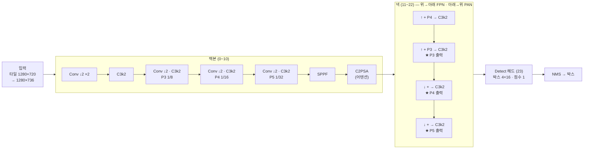

> [!summary] YOLO11 = **백본 (특징 뽑기) → 넥 (크기별로 섞기) → 헤드 (박스 · 점수)** · 우리는 **YOLO11m** (파라미터 **20.05M** · 사람 1클래스 · 입력 1280)
> 2024-09 Ultralytics 출시 · 앵커 박스 없음 · 한 번에 3개 크기 (1/8 · 1/16 · 1/32) 에서 예측 · 후처리 NMS

## 1. 흐름

## 2. 층 표 (실제 모델 · 입력 1280×736)

| 층 | 블록 | 입력 | 출력 (채널 × 높이 × 너비) | 파라미터 | 뜻 |
|---|---|---|---|---|---|
| 0 | Conv ↓2 | 그림 | 64 × 368 × 640 | 0.00M | 1/2 |
| 1 | Conv ↓2 | 0 | 128 × 184 × 320 | 0.07M | 1/4 (P2) |
| 2 | C3k2 | 1 | 256 × 184 × 320 | 0.11M | |
| 3 | Conv ↓2 | 2 | 256 × 92 × 160 | 0.59M | 1/8 |
| 4 | C3k2 | 3 | 512 × 92 × 160 | 0.44M | **P3 특징** |
| 5 | Conv ↓2 | 4 | 512 × 46 × 80 | 2.36M | 1/16 |
| 6 | C3k2 | 5 | 512 × 46 × 80 | 1.38M | **P4 특징** |
| 7 | Conv ↓2 | 6 | 512 × 23 × 40 | 2.36M | 1/32 |
| 8 | C3k2 | 7 | 512 × 23 × 40 | 1.38M | |
| 9 | SPPF | 8 | 512 × 23 × 40 | 0.66M | 여러 크기 주변 |
| 10 | **C2PSA** | 9 | 512 × 23 × 40 | 0.99M | **P5 특징** · 어텐션 |
| 11~13 | ↑ · 이어붙이기 (6) · C3k2 | 10 + 6 | 512 × 46 × 80 | 1.64M | 깊은 의미 + P4 |
| 14~16 | ↑ · 이어붙이기 (4) · C3k2 | 13 + 4 | **256 × 92 × 160** | 0.54M | ★ **P3 출력 (작은 사람)** |
| 17~19 | Conv ↓2 · 이어붙이기 (13) · C3k2 | 16 + 13 | **512 × 46 × 80** | 2.10M | ★ **P4 출력** |
| 20~22 | Conv ↓2 · 이어붙이기 (10) · C3k2 | 19 + 10 | **512 × 23 × 40** | 4.00M | ★ **P5 출력 (큰 사람)** |
| 23 | Detect | 16 · 19 · 22 | 격자 점마다 박스 + 점수 | 1.41M | stride 8 · 16 · 32 |

- 크기 배율 m = 깊이 0.50 · 너비 1.00 · 최대 채널 512 (n · s · m · l · x 는 같은 설계도에 배율만 다름)
- 격자 점 수 (1280×736): 160×92 + 80×46 + 40×23 = **19,320개** → 점마다 박스 하나 · 확신 0.01 이상만 남겨 NMS

## 3. 크기별 담당

| 출력 | 1칸 = | 격자 | 주로 | 우리 사람 크기 |
|---|---|---|---|---|
| P3 | 8 px | 160 × 92 | 작은 것 | 숲 · 비스듬 평가셋의 24~50 px · 운용 60~100 px 의 일부 |
| P4 | 16 px | 80 × 46 | 중간 | 운용 고도 16~20 m 사람 (60~100 px) |
| P5 | 32 px | 40 × 23 | 큰 것 | 가까이 · 낮게 찍은 사람 |

- ⚠ 8 px 보다 작은 사람은 P3 격자 점이 1~2개만 걸려 학습 신호가 약하다 → P2 (1/4) 층을 붙여 봤지만 v6 데이터에선 ±0 ([[NWD·P2 효과 없음 - 원인 분석]])
- 그래서 학습 데이터에서 **10 px 미만 사람은 가림** (v12)

## 4. 기억할 숫자

| 항목 | 값 |
|---|---|
| 파라미터 | 20.05M (1클래스) · COCO 80클래스면 약 20.1M |
| 계산량 | 약 68 GFLOPs @640 → 1280×736 에서 약 4배 |
| 우리 속도 | 1080p 한 장 = 타일 4장 · TensorRT FP16 · **18.9 ms** (RTX 3090) |
| 활성화 | SiLU (x · sigmoid(x)) — ReLU 보다 부드러움 · 사전학습 가중치가 SiLU 기준 |
| 출발 가중치 | COCO 사전학습 `yolo11m.pt` → 사람 1클래스로 헤드만 새로 |

## 연결

[[_공부 색인]] · 다음 → [[2 YOLO11 블록 - C3k2 · SPPF · C2PSA · Detect]]
