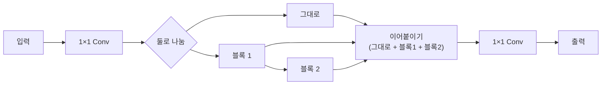
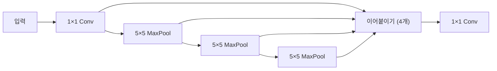

> [!summary] YOLO11 을 이루는 블록은 넷 — **C3k2** (기본 벽돌) · **SPPF** (여러 크기 주변) · **C2PSA** (어텐션 · 11 에서 새로) · **Detect** (분리형 헤드)
> 모든 Conv = 합성곱 + BatchNorm + SiLU

## 1. Conv (기본 단위)

- 합성곱 (3×3 또는 1×1) → **BatchNorm** (값 분포 맞추기) → **SiLU** (비선형)
- stride 2 면 가로 · 세로가 절반 → 백본에서 5번 → 1/32
- ⚠ BatchNorm 의 평균 · 분산 통계 (running mean · var) 가 학습마다 달라 **서로 다른 학습의 가중치를 평균하면 무너질 수 있다** (수프 실패 원인 · [[17 v12 데이터 재구성 - 파이프라인 점검 (10-12)]])

## 2. C3k2 — 기본 벽돌 (CSP 구조)

- **CSP** (Cross Stage Partial) — 절반만 무거운 블록에 통과 · 나머지는 그대로 → 계산 ↓ · 기울기 흐름 ↑
- 안의 블록: n · s = 병목 (Bottleneck · 3×3 두 번) · **m · l · x = C3k** (병목을 더 쌓은 작은 CSP · 커널 3) — 우리 m 은 전부 C3k
- 이름 뜻: C3 + k (커널 크기 지정) + 2 (Conv 2개) · YOLOv8 의 C2f 를 바꾼 것

## 3. SPPF — 여러 크기의 주변을 싸게

- 5×5 를 3번 = 실질 5 · 9 · 13 크기 풀링 → 한 점이 주변 넓은 범위를 봄
- 가장 깊은 층 (1/32) 에 한 번 · 계산은 거의 없음

## 4. C2PSA — 위치를 아는 어텐션 (YOLO11 에서 새로)

- **PSA** (Position-Sensitive Attention) = 멀티헤드 셀프 어텐션 + 피드포워드 · C2 꼴 (절반만 통과) 로 감쌈
- 가장 깊은 층 (P5 · 23×40) 에만 → 격자 점이 적어 어텐션 계산이 싸다
- 하는 일: 그림 **전체 맥락**을 봄 (예: 길 · 숲 가장자리 · 차 옆 → 사람이 있을 법한 곳)
- 우리에게: 맥락이 강한 만큼 「사람 크기 · 모양의 물체 (수레 · 상자)」 에 속을 수도 있다 — test_v2 확신 높은 오탐 대부분이 이 종류

## 5. Detect 헤드 — 분리형 · 앵커 없음

| 가지 | 구조 | 출력 (격자 점마다) |
|---|---|---|
| 박스 | Conv 3×3 → Conv 3×3 → Conv 1×1 | **4 × 16 = 64** — 왼 · 위 · 오른 · 아래 경계까지 거리를 각각 16칸 분포로 ([[3 YOLO11 학습 - 손실 · TAL · DFL · EMA]] DFL) |
| 분류 | **깊이별 Conv** (DWConv) + 1×1 Conv × 2 → Conv 1×1 | **1** (사람 확률 · 시그모이드) |

- **분리형** (decoupled) — 박스 · 분류를 따로 배워 서로 덜 방해
- **앵커 없음** — 미리 정한 박스 모양 없이 격자 점에서 네 경계까지 거리를 직접 예측
- 11 에서 분류 가지를 깊이별 Conv 로 가볍게 → v8 보다 헤드 계산 ↓
- 최종 박스 = (격자 점 위치 ± 거리 × stride) · 점수 = 사람 확률 → 확신 0.01 이상 → NMS

## 연결

[[_공부 색인]] · 앞 ← [[1 YOLO11 구조 한눈에]] · 다음 → [[3 YOLO11 학습 - 손실 · TAL · DFL · EMA]]
