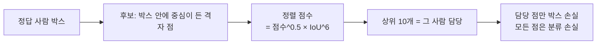

> [!summary] 학습 = ① 격자 점마다 **누가 어느 사람을 맡을지 정하고 (TAL)** ② 맡은 점의 **점수 (BCE) · 박스 (CIoU + DFL)** 를 정답에 맞춘다 · 최종 가중치는 **EMA**
> 손실 = 7.5 × 박스 (CIoU) + 0.5 × 분류 (BCE) + 1.5 × DFL (ultralytics 기본값 · 우리도 그대로)

## 1. 정답 배정 — TAL (Task-Aligned Assigner)

- 「점수도 높고 박스도 잘 맞는 점」 이 담당이 된다 → 분류와 박스가 같은 점을 밀어 줌 (task-aligned)
- 담당 점의 정답 점수 = 0/1 이 아니라 **정렬 점수를 정규화한 값** (박스를 잘 맞힐수록 높은 점수를 배움)
- ⚠ **작은 사람의 약점**: 후보는 「정답 박스 안에 중심이 든 점」 만 → 8 px 미만 사람은 P3 (1칸 8 px) 에서 점이 1~2개 · 상위 10개를 못 채움 → 신호가 약하다

## 2. 분류 손실 — BCE

- 점마다 「사람일 확률」 을 시그모이드로 · 정답 (담당 점 = 정렬 점수 · 나머지 = 0) 과의 이진 교차 엔트로피
- 격자 점 19,320개 중 대부분이 배경 → 배경을 「아니다」 로 배우는 게 오탐을 줄이는 쪽
- ⚠ 그래서 **라벨 없는 사람**이 학습 그림에 있으면 「사람인데 배경」 으로 배운다 → v12 에서 오염 음성 863장을 뺀 이유

## 3. 박스 손실 — CIoU + DFL

| 손실 | 무엇을 맞추나 | 메모 |
|---|---|---|
| **CIoU** | 겹침 ([[IoU]]) + 중심 사이 거리 + 가로세로 비 | 겹치지 않아도 기울기가 있음 |
| **DFL** (Distribution Focal Loss) | 네 경계까지 거리를 **16칸 확률 분포**로 → 정답 값 양옆 두 칸에 몰리게 | 경계가 흐린 사람 (그림자 · 가림) 에 유리 · 출력 = 분포의 기댓값 |

- 우리가 시험한 바꾸기: **NWD** (작은 물체용 박스 거리) → −2.4 %p (확신도 부풀림) · 기각

## 4. 학습 설정 (우리 · `v6_oblique.yaml`)

| 항목 | 값 | 이유 |
|---|---|---|
| 출발 | COCO `yolo11m.pt` | 전이학습 ([[전이학습과 백본 동결]]) |
| 입력 | 1280 | 추론 타일과 같은 크기 (그림을 키우면 손해였다) |
| 에폭 | 30 | 60 에폭은 val ↑ · 비스듬 −4.0 %p → 기각 |
| 최적화 | SGD lr0 0.01 · warmup 3 · 배치 8 (누적 64) | |
| 증강 | mosaic 1.0 · scale 0.3 · translate 0.15 · 회전 10° · 좌우 뒤집기 · 색 (h 0.02 · s 0.8 · v 0.5) | 비스듬 화면은 위아래가 있어 상하 뒤집기 0 |
| close_mosaic | 0 (끝까지 mosaic) | 끄면 손해였다 |
| best.pt | val **mAP50-95** 최고 에폭 ([[fitness와 조기 종료]]) | 실제로 26~30 에폭 |

## 5. EMA · 수프 · 학습 안 평균

| 방법 | 무엇 | 우리 결과 |
|---|---|---|
| **EMA** | 학습 중 가중치의 지수 이동 평균 · 저장되는 모델은 EMA | 기본 |
| **수프** (soup) | 같은 설정으로 따로 학습한 모델들 가중치 평균 | v7 +1.5 %p · ⚠ BatchNorm 통계가 어긋나 **자주 무너짐** (BN 거리 ≥ 0.25 면 안 만듦) |
| **학습 안 평균** (SWA 꼴) | 한 학습의 마지막 에폭 26~29 가중치 평균 | v12 비스듬 +0.3 %p (유의) · 무너짐 없음 → 지금 후보 `v12_f91_swa` · `f92_swa` |

## 6. 「진짜 반복」

- ultralytics 8.4 는 학습 목록을 **이름순 정렬** → 시드 · 순서를 바꿔도 같은 학습 → 반복 차이는 GPU 비결정성뿐이었다
- 그래서 반복은 **목록의 95 % 를 무작위로 뽑아** 만든다 · 같은 설정도 비스듬 평가셋에서 0.604~0.631 로 흔들림 → 판정은 **여러 번 학습한 평균끼리**

## 연결

[[_공부 색인]] · 앞 ← [[2 YOLO11 블록 - C3k2 · SPPF · C2PSA · Detect]] · 다음 → [[4 YOLO11 추론 - 타일 · NMS · 임계값 · TensorRT]]
