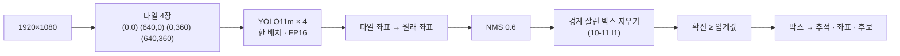

> [!summary] 1080p 한 장 → **타일 4장 (1280×720 · 겹침 50 %)** → YOLO11m (TensorRT FP16) → 원래 좌표로 → **NMS 0.6 + 경계 잘린 박스 지우기** → **확신 ≥ 0.20 (제안)** → 후보 · 좌표 · 상태
> 18.9 ms / 장 (RTX 3090) · NFR-V01 ≤ 30 ms ✅

## 1. 흐름

## 2. 왜 타일인가

- 통째로 1280 에 넣으면 1920 → 1280 으로 **줄어 사람이 2/3 크기** → 작은 사람을 놓침
- 타일 = 원래 해상도 그대로 (1:1) · 학습도 1280×720 창이라 크기가 맞음 · 타일 추론 +2.9 %p (09-20)
- 겹침 50 % → 640×360 보다 작은 사람은 **어느 한 타일에 온전히** 들어감

## 3. 합치기 — NMS + 경계 잘린 박스 지우기

| 단계 | 하는 일 | 왜 |
|---|---|---|
| NMS (IoU 0.6) | 점수 높은 박스부터 · 많이 겹치는 (IoU > 0.6) 나머지를 지움 | 같은 사람에 박스 여럿 |
| **경계 잘린 박스 지우기** | 자기 타일 안쪽 경계에 닿은 박스가 다른 타일의 큰 박스 안에 60 % 이상 → 지우고 점수는 큰 박스로 | 잘린 박스는 온전한 박스와 IoU < 0.6 이라 NMS 가 못 지움 → 한 사람이 후보 둘 |

- 효과 (모델 그대로): 숲 +0.8 · 한국 +2.2 %p · worker 기본 켜짐 (파이프라인 1.1)
- 안 된 것: 중심 소유 규칙 (타일 사분면) 은 손해

## 4. 확신 임계값 — 0.15 → 0.20 (10-13 제안)

| v12_f91_swa | 0.10 | 0.15 | **0.20** | 0.30 |
|---|---|---|---|---|
| 숲 정밀도 / 재현율 | 0.66 / 0.74 | 0.71 / 0.73 | **0.73 / 0.73** | 0.77 / 0.71 |
| 도로 장면 오탐 (건/장 · ≤ 1) | 2.20 | 1.05 | **0.55** | 0.26 |

- F2 ([[신뢰도 임계값과 F2]]) 는 0.1~0.25 에서 거의 같다 → **오탐 기준 (NFR-V06)** 이 값을 정함
- 대안: 두 단계 — 0.10 으로 추적 · 여러 장에서 잡힌 사람만 관제에 → UE 로 확인 예정
- ![[fig_임계값_스윕.png]]

## 5. TensorRT

- `.pt` → ONNX → TensorRT 엔진 · FP16 · 배치 4 (타일 4장) · 입력 **`imgsz=[736,1280]`** (숫자 하나면 정사각 엔진이 됨)
- 엔진은 **GPU · TensorRT 버전마다 다시** 만든다 (worker 는 처음 뜰 때 자동)
- FP16 로 정확도 손해 없음 (AP50 0.5927 → 0.5933)

## 6. 해 보고 안 된 것

- 그림을 키워 넣기 (1920 초과 · 1.5배) — 작은 사람 재현율 ↑ 이지만 AP 손해
- 2 × (1280×1080) 타일 (겹침 없음) — 이득 없음
- 두 모델 앙상블 (우리 + FlyPose) — 세 평가셋 모두 ↑ 지만 43 ms → 30 ms 초과

## 연결

[[_공부 색인]] · 앞 ← [[3 YOLO11 학습 - 손실 · TAL · DFL · EMA]] · 다음 → [[5 YOLO 버전 비교와 우리 시험]] · [[타일 추론]] · [[16 v7 넘기 - 파이프라인 검토 (10-11)]]
